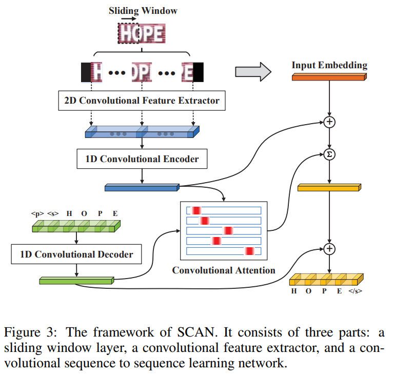
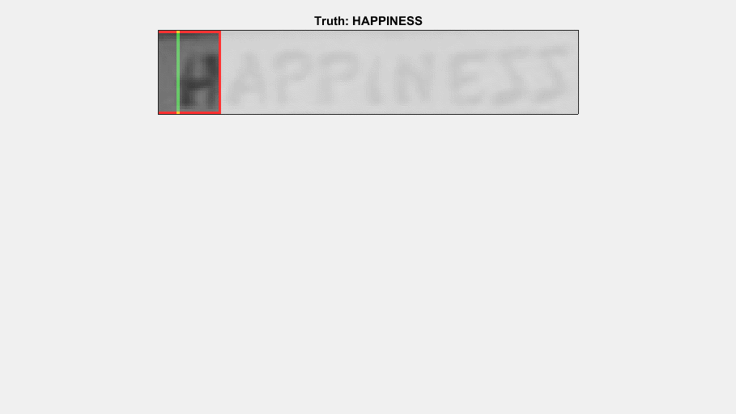
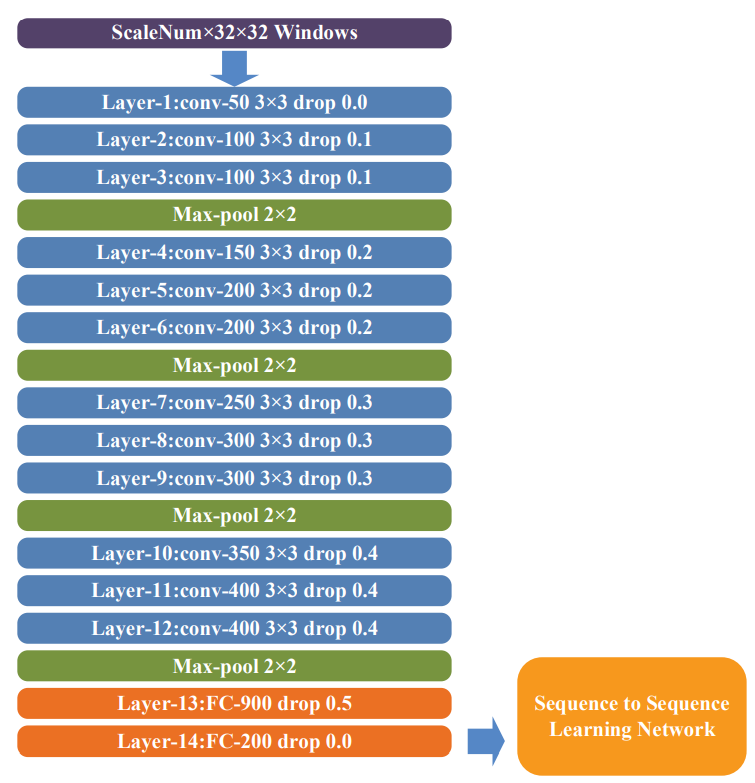
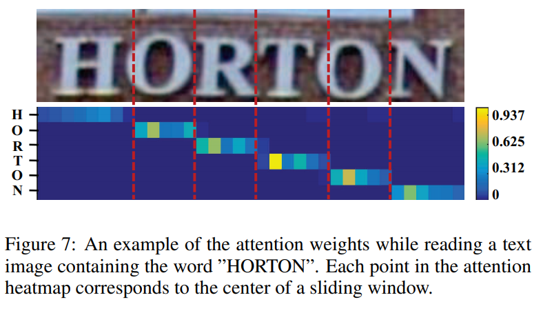

-----

| Title     | ML Tasks Image OCR SCAN                               |
| --------- | ----------------------------------------------------- |
| Created @ | `2020-05-09T02:06:41Z`                                |
| Updated @ | `2026-11-25T16:34:22Z`                                |
| Labels    | \`\`                                                  |
| Edit @    | [here](https://github.com/junxnone/aiwiki/issues/191) |

-----

# SCAN

SCAN（Sliding Convolutional Attention Network，2018，中科院自动化所 NLPR，IJCAI
2018）是面向场景文本**识别**的全卷积序列到序列模型。当时主流的 CRNN/Attention 识别器都依赖 RNN，有两个问题：RNN
要维护整个历史隐状态，**训练无法在序列内部并行**，速度慢；并且训练难调、像一个黑盒。SCAN
受人类阅读时"眼跳（saccade）与注视（fixation）交替"的启发：用**滑动窗口**一块一块地"看"文字行，再用**卷积**版的
Seq2Seq（编码器 + 带注意力的解码器）把窗口序列翻译成字符序列。整个网络没有
RNN，训练可以完全并行，注意力权重还能直观地对应到窗口位置，可解释性更好。总览见
[OCR](0200_ML_Tasks_Image_OCR)；它与 [Sliding
Convolutional](0188_ML_Tasks_Image_OCR_SW) 一脉相承（滑动窗口 + CNN），区别是把 CTC
换成了卷积注意力解码。

## 结构

图中：

  - **输入**：文字行图像高度归一化为 32，宽度按比例缩放，不足 256 的补零到 256，便于批量并行。
  - **多尺度滑动窗口**：窗口沿宽度方向以固定步长滑动，切出相互重叠的小块。字符宽窄不一，所以同时使用 $32 \\times
    32$、$32 \\times 40$、$32 \\times 48$ 等多种窗口宽度，每种窗口都先统一缩放为 $32
    \\times 32$，再沿通道拼接，让每个位置能同时获得不同跨度的上下文。
  - **CNN 特征提取器**：14 层网络（卷积 + 池化 + 全连接，最后一层全连接输出 200
    维），把每个窗口压缩成一个特征向量，得到长度为窗口数的特征序列。
  - **卷积编码器**：在窗口特征序列上做一维卷积，每个位置的输出融合了相邻窗口的信息；卷积核宽度相当于感受野，论文实验中编码器取
    5（略大于一个字符的宽度）效果最好。
  - **卷积注意力解码器**：沿用 ConvS2S
    的设计，每一层解码器都有独立的注意力：把当前解码状态与上一个目标字符的嵌入结合，与编码器各位置做点积，softmax
    后加权求和得到上下文向量；多层之间是"多步注意力"，后一层可以参考前一层已关注的位置。
  - **解码**：无词典（lexicon-free）时用束搜索；有词典时先取前 $K$ 个候选，再计算它们与词典中每个词的
    Levenshtein 距离，选距离最短的，见 [OCR
    Lexicon](0198_ML_Tasks_Image_OCR_Lexicon)。
  - 关键结论：窗口位置对应图像中的具体位置，注意力热力图能直观看到模型"现在在读哪一块"，这是相比 RNN 黑盒的可解释性优势。

## 窗口与输入

  - 输入缩放到高度 $32$，宽度补齐到 $256$。
  - 多尺度窗口：$32 \\times 32$、$32 \\times 40$、$32 \\times 48$ → 按比例缩放 →
    沿通道拼接，成为多通道输入。
  - 论文的消融实验表明单尺度中窗口更宽（$32 \\times
    40$）效果最好：更大跨度的窗口含有更多信息，但窗口过大又会引入更多无关上下文，所以最终采用多尺度组合。

## 注意力

$$ \\alpha\_{ij}^{l} = \\frac{\\exp\!\\left(d\_i^{l} \\cdot
z\_j\\right)}{\\sum\_{t=1}^{m}\\exp\!\\left(d\_i^{l} \\cdot
z\_t\\right)},\\qquad c\_i^{l} =
\\sum\_{j=1}^{m}\\alpha\_{ij}^{l},\\left(z\_j + e\_j\\right) $$

其中：

  - $l$：解码器的层号；$i$：当前解码的字符位置；$j, t \\in \[1, m\]$：编码器输出序列的位置，$m$ 为窗口数
  - $z\_j$：编码器在位置 $j$ 的输出；$e\_j$：位置 $j$ 的输入嵌入（ConvS2S
    里把输入嵌入也加进上下文，帮助保留位置信息）
  - $d\_i^{l}$：第 $l$ 层解码器第 $i$ 步的"查询"向量，由当前解码器状态与上一个目标字符的嵌入结合得到
  - $\\alpha\_{ij}^{l}$：第 $l$ 层第 $i$ 步对编码器位置 $j$ 的注意力权重，$\\sum\_j
    \\alpha\_{ij}^{l} = 1$
  - $c\_i^{l}$：上下文向量，即"此刻读到的内容"

这里的写法按 ConvS2S 的点积注意力给出（SCAN 的解码器沿用该结构），具体符号以原论文为准。

## 特点与局限

  - 训练设置：只用 Jaderberg 等发布的约 800 万张合成文字行图像训练（没有在真实数据上微调），编码器和解码器各用 256
    个隐单元，Adam 优化器、学习率 0.0005，dropout 0.5；编码器 3 层、卷积核宽 5，解码器 2
    层、卷积核宽 7（解码器相当于语言模型，核更大更好）；窗口滑动步长为 4；束搜索宽度
    $K=5$，并把候选序列的对数似然除以长度，以抵消对短串的偏好。
  - 优点：全卷积，训练可并行，论文报告训练速度至少是自己实现的循环版本的 9 倍，识别一张图平均约 0.3 秒；无需 CTC
    的空白符；注意力可视化可解释。
  - 在 IIIT5k、SVT、ICDAR 2003/2013
    等基准上，无词典设置下优于当时对比的方法；对不规则文本，仅靠简单的滑动窗口就比复杂的
    RARE 矫正方案效果好。
  - 局限：窗口步长和尺度是手工设定的超参，对极端变形或极宽文本需要额外处理；与现代 Transformer
    识别器（[SVTR](0779_ML_Tasks_Image_OCR_SVTR)、[TrOCR](0780_ML_Tasks_Image_OCR_TrOCR)）相比，精度和扩展性已经落后。

## 原图

| Pipeline                                                     | Sliding                                                    |
| ------------------------------------------------------------ | ---------------------------------------------------------- |
|  |  |

| CNN Extractor                                                | Convolutional Attention                                      |
| ------------------------------------------------------------ | ------------------------------------------------------------ |
|  |  |

上面两张表保留了原文档的示意图：左上为整体流程，右上为滑动窗口切分的动画示意；左下为 CNN 特征提取器的层配置，右下为卷积注意力的结构。

## Reference

  - [paper - 2018 - SCAN: Sliding Convolutional Attention Network for
    Scene Text Recognition](https://arxiv.org/pdf/1806.00578v1.pdf)
  - [paper - 2017 - Convolutional Sequence to Sequence
    Learning](https://arxiv.org/abs/1705.03122)
