-----

| Title     | ML Tasks Image OCR TextScanner                        |
| --------- | ----------------------------------------------------- |
| Created @ | `2020-05-15T05:52:22Z`                                |
| Updated @ | `2026-11-25T16:56:13Z`                                |
| Labels    | \`\`                                                  |
| Edit @    | [here](https://github.com/junxnone/aiwiki/issues/192) |

-----

## Reference

  - [TextScanner: Reading Characters in Order for Robust Scene Text
    Recognition](https://arxiv.org/abs/1912.12422)
  - [旷视研究院提出TextScanner：确保字符阅读顺序，实现文字识别新突破](https://zhuanlan.zhihu.com/p/100683420?utm_source=qq)
  - [【OCR实践系列】TextScanner的一些研究](https://zhuanlan.zhihu.com/p/133662322)
    --- [TF 实现](https://github.com/piginzoo/textscanner)

## Brief

  - History issues

| Model        | 缺点                | 优点      |
| ------------ | ----------------- | ------- |
| RNN          | 注意力漂移             |         |
| Segmentation | 字符分割为不同部分 & 多字符黏连 | 不规则字体识别 |

  - 基于 `CA-FCN`
      - Remove Character Attentions - CA
      - ResNet-50
  - `Vatti clipping algo` - vati 1992
  - `Sequence label` - `Character label` - Mutual-Supervision
  - Branch

| Branch                  | Output                      | Description |
| ----------------------- | --------------------------- | ----------- |
| Class Branch 类别分支    | Character Segmentation Maps | 字符分割 mask   |
| Geometry Branch 几何分支 | Localization Maps           | 字符位置顺序      |

### Attention Decoder vs Segmentation-based vs TextScanner

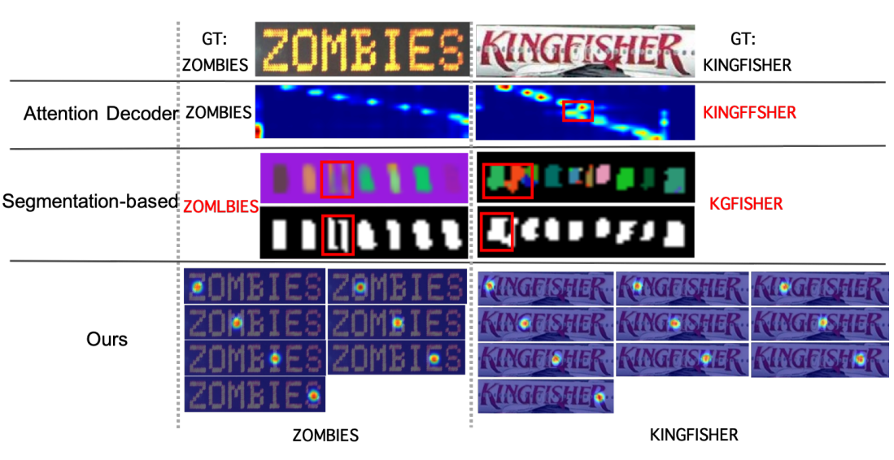

## Arch

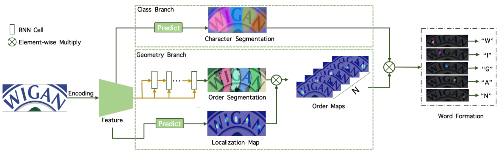

## Class Branch

  - CNN Backbone --\> 3x3 + 1x1 Conv Layers --\> Softmax Layer --\>
    Character Segmentation maps
  - Output - G - `hxwxc`
      - `c` = all character classes + background

## Geometry Branch

  - CNN Backbone --\> sigmoid layer --\> Localization Maps
  - CNN Backbone --\> Encoder --\> RNN(GRU) --\> Decoder --\> Order
    Segmentation Maps
  - Output
      - Localization map - Q - `hxwx1`
      - Order segmentation maps - S -`hxwxN`
          - `N` - 预定义的字符序列长度
      - Order map - `H = Q * S` - `hxwxN`

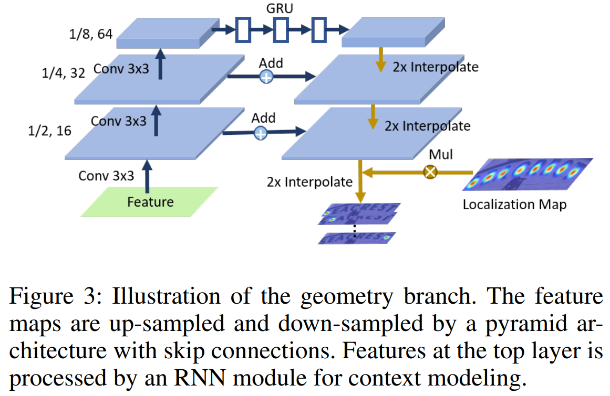

### Mutual-Supervision

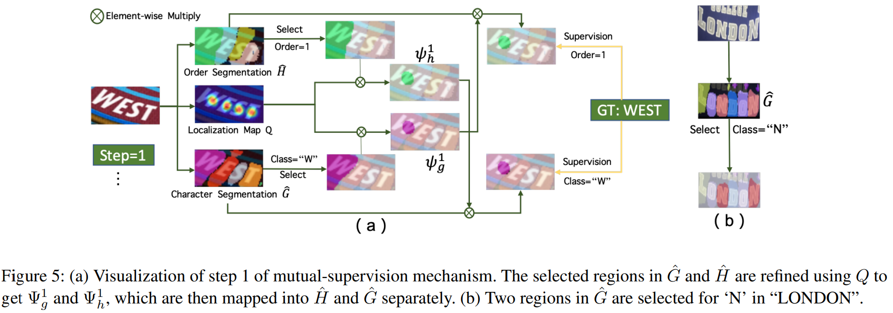

## Word Formation

| classification scores | 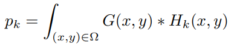 |
| --------------------- | ------------------------------------------------------------ |

## Training

  - `5 epchs` pre-train `@SynthText - character level` + `1 epoch`
    fine-tuning `@real images sequence-level`
  - Init LR = `10^-3` -\> `10^-4` -\> `10^-5`
  - Input - Resize to `64x256`
  - Adam

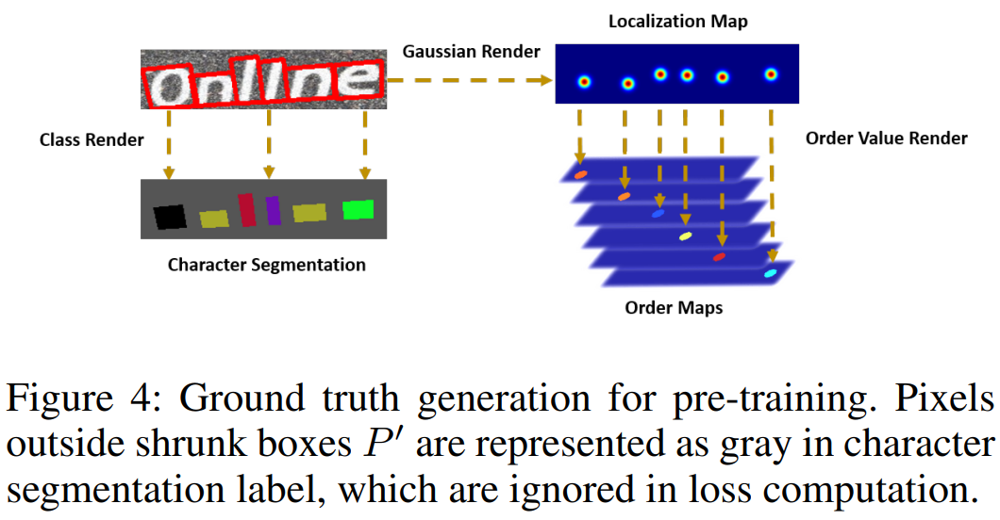

## Loss

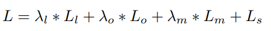

  - `Lc` - Localization map
  - `Lo` - Order segmentation
  - `Ls` - Text segmentation
  - `Lm` - Mutual supervision
  - `λ`
      - `λl` - `=10`
      - `λo` - `=10`
      - `λm`
          - pretrain `=0`
          - 其他 `=1`

| Mutual supervision Loss | 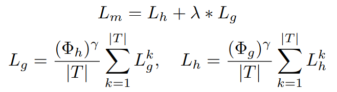 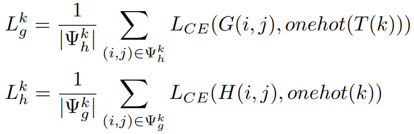 |
| ----------------------- | ---------------------------------------------------------------------------------------------------------------------------- |

> `λ = 0.2` - `γ = 2`

## Test

**English Dataset Test**

  - IC13 - ICDAR 2013
  - IC15 - ICDAR 2015
  - IIIT - IIIT 5K-Words
  - SVT - Street View Text
  - SVTP - SVT-Perspective
  - CT - CUTE80
  - MLT-2017
  - SynthText
  - Synth90K

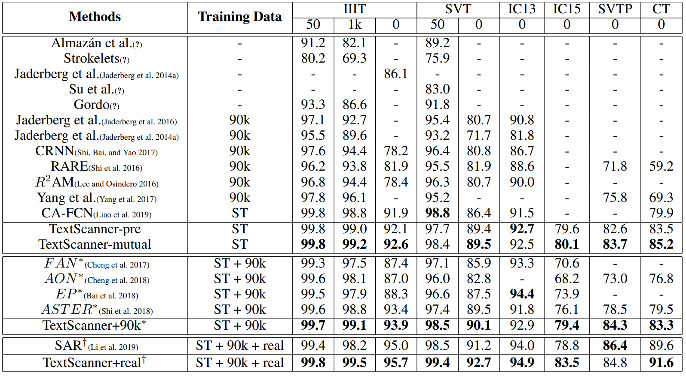

**Chinese Dataset Test**

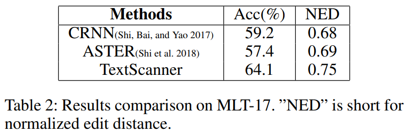

## 公式

### 字符分类图与顺序图

$$ H\_k=Q\\odot S\_k,\\qquad \\hat c\_k=\\arg\\max\_{c}\\
\\frac{\\sum\_{x,y}G\_{x,y,c},H\_{k,x,y}}{\\sum\_{x,y}H\_{k,x,y}} $$

其中：

  - $G\\in\\mathbb R^{h\\times w\\times C}$：类别分支输出的字符分割图，每个像素是 $C$ 类
    (所有字符类 + 背景) 的概率
  - $Q\\in\\mathbb R^{h\\times
    w\\times1}$：几何分支的定位图，表示每个像素是否位于字符中心附近；$S\_k\\in\\mathbb
    R^{h\\times w}$：顺序分割图的第 $k$ 个通道，表示第 $k$ 个字符所在的区域，$k=1,\\dots,N$，$N$
    为预设的最大序列长度
  - $H\_k$：第 $k$ 个字符的顺序图，用定位图 $Q$ 对 $S\_k$ 逐元素 ($\\odot$) 加权，使其集中在字符内部
  - $\\hat c\_k$：第 $k$ 个字符的类别：用 $H\_k$ 作权重，对类别图 $G$
    在空间上做加权平均，取概率最大的类别；这就是「按顺序读出字符」的过程，不需要
    RNN 解码或注意力解码
  - 上式是按文字描述整理的形式化表达，细节请以论文为准 `[待核实]`

### 损失

$$
L=L\_c+\\lambda\_lL\_l+\\lambda\_oL\_o+\\lambda\_sL\_s+\\lambda\_mL\_m
$$

其中：

  - $L\_c$：字符类别分割损失；$L\_l$：定位图 (localization map)
    损失；$L\_o$：顺序分割损失；$L\_s$：文本分割损失；$L\_m$：互监督
    (mutual supervision) 损失
  - $\\lambda\_l=\\lambda\_o=10$；$\\lambda\_m$ 在预训练阶段为 $0$，其他阶段为 $1$
    (见上面的训练设置)
  - 互监督：序列级的标注 (只有整词文本)
    通过顺序图把字符级的预测聚合起来监督，字符级的预测也反过来约束顺序图，二者相互促进，因此在只有序列标注的真实数据上也能微调

## 结构

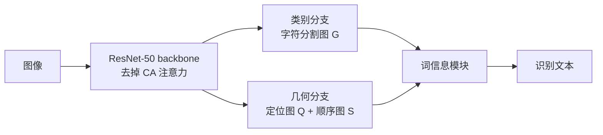

图中：

  - 基于 [CA-FCN](/0186_ML_Tasks_Image_OCR_CAFCN)，去掉其字符注意力模块，骨干换成
    ResNet-50
  - 类别分支回答「这个像素是什么字符」，几何分支回答「这个字符在序列里排第几」；二者的结果在词信息模块里合并成最终文本
  - 几何分支里的顺序图由「编码器 → RNN (GRU) → 解码器」产生，只在这一处使用循环网络，用于排序，不负责识别

| 方法           | 缺点            | 本方法的做法     |
| ------------ | ------------- | ---------- |
| 基于 RNN/注意力解码 | 注意力漂移，长文本错位   | 用顺序图显式给出位置 |
| 基于分割         | 字符分割不当造成粘连、遗漏 | 加入顺序信息和互监督 |

表中：TextScanner 同时吸收了分割方法 (识别稳定，适合不规则文字) 和序列方法 (有顺序信息) 的优点；总览见
[OCR](/0200_ML_Tasks_Image_OCR)。

## 备注

  - 预处理中的 Vatti 裁剪算法 (Vatti clipping)：用于对字符多边形框做向内收缩，生成字符中心区域的标签，作用类似
    CA-FCN 里的标签收缩
  - 训练方式：先在带字符级标注的 SynthText 上预训练 $5$ 个 epoch，再在真实图像上用序列级标注微调 $1$ 个
    epoch，学习率 $10^{-3}\\to10^{-4}\\to10^{-5}$
