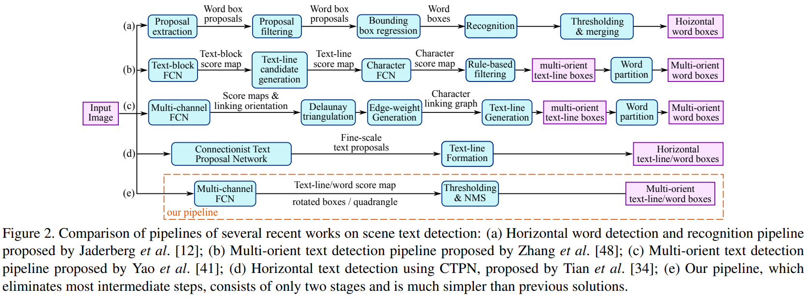
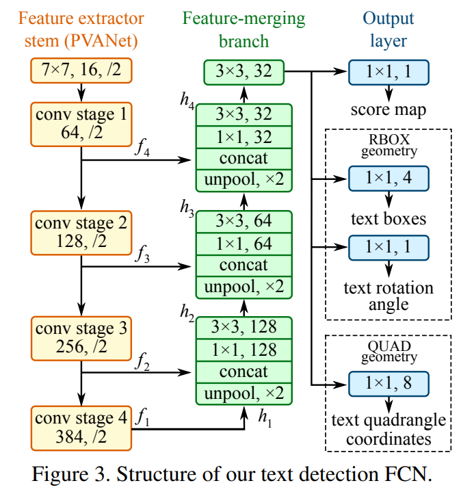

-----

| Title     | ML Tasks Image OCR EAST                               |
| --------- | ----------------------------------------------------- |
| Created @ | `2020-05-28T02:07:31Z`                                |
| Updated @ | `2026-11-25T16:19:26Z`                                |
| Labels    | \`\`                                                  |
| Edit @    | [here](https://github.com/junxnone/aiwiki/issues/193) |

-----

# EAST

EAST（Efficient and Accurate Scene Text
detector，2017）是单阶段的场景文本检测器：一个全卷积网络直接在每个像素上预测"这里是不是文字"以及"所在文本框的几何形状"，之后只需阈值过滤和一次
NMS，去掉了 CTPN 等方法里的候选框生成、过滤、合并多个中间步骤，因此又快又准，可检测任意方向的文本。

## Pipeline

上图为论文给出的流程示意：EAST 的核心流程只有"全卷积网络预测 → 局部感知
NMS"两步，相比多阶段方法省去了候选框生成、过滤、合并等中间步骤。

## 结构

上图为网络结构，分三部分：

  - **Feature extractor**：骨干网络（论文用 PVANet 或 VGG16）提取四个尺度的特征图。
  - **Feature merging branch**：类似 U-Net，自顶向下逐级上采样、与浅层特征拼接，再接 $1 \\times
    1$、$3 \\times 3$ 卷积融合，既保留小文本所需的高分辨率细节，也保留大文本所需的高层语义。
  - **Output layer**：输出 1/4 输入分辨率的两类图：
      - **Score map**：1 通道，每个像素属于文本区域的置信度
      - **Geometry map**：每个像素对应的文本框几何，有两种形式：
          - RBOX（旋转框）：该像素到文本框上、右、下、左四条边的距离（4 通道）+ 旋转角度 $\\theta$（1 通道）
          - QUAD（四边形）：4 个顶点相对该像素的坐标偏移（8 通道）

## 后处理：局部感知 NMS

每个像素都会预测一个框，数量很大。标准 NMS 复杂度为 $O(n^2)$，EAST 提出 Locality-Aware
NMS：利用相邻像素预测的框高度重叠这一特点，按行依次扫描，相邻且 IoU
超过阈值的框先按得分加权合并，最后再对合并后的少量框做一次标准 NMS。

## 损失函数

$$ L = L\_s + \\lambda\_g L\_g $$

其中：

  - $L\_s$：score map 的损失，论文使用类别平衡交叉熵，缓解文本像素远少于背景像素的问题
  - $L\_g$：几何损失；$\\lambda\_g$：两部分的权重，论文取 1

RBOX 的几何损失：

$$ L\_g = L\_{\\mathrm{AABB}} + \\lambda\_\\theta L\_\\theta,\\qquad
L\_{\\mathrm{AABB}} = -\\ln \\mathrm{IoU}(\\hat{R}, R^*),\\qquad
L\_\\theta = 1 - \\cos(\\hat{\\theta} - \\theta^*) $$

其中：

  - $\\hat{R}, R^\*$：预测的和真值的轴对齐框（由四个距离得到），$-\\ln \\mathrm{IoU}$
    使损失对框的尺度不敏感，不同大小的文本被同等对待
  - $\\hat{\\theta}, \\theta^\*$：预测的和真值的旋转角度；$1-\\cos(\\cdot)$ 在角度相同时为
    0，差得越多越大
  - $\\lambda\_\\theta$：角度损失权重，论文取 10

## 局限

  - 感受野有限，对非常长的文本行（尤其是长汉字行）容易断开；
  - 输出的是四边形/旋转矩形，对弯曲文本表达能力不足，后续的 TextField、DBNet、PSENet
    等用像素级分割/方向场处理任意形状文本，参见
    [TextField](0194_ML_Tasks_Image_OCR_TextField)。

## Reference

  - [paper - 2017 -EAST: An Efficient and Accurate Scene Text
    Detector](https://arxiv.org/pdf/1704.03155.pdf)
  - [OCR EAST: An Efficient and Accurate Scene Text Detector
    自然场景下的文字算法详解](https://www.jianshu.com/p/6e35829a38de)
  - [A tensorflow implementation of EAST text
    detector](https://github.com/argman/EAST)
