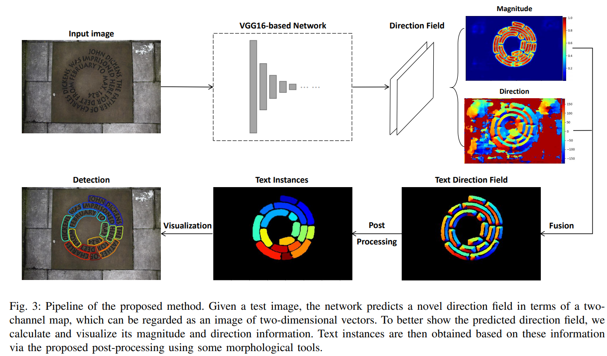
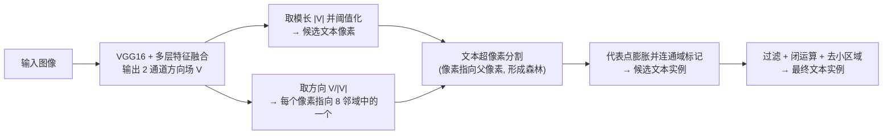

-----

| Title     | ML Tasks Image OCR TextField                          |
| --------- | ----------------------------------------------------- |
| Created @ | `2020-05-28T02:38:04Z`                                |
| Updated @ | `2026-11-25T16:37:59Z`                                |
| Labels    | \`\`                                                  |
| Edit @    | [here](https://github.com/junxnone/aiwiki/issues/194) |

-----

# TextField

TextField（2018，Yongchao Xu 等，IEEE TIP
2019）面向**弯曲、不规则文本**检测。矩形框、旋转框、四边形等表示在弯曲文本上都放不准，而普通的二值分割掩码又会把相邻的文本实例粘在一起，需要很重的后处理才能分开。TextField
的做法是让全卷积网络学习一个**方向场（direction
field）**：对每个文本像素预测一个二维单位向量，指向"远离最近文本边界"的方向。方向场同时包含了"这个像素是不是文本"（向量模长）和"它在文本实例里的相对位置"（向量方向），相邻文本的交界处方向相反，因此可以靠简单的形态学后处理把实例分开并还原成任意形状的多边形。总览见
[OCR](0200_ML_Tasks_Image_OCR)。

## Pipeline

上图是原文档保留的整体流程图：输入图像 → VGG16 网络预测方向场（两通道图）→ 形态学后处理 → 文本实例。下文分别展开各步骤。

## 方向场

图中：

  - **方向场 $V$**：网络的两通道输出，可视为二维向量图；模长接近 1 的像素是文本，接近 0 的像素是背景。
  - **候选文本像素**：用阈值 $m$ 对模长做二值化得到。
  - **文本超像素**：把候选像素的方向量化为 8
    邻域中的一个方向，每个候选像素都指向一个邻居（它的"父像素"），整张图就形成一片"森林"，每棵树是一个文本超像素。
  - **代表点**：树的根像素都在文本的对称轴附近（方向场在对称轴上向两侧发散），同一个文本实例的代表点彼此靠近，所以可以用一次小膨胀 +
    连通域标记把它们并成一个实例。
  - 关键结论：相邻文本实例之间边界处方向相反，因此根像素不会连成片，实例自然分开。

方向场的定义：

$$ V\_{gt}(p) = \\begin{cases} \\dfrac{\\overrightarrow{N\_p
p}}{\\left|\\overrightarrow{N\_p p}\\right|}, & p \\in T \\\[2mm\] (0,
0), & p \\notin T \\end{cases} $$

其中：

  - $p$：图像中的一个像素；$T$：图像中所有文本实例的像素集合
  - $N\_p$：像素 $p$ 所在文本实例之外、距离 $p$ 最近的像素（用距离变换算法求得），即最近的边界点
  - $\\overrightarrow{N\_p p}$：从 $N\_p$ 指向 $p$
    的向量，除以自身长度得到单位向量，即"远离最近边界"的方向
  - $V\_{gt}(p)$：像素 $p$ 的真值方向场；非文本像素置为 $(0,0)$，因此模长等价于二值文本掩码

## 网络与损失

  - **网络**：用 ImageNet 预训练的 VGG16，去掉最后的池化层和全连接层；取 stage3、stage4、stage5
    的特征，上采样到 stage3
    的大小后拼接，再接三层卷积得到两通道输出，最后双线性上采样回原图大小。方向场只依赖局部线索（最近边界在哪），所以感受野只需要覆盖文本的**短边**，而不像基于候选框的方法那样要覆盖长边，这使它对长文本也很友好。
  - **损失**：实例平衡的逐像素均方误差：

$$ L = \\sum\_{p} w(p),\\left| V\_{gt}(p) - V\_{pred}(p)
\\right|^{2},\\qquad w(p) = \\begin{cases}
\\dfrac{\\sum\_{T}|T|}{N,|T\_p|}, & p \\in T \\\[2mm\] 1, & p \\notin T
\\end{cases} $$

其中：

  - $V\_{pred}(p)$：网络预测的方向向量
  - $w(p)$：像素权重；$N$：该图中文本实例的个数，$|T\_p|$：$p$ 所在文本实例的像素数，$\\sum\_T
    |T|$：所有文本像素数。大文本每个像素的权重小、小文本每个像素的权重大，使每个文本实例对总损失的贡献大致相同，避免小文本被忽略
  - 非文本像素权重为 1，并配合**在线难例挖掘**：把非文本像素按损失从大到小排序，只保留数量为文本像素数 $\\lambda$
    倍的那一部分参与反传，缓解正负样本严重不平衡

## 后处理

按上文流程图：

1.  对预测方向场的模长做阈值化，得到候选文本像素（对称轴附近由于相反方向相互抵消，模长常常偏低，所以后面用代表点而不是直接用掩码）。
2.  用方向把候选像素分成文本超像素；取各棵树的根作为代表点。
3.  对代表点用 $3 \\times 3$ 结构元素膨胀并连通域标记，得到候选文本实例。
4.  过滤：真正的文本实例中，代表点的方向分布应该大致成对相反（对称轴两侧）；统计未配对代表点的比例，超过阈值（论文取 0.6）的实例被丢弃。
5.  对保留的实例把标签传播到各自的超像素，用 $11 \\times 11$ 结构元素做闭运算填洞，去掉面积小于 200
    的噪声区域，得到最终的文本实例，可再取其轮廓得到多边形。

## 结果与局限

  - 论文报告在弯曲文本数据集 Total-Text 上 F-measure 达 80.6%（召回 79.9%，精度
    81.2%），摘要中称相对此前最好方法在 Total-Text 和 SCUT-CTW1500 上分别提升
    28% 和 8%；在多方向数据集 ICDAR 2015、MSRA-TD500 上也有竞争力的结果。
  - 局限：后处理含多个手工设定的阈值和结构元素，需要按数据集调整；方向场预测在文本对称轴附近模长偏低，依赖后处理弥补；与后来的
    [DBNet](0778_ML_Tasks_Image_OCR_DBNet) 相比，后处理更复杂，速度也更慢。
  - 与 [EAST](0193_ML_Tasks_Image_OCR_EAST) 的区别：EAST 回归四边形，TextField
    用分割式的方向场，天然支持弯曲文本。

## Reference

  - [paper - 2018 - TextField: Learning A Deep Direction Field for
    Irregular Scene Text
    Detection](https://arxiv.org/pdf/1812.01393.pdf)
  - [论文阅读TextField: Learning A Deep Direction Field for Irregular Scene
    Text
    Detection](https://blog.csdn.net/weixin_42367386/article/details/89838941)
  - [论文速读（Yongchao Xu——【2018】TextField\_Learning A Deep Direction Field
    for Irregular Scene
    Text](https://www.cnblogs.com/lillylin/p/10408573.html)
  - [YukangWang/TextField -
    Github](https://github.com/YukangWang/TextField)
