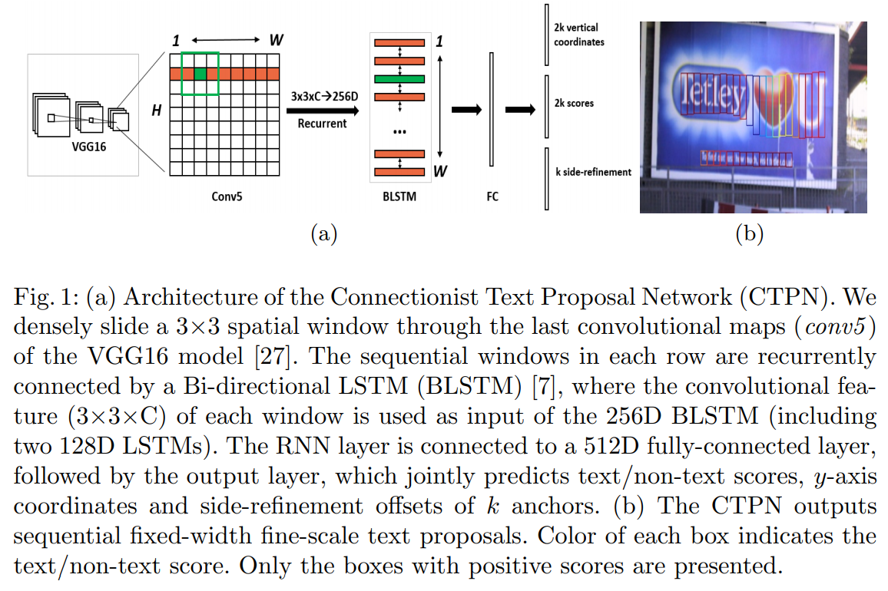

-----

| Title     | ML Tasks Image OCR CTPN                               |
| --------- | ----------------------------------------------------- |
| Created @ | `2020-05-28T06:03:37Z`                                |
| Updated @ | `2026-11-25T16:17:02Z`                                |
| Labels    | \`\`                                                  |
| Edit @    | [here](https://github.com/junxnone/aiwiki/issues/197) |

-----

# CTPN

CTPN（Connectionist Text Proposal Network，2016）把文本行检测拆成"检测很多固定宽度的小竖条（text
proposal）→
按顺序连接成文本行"。文本行长度变化极大，但把它切成固定宽度的小片段后，每个片段的形状是统一的，更容易回归；片段之间的上下文再由循环网络建模。名字里的
Connectionist 指的是用 RNN 把这些片段按序列连起来。它擅长检测水平方向的文本行。

## 结构

上图为 CTPN 的整体流程，各部分的含义：

  - **VGG16 conv5 特征图**：骨干网络提取的特征，每个位置对应原图上固定的 16 像素步长。
  - **3×3 滑动窗口**：在特征图上逐位置取 $3 \\times 3$ 邻域特征。
  - **BiLSTM**：对特征图的**每一行**，沿宽度方向把各位置串成序列送入双向 LSTM，让每个竖条获得左右的上下文信息（这就是
    Connectionist 的含义，也让竖条判断不再只依赖局部外观）。
  - **全连接 + 三个输出分支**（每个位置有 $k$ 个垂直方向的 anchor，论文取 $k=10$）：
      - $2k$ 个 **vertical coordinates**：anchor 的中心 y 坐标和高度的偏移，只回归垂直方向；
      - $2k$ 个 **scores**：该 anchor 是文本/非文本的分数；
      - $k$ 个 **side-refinement**：文本行首尾处的水平偏移修正，补偿固定宽度造成的水平边界误差。

## 要点

  - **固定宽度 anchor**：anchor 宽度固定为 16 像素，只有高度变化（论文约从 11 到 273
    像素，逐级放大），因此网络只需要回归高度和中心 y，问题大幅简化。
  - **文本行构造**：对相邻的、分数高的 proposal，按水平距离、垂直重叠度等规则两两配对并连接成链，每条链就是一个文本行；再用
    side-refinement 修正行的左右端点。
  - **局限**：只能处理水平（或接近水平）文本；对旋转、弯曲文本无能为力，之后
    [EAST](0193_ML_Tasks_Image_OCR_EAST)、SegLink 等方法解决了任意方向问题。

## Reference

  - [paper - 2016 - Detecting Text in Natural Image with Connectionist
    Text Proposal Network](https://arxiv.org/pdf/1609.03605)
  - [场景文字检测—CTPN原理与实现](https://zhuanlan.zhihu.com/p/34757009)
  - [Github code - Detecting Text in Natural Image with Connectionist
    Text Proposal Network ](https://github.com/tianzhi0549)
