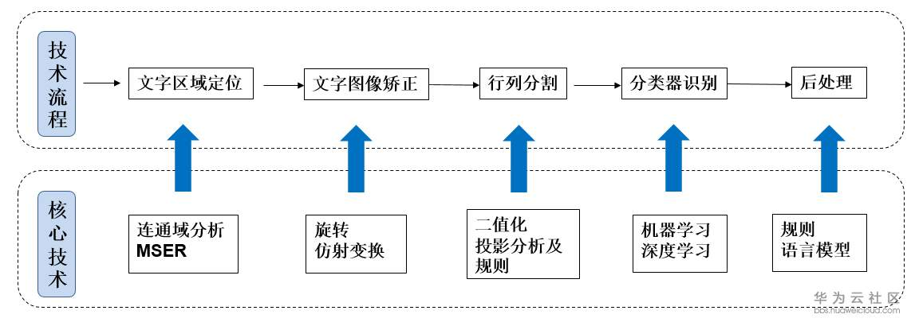
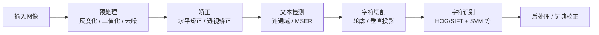

-----

| Title     | CV TOCR                                               |
| --------- | ----------------------------------------------------- |
| Created @ | `2020-06-01T08:50:21Z`                                |
| Updated @ | `2026-11-25T16:38:06Z`                                |
| Labels    | `index`                                               |
| Edit @    | [here](https://github.com/junxnone/aiwiki/issues/199) |

-----

# Traditional OCR 传统字符识别

传统 OCR 指深度学习成为主流之前的做法：用**手工设计的图像处理步骤和特征**，把"一张图里的文字"拆成"预处理 → 矫正 → 检测 →
切割 →
识别"一条流水线，每一步都是独立的算法。它依赖干净的输入（扫描文档、固定版式），对场景文字、艺术字、手写体效果很差；但原理直观、不需要训练数据、速度快，现在仍然用于简单的印刷体和作为深度学习方案的预处理或对照基线，开源引擎
[Tesseract](0792_ML_Tasks_Image_OCR_Tesseract) 早期版本就是这条路线。深度学习方案总览见
[OCR](0200_ML_Tasks_Image_OCR)。

## Pipeline

下面用流程图表示传统流水线的整体结构（上方原图为原文档保留的示意图）：

图中：

  - 每个方框是一道独立的工序，箭头是数据流；上一道的输出就是下一道的输入。
  - 关键结论：任何一步出错（二值化阈值不合适、切割把粘连字符切错）都会让后面全部出错，错误逐级累积，这是传统方法鲁棒性差、被端到端深度学习取代的主要原因。

## 预处理

  - **灰度化**：彩色转灰度，去掉与文字无关的颜色信息。
  - **二值化**：把图像分成"文字"和"背景"。全局阈值（如 Otsu）适用于光照均匀的扫描件，光照不均时用局部（自适应）阈值。
  - **去噪**：中值滤波、高斯滤波去掉椒盐噪声、小斑点。

Otsu 方法自动选择阈值，使前景和背景两类像素的类间方差最大：

$$ t^{\*} = \\arg\\max\_{t}\\
\\omega\_0(t),\\omega\_1(t),\\big\[\\mu\_0(t) - \\mu\_1(t)\\big\]^{2} $$

其中：

  - $t$：候选阈值，取值 $0 \\sim 255$；$t^{\*}$：最优阈值
  - $\\omega\_0(t), \\omega\_1(t)$：灰度小于等于 $t$、大于 $t$ 的两类像素各自占全部像素的比例
  - $\\mu\_0(t), \\mu\_1(t)$：两类像素的平均灰度
  - 直觉：两类的平均灰度差得越远、两类的占比越均衡，类间方差越大，说明分得越开

## 矫正

  - **水平矫正**（去倾斜）
      - 霍夫（Hough）直线矫正：检测文本行方向的直线，求出整体倾斜角后旋转回水平
      - 轮廓矫正：求文字区域的最小外接矩形，用它的旋转角校正
  - **透视矫正**：拍照的文档有梯形形变，找到文档四个角点，用透视变换拉成矩形。

霍夫变换把图像中的直线用极坐标参数表示：

$$ \\rho = x\\cos\\theta + y\\sin\\theta $$

其中：

  - $(x, y)$：图像上边缘点的坐标
  - $\\rho$：直线到原点的垂直距离；$\\theta$：直线法线与 $x$ 轴的夹角
  - 每个边缘点会在 $(\\rho, \\theta)$ 空间里"投票"出一条曲线，多条曲线交汇处的 $(\\rho,\\theta)$
    就是图中的直线；文本行近似水平线，其 $\\theta$ 相对 $90^{\\circ}$ 的偏差就是倾斜角

## 检测算法

  - **连通域检测文本**：二值化后，把相邻的前景像素标成连通域，再按大小、宽高比等规则筛选出"像字"的区域，相邻的连通域合并成文本行。
  - **MSER 检测文本**（Maximally Stable Extremal
    Regions，最大稳定极值区域）：对图像用一系列阈值做二值化，找出在很大阈值范围内面积几乎不变的"稳定区域"，文字笔画通常颜色均匀、边缘清晰，因此是稳定区域的良好候选；对光照变化、模糊比单一阈值的连通域方法更稳。

## 切割算法

把文本行进一步切成一个个字符：

  - **连通域轮廓切割**：每个字符对应一个连通域，直接取外接矩形；对粘连字符（如两字母连在一起）或断裂笔画（如汉字偏旁分开）会出错。
  - **垂直投影切割**：把文本行二值图沿垂直方向累加前景像素数，得到一条"投影曲线"，曲线接近 0
    的位置就是字符间隙，在这些位置切开。对等宽、不粘连的印刷体效果好。

## 识别算法

对每个切出的字符提特征，再用分类器分类：

  - **特征**：HOG（方向梯度直方图，描述笔画朝向分布）、SIFT（尺度不变特征，对缩放旋转稳健）
  - **分类器**：SVM（支持向量机，最常用）、逻辑回归、决策树，以及最近邻的模板匹配

## 局限

  - 严重依赖切割的质量：连笔、粘连、断裂字符无法正确切分；
  - 手工特征表达能力有限，换字体、换语言需要重新设计和调参；
  - 对自然场景（复杂背景、光照变化、艺术字体）几乎无能为力。

这些局限促成了不需要切割的序列识别（[CRNN](0196_ML_Tasks_Image_OCR_CRNN) +
[CTC](0189_ML_Tasks_Image_OCR_CTC)）和端到端方案。

## Reference

  - [传统OCR识别综述](https://blog.csdn.net/devcloud/article/details/103678688)
  - [OpenCV 文档](https://docs.opencv.org/)
