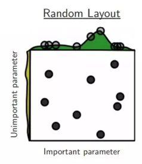

-----

| Title     | ML AutoML HPO RandomSearch                            |
| --------- | ----------------------------------------------------- |
| Created @ | `2022-01-19T10:48:34Z`                                |
| Updated @ | `2026-11-26T08:34:00Z`                                |
| Labels    | `index`                                               |
| Edit @    | [here](https://github.com/junxnone/aiwiki/issues/204) |

-----

# Random Search

  - Random Search比Gird Search更有效
  - 实际操作的时候，一般也是先用Gird Search的方法，得到所有候选参数，然后每次从中随机选择进行训练。

图中：该图为原文档附带的示意图，用于对比网格搜索（采样点在规则格点上）与随机搜索（采样点散布在整个空间）的差别。

## 为什么随机搜索更有效

超参数对结果的重要性往往不均衡：少数几个超参数决定大部分效果。网格搜索在不重要的维度上重复试同样的值，浪费预算；随机搜索每次试验在**每个维度**上都取到不同的值。

要以概率 $1-\\delta$ 至少有一次落入「最好的 $q$ 比例区域」，所需试验次数 $n$ 满足：

$$ 1-(1-q)^{n}\\ge 1-\\delta\\ \\Longrightarrow\\
n\\ge\\frac{\\ln\\delta}{\\ln(1-q)} $$

其中：

  - $q$：最优区域占整个搜索空间的比例（如 $0.05$ 表示最好的 5%）
  - $\\delta$：允许的失败概率（如 $0.05$）；$n$：试验次数
  - 例：$q=\\delta=0.05$ 时 $n\\ge\\ln0.05/\\ln0.95\\approx58.4$，即约 60
    次随机试验就能以 95% 的概率找到前 5% 的配置，且与超参数个数无关

## 与网格搜索对比

| 对比项      | 网格搜索      | 随机搜索        |
| -------- | --------- | ----------- |
| 采样方式     | 在规则网格上全组合 | 在分布中随机采样    |
| 试验数      | 随维数指数增长   | 由预算决定，与维数无关 |
| 重要超参数的覆盖 | 不同取值少     | 每次试验都有新取值   |
| 连续变量     | 需离散化      | 可直接采样       |
| 并行       | 易         | 易           |

表中：

  - 对比结论：同样预算下，随机搜索更容易找到好的配置；网格搜索见
    [GridSearch](https://github.com/junxnone/aiwiki/issues/205)

## 实践建议

  - 对学习率、正则强度等按**对数均匀**采样（如 $10^{U(-5,-1)}$），而不是线性均匀
  - 先用大范围粗搜，再在表现好的区域缩小范围细搜
  - 预算更紧时可用贝叶斯优化（见 [ML AutoML HPO
    BO](https://github.com/junxnone/aiwiki/issues/22)）
  - 总体超参数概念见 [Hyperparameter
    超参数](https://github.com/junxnone/aiwiki/issues/368)
