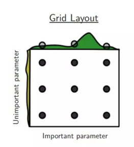

-----

| Title     | ML AutoML HPO GridSearch                              |
| --------- | ----------------------------------------------------- |
| Created @ | `2019-03-18T05:45:44Z`                                |
| Updated @ | `2026-11-26T10:11:31Z`                                |
| Labels    | \`\`                                                  |
| Edit @    | [here](https://github.com/junxnone/aiwiki/issues/205) |

-----

# Grid Search

  - 把参数空间按一定网格均匀分开, 将每种可能的超参数组合都实验一遍
  - skleran - `GridSearchV`



图中：该图为原文档附带的网格搜索示意图，每个格点是一组超参数组合。

## 组合数量

$$ N=\\prod\_{i=1}^{d}n\_i $$

其中：

  - $d$：超参数个数；$n\_i$：第 $i$ 个超参数的候选值个数
  - $N$：需要评估的组合总数；例如 3 个超参数各取 5 个值，$N=5^3=125$ 次训练
  - 组合数随维度指数增长（维数灾难），所以只适合超参数少、训练快的情况

## 示例

``` python
from sklearn.model_selection import GridSearchCV
from sklearn.svm import SVC

param_grid = {"C": [0.1, 1, 10], "gamma": [0.01, 0.1, 1]}
search = GridSearchCV(SVC(), param_grid, cv=5)
search.fit(X, y)
print(search.best_params_, search.best_score_)
```

其中：

  - `param_grid`：每个超参数的候选值，这里 $3\\times3=9$ 个组合
  - `cv=5`：每个组合做 5 折交叉验证，所以总共训练 $9\\times5=45$ 次
  - `best_params_`：最优组合；`best_score_`：对应的交叉验证得分

## 与随机搜索对比

| 对比项   | 网格搜索     | 随机搜索     |
| ----- | -------- | -------- |
| 采样    | 规则网格，全组合 | 在分布中随机采样 |
| 维度增加时 | 组合数指数增长  | 试验数由预算决定 |
| 重要超参数 | 取值数量少    | 每次都有新取值  |

表中：对比结论：超参数少且范围明确时用网格搜索；维度较高时优先用
[随机搜索](https://github.com/junxnone/aiwiki/issues/204)。更多见
[Hyperparameter](https://github.com/junxnone/aiwiki/issues/368)。
