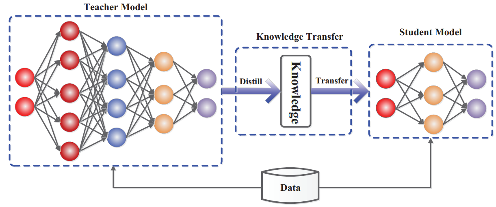

-----

| Title     | MO KD                                                 |
| --------- | ----------------------------------------------------- |
| Created @ | `2021-04-12T02:03:32Z`                                |
| Updated @ | `2026-10-18T09:33:40Z`                                |
| Labels    | \`\`                                                  |
| Edit @    | [here](https://github.com/junxnone/aiwiki/issues/207) |

-----

# 知识蒸馏

  - Knowledge Distillation 知识蒸馏
  - Teacher/Student Model
      - Teacher Model 的输出 作为 Soft Target Training Student Model
      - Student 学习 Teacher 泛化能力
      - 具体做法：把 Teacher 的输出 logits 除以一个"温度"（Temperature，T\>1）再做
        softmax，得到比 one-hot 硬标签更平滑的"软目标"（Soft Target）——里面包含了
        Teacher
        对不同类别之间相对关系的判断（比如"猫"和"狗"比"猫"和"汽车"更接近），这部分信息硬标签完全不包含。Student
        的损失函数通常是硬标签的交叉熵 + 和 Teacher 软目标的 KL 散度（或交叉熵）加权组合
  - 用途
      - 模型压缩(小模型学习大模型的泛化能力)
  - [History](0336_MO_KD_History)
  - [Distilling the Knowledge in a Neural Network](0208_MO_KD_s)

-----

## Trend

### 按"学什么"分类

  - **Response-based（响应蒸馏）**：Student 匹配 Teacher 最终输出的软化 logits——Hinton
    2015 的原始做法；
  - **Feature-based（特征蒸馏）**：Student 匹配 Teacher 的中间层激活/特征图，而不只是最终输出，代表工作
    FitNets（用 Teacher 隐藏层的"提示"训练更瘦更深的学生网络）、Attention Transfer（匹配空间注意力图）；
  - **Relation-based（关系蒸馏）**：Student 匹配的是样本之间/层之间的**相对关系**（距离、夹角、Gram
    矩阵），而不是每个样本的绝对输出值，代表工作 Relational Knowledge
    Distillation（距离/角度损失）。

### 按"怎么训"分类

  - **Offline（离线/传统蒸馏）**：Teacher 先预训练好并冻结，Student 之后单独对着固定的 Teacher
    输出训练——Hinton 2015、FitNets、TinyBERT 等默认都是这个模式；
  - **Online（在线/互学习）**：Teacher 和 Student（或多个对等的
    Student）同时训练、互相指导，不需要预训练好的固定
    Teacher，代表工作 Deep Mutual Learning（一组 Student 网络互相蒸馏）；
  - **Self-distillation（自蒸馏）**：模型自己同时充当 Teacher 和
    Student——用自己更早的训练代、更深的层指导更浅的层/更晚的代，代表工作
    Born-Again Networks（同架构的 Student 一代一代地向上一代学习，且 Student 经常能超过
    Teacher）。

### LLM 时代的新趋势

  - 蒸馏的对象从 logits 扩展到**生成的完整序列**（Sequence-Level Knowledge
    Distillation，2016），是后续大模型蒸馏方法的先声；
  - **GKD（Generalized/On-Policy Distillation，Google DeepMind，2023）**：让
    Student 在自己生成的 rollout 上接受 Teacher 打分训练，而不是只在 Teacher
    生成的固定数据上训练，缓解了"Student
    推理时遇到的分布和训练时不一致"的问题，是目前 LLM
    蒸馏的主流思路之一；
  - **DeepSeek-R1 蒸馏（2025-01）**：把 R1 的推理能力通过 SFT 直接蒸馏进 Qwen2.5/Llama3
    系列的稠密小模型（1.5B-70B），论文发现"直接蒸馏"效果优于"对小模型直接做强化学习"——是目前关注度最高的一次知识蒸馏实践案例；
  - **蒸馏的 Scaling Law（Apple，2025-02）**：研究蒸馏效果如何随 Teacher/Student
    的训练算力分配变化，发现存在"能力差距"现象——Teacher 太强反而可能让 Student
    学得更差，蒸馏不是"Teacher 越大越好"。

完整的历史时间线（含各篇论文的具体日期和出处）见 [History](0336_MO_KD_History)。

## Reference

  - 2020-6 Knowledge Distillation: A Survey
    \[[Paper](https://arxiv.org/pdf/2006.05525.pdf)\]
  - FitNets: Hints for Thin Deep Nets
    \[[Paper](https://arxiv.org/abs/1412.6550)\]
  - Deep Mutual Learning \[[Paper](https://arxiv.org/abs/1706.00384)\]
  - Born-Again Neural Networks
    \[[Paper](https://arxiv.org/abs/1805.04770)\]
  - Relational Knowledge Distillation
    \[[Paper](https://arxiv.org/abs/1904.05068)\]
  - On-Policy Distillation of Language Models (GKD)
    \[[Paper](https://arxiv.org/abs/2306.13649)\]
  - DeepSeek-R1 \[[Paper](https://arxiv.org/abs/2501.12948)\]
  - Distillation Scaling Laws
    \[[Paper](https://arxiv.org/abs/2502.08606)\]
  - **Awesome list**
      - **[Awesome Knowledge
        Distillation](https://github.com/dkozlov/awesome-knowledge-distillation)**
      - [Awesome
        Knowledge-Distillation](https://github.com/FLHonker/Awesome-Knowledge-Distillation)
