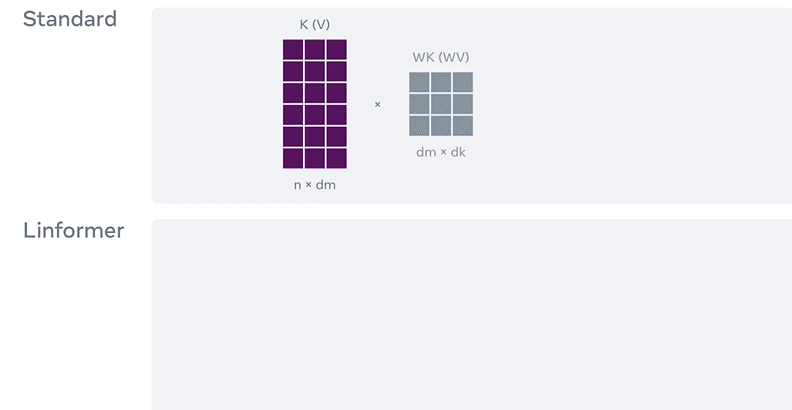
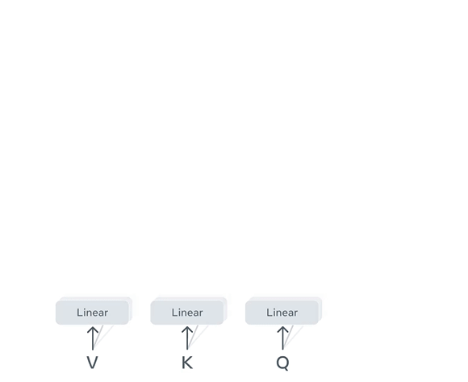
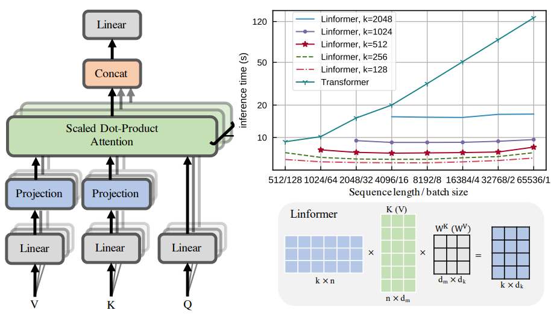
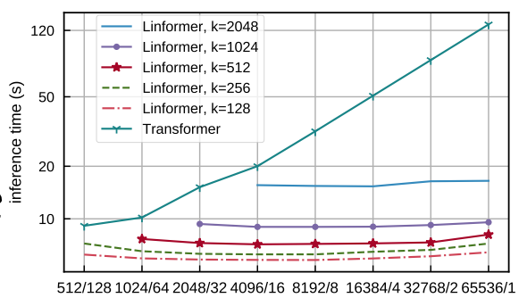
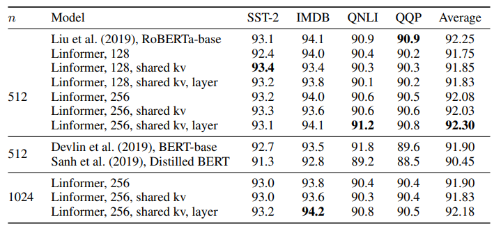
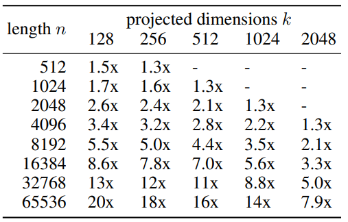
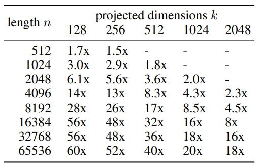

-----

| Title     | ML Transformer Linformer                              |
| --------- | ----------------------------------------------------- |
| Created @ | `2021-02-20T03:04:14Z`                                |
| Updated @ | `2026-11-19T09:38:46Z`                                |
| Labels    | \`\`                                                  |
| Edit @    | [here](https://github.com/junxnone/aiwiki/issues/224) |

-----

# Linformer

Linformer 把 Self-Attention 的时间和空间复杂度从 $`O(n^2)`$ 降到
$`O(n)`$。论文先论证**注意力矩阵是低秩的**（Self-Attention is Low
Rank），再用低秩近似取代完整的注意力矩阵：在计算注意力前，把 $`K`$、$`V`$ 沿序列长度维度从 $`n \times d`$ 投影到
$`k \times d`$（$`k \ll n`$ 为超参）。

## Motivation

  - 标准 Transformer 的注意力矩阵 $`n \times n`$，时间/显存随序列长度平方增长，训练慢、长序列难以处理
  - 已有的优化技术：
      - Mixed Precision
      - Knowledge Distillation
      - Sparse Attention（Sparse Transformer）
      - LSH Attention（Reformer）
      - Improving Optimizer Efficiency
  - 观察：对预训练模型的注意力矩阵做 SVD，奇异值谱集中在前几个最大的奇异值上（越高层越明显），说明 $`n \times n`$
    矩阵信息冗余
  - 理论依据：`distributional Johnson–Lindenstrauss lemma`——存在低秩矩阵，可以在误差
    $`\epsilon`$ 内逼近原注意力矩阵，所需秩 $`k`$ 为 $`O(\log n/\epsilon^2)`$ 量级，与
    $`n`$ 近似无关

## Linear self-attention

对每个 head，引入两个可学习投影 $`E_i, F_i \in \mathbb{R}^{k \times n}`$，只压缩
$`K`$、$`V`$ 的序列维：

$$ \\mathrm{head}\_i =
\\mathrm{softmax}\\left(\\frac{QW\_i^Q,(E\_iKW\_i^K)^\\top}{\\sqrt{d\_k}}\\right)F\_iVW\_i^V
$$

符号与形状（$`Q, K, V \in \mathbb{R}^{n\times d}`$，$`n`$ 为序列长度，$`d_k`$ 为每个
head 的维度）：

  - $`QW_i^Q,\ KW_i^K,\ VW_i^V \in \mathbb{R}^{n\times
    d_k}`$：与标准多头注意力相同的线性投影
  - $`E_i KW_i^K \in \mathbb{R}^{k\times d_k}`$：$`E_i`$ 左乘，把 $`n`$ 个 key
    压缩成 $`k`$ 个"综合 key"；$`F_iVW_i^V \in \mathbb{R}^{k\times d_k}`$ 同理压缩
    value
  - $`QW_i^Q (E_iKW_i^K)^\top \in \mathbb{R}^{n\times k}`$：每个 query 只和
    $`k`$ 个综合 key 算相似度，softmax 后的注意力矩阵（context mapping）是 $`n \times
    k`$，而不是标准的 $`n \times n`$
  - 再乘 $`F_iVW_i^V`$（$`k\times d_k`$）得到 $`n\times d_k`$
    的输出，形状与标准注意力一致，可以直接替换

**为什么只压缩 $`K`$、$`V`$，不动 $`Q`$**：输出必须保留每个位置各一个向量（$`n`$ 行），所以 $`Q`$ 的
$`n`$ 不能压；而被 query 查询的"记忆"（$`K`$、$`V`$）的 $`n`$ 个条目是冗余的，可以压缩。

**复杂度推导**：计算 $`QK^\top`$ 需要 $`n \cdot k \cdot d_k`$ 次乘加，与 $`n \times k`$
矩阵相乘 $`V`$ 同阶，因此时间复杂度为 $`O(nkd_k)`$；注意力矩阵只占 $`O(nk)`$ 显存。$`k`$ 固定（与
$`n`$ 无关）时，随 $`n`$ 是**线性**的，即 $`O(n)`$（标准注意力为 $`O(n^2 d_k)`$）。

**低秩直觉**：若 $`n\times n`$ 的注意力矩阵 $`P`$ 近似为秩 $`k`$，则 $`P`$ 的信息可由 $`k`$
个方向表示。Johnson–Lindenstrauss 引理说明：把 $`n`$ 维向量随机投影到 $`k = O(\log
n/\epsilon^2)`$ 维，向量间距离/内积的误差不超过 $`\epsilon`$。所以 $`E_i, F_i`$
即使是随机矩阵也能近似，论文里再把它们设为可学习的以获得更好的效果。

|  |
| ----------------------------------------------------------------- |
| Linformer self-attention 与 标准 self-attention 的比较                  |

|  |
| ----------------------------------------------------------------- |
| FAIR detect hate speech 使用的 **linformer**                         |

**局限**

  - 投影矩阵 $`E, F`$ 的大小与序列长度 $`n`$ 绑定，只适用于**固定序列长度**
  - 只适用于 non-autoregressive 模型：压缩了序列维，无法对每个位置做 causal mask，不能直接用于自回归生成

## Arch

### Projections Parameter Sharing

| Level     | Description                                             | Matrices Number (example: `layer=12/head=12`) |
| --------- | ------------------------------------------------------- | --------------------------------------------- |
| Headwise  | 同一 Layer 中 所有 Head 中 Projection matrices `Ei = E /Fi=F` | 24                                            |
| Key-Value | `Headwise Sharing`+ `Ei=Fi=E`                           | 12                                            |
| Layerwise | 所有 Layer/Head/Key-Value - `Ei = Fi=F`                   | 1                                             |

### 相关优化比较

| Model                | Transformer(2017) | Sparse Transformer(2019) | Reformer(2020) | Linformer(2020) |
| -------------------- | ----------------- | ------------------------ | -------------- | --------------- |
| Complexity/Layer     | $`O(n^2)`$        | $`O(n\sqrt{n})`$         | $`O(n\log n)`$ | **$`O(n)`$**    |
| Sequential Operation | $`O(1)`$          | $`O(1)`$                 | $`O(\log n)`$  | **$`O(1)`$**    |

## Evaluation

  - 在 RoBERTa 预训练设定下，$`n=512`$、$`k=128`$ 左右即可取得与标准 Transformer 接近的
    perplexity 和下游任务效果
  - Layerwise Sharing 取得了最好的实验结果，参数最少
  - Linformer 模型的 Performance 取决于 `k` 而非 `n/k`
  - time/memory save 在 `n` 值比较大时才比较明显

| Linformer vs Transformer           |  |
| ---------------------------------- | ------------------------------------------------------------ |
| NLP Tasks 结果对比                     |  |
| Linformer/Transformer time saved   |  |
| Linformer/Transformer memory saved |  |

## Reference

  - 2020-08 **\[Linformer\]** Linformer: Self-Attention with Linear
    Complexity \[[Paper](https://arxiv.org/abs/2006.04768)\]
    \[[Code](https://github.com/pytorch/fairseq/tree/master/examples/linformer)\]
  - [Code - lucidrains](https://github.com/lucidrains/linformer)
  - [Linformer:具有线性复杂性的自注意力机制](https://zhuanlan.zhihu.com/p/147225773)
  - [How Facebook uses super-efficient AI models to detect hate
    speech](https://ai.facebook.com/blog/how-facebook-uses-super-efficient-ai-models-to-detect-hate-speech/)
