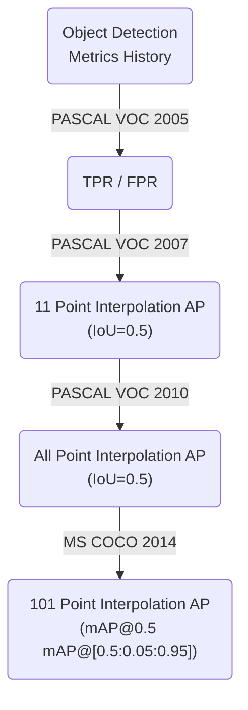
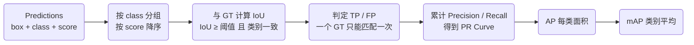
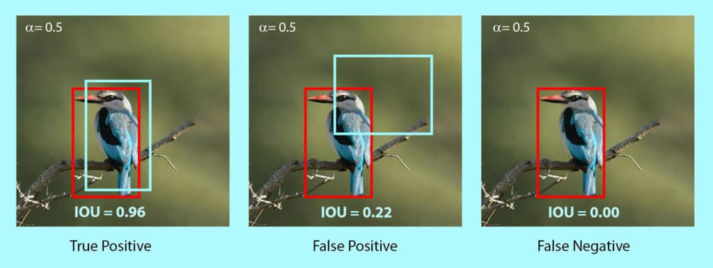

-----

| Title     | ML Metrics Detection                                  |
| --------- | ----------------------------------------------------- |
| Created @ | `2019-01-16T03:46:56Z`                                |
| Updated @ | `2026-11-24T00:58:22Z`                                |
| Labels    | \`\`                                                  |
| Edit @    | [here](https://github.com/junxnone/aiwiki/issues/230) |

-----

# Detection Metrics

  - 目标检测同时要评价「**框得准不准**」(定位) 和「**类别对不对**」(分类)，还要考虑「**有没有漏/多检**」
  - 因此检测的 Metrics 由三层构成：IoU 衡量定位 → TP/FP/FN 判定每个检测结果 → Precision/Recall
    汇总成 AP/mAP

## Metrics

  - [IoU](/0383_ML_Metrics_Detection_IoU) - `Intersection over Union`
  - TP/FP/FN
  - Precision
  - Recall
  - [TPR / FPR](/0381_ML_Metrics_Detection_TPRFPR) - `True Positive
    Rate` / `False Positive Rate`
  - Accuracy
  - [AP / mAP / AR](/0382_ML_Metrics_Detection_APmAPAR) - `Average
    Precision` / `Mean Average Precison` / `Average Recall`
  - [COCO Metrics](/0384_ML_Metrics_Detection_COCO)
  - [GIoU](/0232_ML_Metrics_Detection_GIoU)
  - [Center Distance](/0525_ML_Metrics_Detection_CD)
  - Image/Object Level

## Object Detection Metrics History



图中：

  - 自上而下是检测指标的演进顺序，箭头上的文字是对应的数据集/竞赛及年份
  - 早期 VOC 2005 用 TPR/FPR；VOC 2007 起用 AP，先用 11 点插值，VOC 2010 改为全点插值；COCO
    2014 采用 101 点插值，并且对 IoU 阈值 0.5\~0.95 取平均，要求更严格
  - 括号内是该阶段的 IoU 阈值设置，说明演进的趋势是对定位精度的要求越来越高

## 评估流程

下图展示从模型输出到 mAP 的完整流程：



图中：

  - 每个预测包含框、类别和置信度 score；评估前先按类别分组，并按 score 从高到低排序
  - 每个预测去找同类别、IoU 最大的 GT，IoU 达到阈值（如 0.5）且该 GT 还没被匹配过，记为 TP，否则记为 FP
  - 没有被任何预测匹配上的 GT 记为 FN
  - 逐个加入预测，累计得到不同阈值下的 Precision/Recall，画出 PR Curve，曲线下面积为该类 AP，所有类别 AP
    平均即 mAP

## TP/FP/FN

  - 根据 IoU 的值确定 TP/FP/FN



| Name | 判定条件                                         |
| ---- | -------------------------------------------- |
| TP   | 预测框与某个 GT 同类别，且 IoU ≥ 阈值，并且该 GT 此前未被匹配       |
| FP   | 预测框没有对应 GT（背景误检、类别错误、IoU 不足），或者对已匹配的 GT 重复检测 |
| FN   | GT 没有任何预测框匹配（漏检）                             |
| TN   | 检测任务中不定义（背景区域无穷多），因此 Accuracy 和 FPR 在检测里很少使用 |

表中每行是一种判定结果及其条件。同一个 GT 被多个预测框覆盖时，只有 score 最高的一个算 TP，其余都算 FP，这也是 NMS 不足时
Precision 下降的原因。

## Precision

$\\huge Precision = \\frac{TP}{TP+FP} = \\frac{TP}{\\text{Total
Predictions}}$

  - 识别为正例的样例中，识别正确的比例

其中：$TP$ 为判定为正确的检测框数，$FP$ 为判定为错误的检测框数，$TP+FP$ 即模型输出的检测框总数 (`Total
Predictions`)。

## Recall

$\\huge Recall = \\frac{TP}{TP+FN} = \\frac{TP}{\\text{Total Ground
Truths}}$

  - 样本所有正例中，识别正确的比例
  - 也被称作`查全率`， 即检测出来的样本/实际应该检测出的样本。

其中：$FN$ 为未被检测到的 GT 数，$TP+FN$ 即标注的目标总数 (`Total Ground Truths`)。

## Image/Object Level

  - **Object Level**：以每个目标框为单位统计 TP/FP/FN，最常用，mAP 即属于此类
  - **Image Level**：以整张图为单位，只关心「图里有没有目标」，常用于缺陷检测的「有无缺陷」判定，此时可退化为分类指标
  - 两种口径下 Precision/Recall 不可直接比较，报告时要注明

## VOC vs COCO

| Name   | PASCAL VOC             | MS COCO                       |
| ------ | ---------------------- | ----------------------------- |
| AP 插值  | 11 点(2007) / 全点(2010+) | 101 点                         |
| IoU 阈值 | 0.5                    | 0.5:0.05:0.95 共 10 个          |
| 目标尺寸   | 不区分                    | 区分 Small / Medium / Large     |
| AR     | 不报告                    | 报告 AR@1/10/100                |
| mAP 记法 | `mAP@0.5`              | `AP@[.5:.95]`，COCO 里 AP 即 mAP |

表中对比两个主流评测协议：COCO 更严格，对定位精度要求更高；同一个模型 `mAP@0.5` 通常远高于
`AP@[.5:.95]`，不同协议的数值不能直接比较。详见 [COCO
Metrics](/0384_ML_Metrics_Detection_COCO)。

## Code

``` python
from torchmetrics.detection import MeanAveragePrecision

metric = MeanAveragePrecision(iou_type="bbox")
preds = [dict(boxes=boxes_pred, scores=scores, labels=labels_pred)]    # xyxy
target = [dict(boxes=boxes_gt, labels=labels_gt)]
metric.update(preds, target)
print(metric.compute())      # map, map_50, map_75, map_small/medium/large, mar_1/10/100 ...
```

## Tools

  - [Open-Source Visual Interface for Object Detection
    Metrics](https://github.com/rafaelpadilla/review_object_detection_metrics)
  - [pycocotools](https://github.com/cocodataset/cocoapi) - COCO 官方评估
  - [TorchMetrics
    MeanAveragePrecision](https://lightning.ai/docs/torchmetrics/stable/detection/mean_average_precision.html)

## Reference

  - [目标检测评价指标(mAP)](https://www.cnblogs.com/makefile/p/metrics-mAP.html)
  - [SSD算法评估：AP，
    mAP和Precision-Recall曲线](https://blog.csdn.net/xunan003/article/details/79252162)
  - [目标检测的评价指标](https://blog.csdn.net/Liven_Zhu/article/details/81316627)
  - [一文了解目标检测/图像分割/coco数据集检测评价标准 -
    Oldpan](https://oldpan.me/archives/understand-coco-metric)
  - [深度学习中IU、IoU(Intersection over Union)的概念理解以及python程序实现 -
    Oldpan](https://oldpan.me/archives/iu-iou-intersection-over-union-python)
  - [MS COCO数据集目标检测评估（Detection
    Evaluation）](https://blog.csdn.net/u014734886/article/details/78831884)
  - [目标检测中Recall、Precision和IOU](https://blog.csdn.net/yongjiankuang/article/details/78336860)
  - [目标检测性能评价指标（mAP、IOU）](https://blog.csdn.net/qq_40196164/article/details/86301784)
  - [\[Algorithm\]
    机器学习算法常用指标总结](https://www.cnblogs.com/maybe2030/p/5375175.html)
  - [F1 score](https://en.wikipedia.org/wiki/F1_score)
  - [目标检测（Object Detection）中性能衡量指标mean Average
    Precision（mAP）的含义与计算](https://blog.csdn.net/asasasaababab/article/details/79994920)
  - [详解对象检测网络性能评价指标mAP计算](https://cloud.tencent.com/developer/article/1370654)
  - [Iou 的计算](https://www.cnblogs.com/q735613050/p/10618558.html)
  - [目标检测 anchor
    理解笔记](https://www.cnblogs.com/zfcode/p/mu-biao-jian-ce-anchor-li-jie-bi-ji.html)
  - [【mAP】关于目标检测mAP的一些理解](https://blog.csdn.net/u014636245/article/details/89236073)
  - [Omni-benchmarking Object
    Detection](https://towardsdatascience.com/omni-benchmarking-object-detection-b390cc4114cd)
  - [mAP (mean Average Precision) for Object
    Detection](https://medium.com/@jonathan_hui/map-mean-average-precision-for-object-detection-45c121a31173)
  - [The PASCAL Visual Object Classes (VOC)
    Challenge](http://homepages.inf.ed.ac.uk/ckiw/postscript/ijcv_voc09.pdf)
  - [Metrics for object
    detection](https://github.com/rafaelpadilla/Object-Detection-Metrics)
  - [An Introduction to Evaluation Metrics for Object
    Detection](https://blog.zenggyu.com/en/post/2018-12-16/an-introduction-to-evaluation-metrics-for-object-detection/)
  - [Mean Average Precision (mAP) in Object
    Detection](https://learnopencv.com/mean-average-precision-map-object-detection-model-evaluation-metric)
