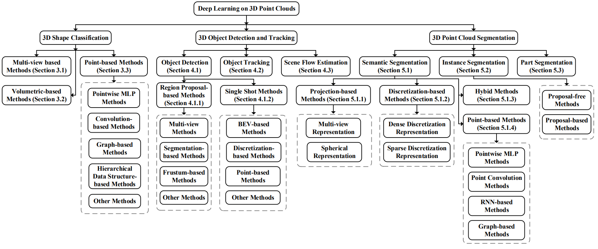
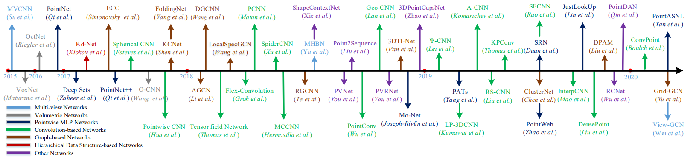
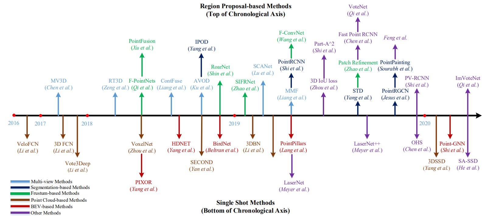
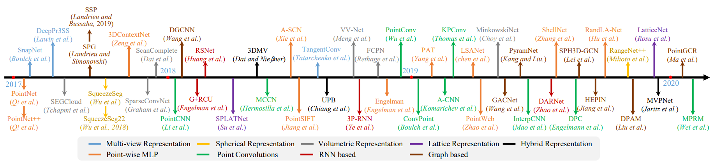
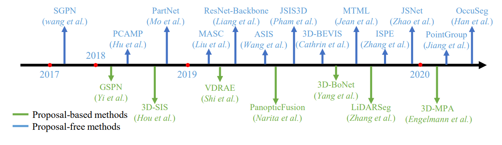

-----

| Title     | 3D DL                                                 |
| --------- | ----------------------------------------------------- |
| Created @ | `2021-08-30T05:52:23Z`                                |
| Updated @ | `2026-10-21T03:21:15Z`                                |
| Labels    | \`\`                                                  |
| Edit @    | [here](https://github.com/junxnone/aiwiki/issues/233) |

-----

# 3D 深度学习技术综述

> 本文是 [3D](0076_3D)（经典点云处理：特征描述子、配准、PCL 工具链）的**深度学习篇**——按"数据表示 → 核心任务 →
> 方法演进 → 应用落地"的脉络，梳理 3D 深度学习从 2015 年到 2023
> 年之后"前馈式基础模型"浪潮为止的技术全貌。原文仅有一篇
> 2019 年点云综述论文的几张示意图，本次扩充为覆盖点云/体素/隐式表示/神经辐射场，以及
> LRM/TRELLIS/Hunyuan3D/VGGT 等近几年重点模型在内的综述。

## 一、为什么 3D 比 2D 难：数据表示的分裂

2D 图像有一种公认的表示方式——像素网格，所以 2D CNN 这一套架构能通吃几乎所有视觉任务。3D
数据没有这种"标准答案"，根据采集/应用场景不同，分裂成好几种表示方式，每种都催生了自己独立的深度学习架构家族：

| 表示方式                            | 特点                                       | 代表架构家族                                             |
| ------------------------------- | ---------------------------------------- | -------------------------------------------------- |
| **点云（Point Cloud）**             | 无序点集 `N×3`/`N×6`，不规则、无网格结构               | PointNet 系列（见下文、[PointNet++](0541_paper_PointNet)） |
| **体素（Voxel）**                   | 规则 3D 网格，可直接套用 3D 卷积，但分辨率稍高就显存爆炸         | 3D CNN、稀疏卷积（SECOND、MinkowskiNet）                   |
| **多视角（Multi-view）**             | 把 3D 物体渲染成多张 2D 投影图                      | MVCNN，直接复用成熟的 2D CNN                               |
| **网格（Mesh）**                    | 顶点+面片，拓扑结构明确但不规则，适合渲染                    | MeshCNN、图神经网络                                      |
| **隐式表示（Implicit）**              | 用神经网络拟合一个连续函数（SDF/占据概率），而不是显式存储几何        | DeepSDF、Occupancy Networks                         |
| **神经辐射场（NeRF）**                 | 不止几何，同时建模外观（颜色+密度），用体渲染从多张 2D 图像反推 3D 场景 | NeRF、Instant-NGP                                   |
| **3D 高斯基元（Gaussian Splatting）** | 显式的各向异性高斯点云+可微光栅化，替代 NeRF 的隐式 MLP        | 3D Gaussian Splatting 及其衍生                         |

这张表本身就是读这篇综述的地图：后面"方法演进"和"应用"两节都按这几条表示路线展开。

## 二、核心任务分类

  - **形状分类（Shape Classification）**：给定一个 3D
    物体，判断类别，点云/体素/多视角三种表示的早期方法大多先在这个任务上验证（如
    ModelNet40 基准）。
  - **目标检测与跟踪（Object Detection & Tracking）**：自动驾驶 LiDAR 感知栈的核心任务，代表方法见下文
    SECOND/VoteNet/PV-RCNN。
  - **分割（语义/实例/全景）**：逐点/逐体素预测类别或实例 ID。
  - **配准（Registration）**：把两份点云对齐到同一坐标系，经典非深度学习方法（ICP 等）见
    [3D](0076_3D)，深度学习版本把配准建模成端到端可微的网络。
  - **3D 重建（Reconstruction）**：从图像/深度数据恢复三维几何，经典非深度学习算法（KinectFusion 等）见
    [3D Algos
    Reconstruction](0305_3D_Algos_Reconstruction)，深度学习路线进一步发展出隐式重建、多视角立体（MVS）网络、NeRF/3DGS
    等。
  - **6D 位姿估计（Pose Estimation）**：预测物体完整的三维位置+姿态，工业抓取场景的核心需求，见下文应用一节。
  - **新视角合成（Novel View Synthesis）**：给定若干已知视角的图像，合成任意新视角的画面，NeRF/3DGS
    的核心任务。
  - **3D 生成（Generation）**：从文本/图像生成 3D 资产，近几年生成式 AI 向三维领域的延伸。

## 三、方法演进：按数据表示分条线梳理

### 点云（Point Cloud）

| 年份   | 方法                    | 发表           | 核心贡献                                                                                                          |
| ---- | --------------------- | ------------ | ------------------------------------------------------------------------------------------------------------- |
| 2017 | **PointNet**          | CVPR 2017    | 第一个直接处理无序点集的网络，用共享 MLP 逐点提特征+全局 max pooling 实现"点的顺序不影响结果"（置换不变性），但缺乏局部感受野                                     |
| 2017 | **PointNet++**        | NeurIPS 2017 | 引入 Set Abstraction（最远点采样+邻域分组+局部 PointNet）层级结构，解决 PointNet 抓不住局部几何的问题，详细架构见 [PointNet++](0541_paper_PointNet) |
| 2018 | **PointCNN**          | NeurIPS 2018 | 学习一个 X 变换把无序点"规整化"后再套用常规卷积                                                                                    |
| 2019 | **DGCNN**             | ACM TOG 2019 | 动态图卷积（EdgeConv），在特征空间动态构建近邻图，而不是固定在欧氏空间近邻                                                                     |
| 2019 | **KPConv**            | ICCV 2019    | 核点卷积，用一组可学习的空间核点直接在连续坐标上定义卷积核，不需要先体素化                                                                         |
| 2019 | **VoteNet**           | ICCV 2019    | 把霍夫投票（Hough Voting）引入点云 3D 检测，每个点投票预测物体中心，成为点云检测的里程碑                                                          |
| 2021 | **Point Transformer** | ICCV 2021    | 把自注意力机制引入点云局部特征聚合，是 Transformer 架构在 3D 领域的早期代表                                                                |

### 体素 / 稀疏表示（Voxel / Sparse）

| 年份   | 方法               | 发表           | 核心贡献                                                |
| ---- | ---------------- | ------------ | --------------------------------------------------- |
| 2015 | **VoxNet**       | IROS 2015    | 最早把 3D 卷积用在体素网格上做物体识别                               |
| 2018 | **SECOND**       | Sensors 2018 | 用稀疏卷积（只对非空体素计算）大幅加速体素 3D 检测，成为 LiDAR 检测的常用 baseline |
| 2019 | **MinkowskiNet** | CVPR 2019    | 通用的稀疏张量卷积框架，把稀疏卷积从检测任务扩展到语义分割等更广泛场景，支持 4D（3D+时间）输入  |
| 2020 | **PV-RCNN**      | CVPR 2020    | 融合点特征（细粒度）和体素特征（高效）两条路线，在检测精度上进一步提升                 |

### 多视角（Multi-view）

| 年份      | 方法                                             | 发表             | 核心贡献                                                                                                               |
| ------- | ---------------------------------------------- | -------------- | ------------------------------------------------------------------------------------------------------------------ |
| 2015    | **MVCNN**                                      | ICCV 2015      | 把 3D 物体渲染成多张 2D 投影图，直接复用预训练 2D CNN 提特征再聚合，早期在 ModelNet40 上效果一度超过体素方法——说明"3D 问题不一定非要 3D 网络不可"                       |
| 2023-12 | **DUSt3R**                                     | CVPR 2024      | 不需要已知相机参数，输入任意两张图像直接端到端预测稠密 3D 点图和相对位姿，把"相机标定+深度估计+配准"这一整套传统多视图几何流水线压缩成一次前向推理                                      |
| 2025-03 | **VGGT**（Visual Geometry Grounded Transformer） | CVPR 2025 最佳论文 | 单次前向推理直接输出相机参数、深度图、点图、3D 点云等多种 3D 属性，是 DUSt3R 之后"前馈式多视图 3D 基础模型"这条线的进一步成熟，衍生出 AnySplat（前馈 3D 高斯重建）、VGGT-SLAM 等后续工作 |

### 隐式表示 / 神经渲染（Implicit / Neural Rendering）

这条路线是 2019 年后发展最快、范式转变最剧烈的方向：

| 年份      | 方法                                  | 发表                  | 核心贡献                                                                                                                                     |
| ------- | ----------------------------------- | ------------------- | ---------------------------------------------------------------------------------------------------------------------------------------- |
| 2019    | **DeepSDF**                         | CVPR 2019           | 用神经网络拟合有符号距离函数（SDF），物体表面就是网络输出为 0 的等值面，分辨率不再受体素/点数限制                                                                                     |
| 2019    | **Occupancy Networks**              | CVPR 2019           | 用神经网络拟合连续的占据概率场，和 DeepSDF 同期提出，殊途同归                                                                                                      |
| 2020    | **NeRF**                            | ECCV 2020           | 革命性方法——用一个 MLP 拟合空间中每一点的颜色+密度，通过体渲染（volume rendering）从多张 2D 图像直接学习出完整的 3D 场景，开创"新视角合成"这个任务；代价是单场景训练往往要几十小时，渲染一帧也要数秒                      |
| 2022    | **Instant-NGP**                     | SIGGRAPH 2022       | 用多分辨率哈希编码替代纯 MLP 隐式表示，把 NeRF 的训练时间从几十小时压缩到几秒到几分钟，是 NeRF 走向实用化的关键一步                                                                       |
| 2023    | **3D Gaussian Splatting**           | SIGGRAPH 2023       | 彻底转换范式——不再用隐式 MLP，而是用大量显式的各向异性 3D 高斯基元表示场景，配合可微光栅化渲染，训练速度和 NeRF 相当但渲染速度达到**实时（100+ FPS）**，成为当前新视角合成/场景重建的主流范式，催生了大量下游工作（动态场景、SLAM、数字人等）  |
| 2023    | **LRM**（Large Reconstruction Model） | ICLR 2024           | 第一个"前馈式"单图生 3D 模型——5 亿参数 Transformer，输入单张图像，**5 秒内**直接预测出 NeRF，不需要逐场景优化，在百万级多视角数据上训练，开创了"大模型一次前向出 3D"这个范式，后续 GS-LRM（输出换成 3D 高斯）等都是这条线的延伸 |
| 2024    | **GS-SLAM / SplaTAM**               | CVPR 2024           | 把 3D Gaussian Splatting 引入稠密 SLAM，用可微光栅化替代隐式 MLP，解决了 NeRF-SLAM 训练/渲染慢的瓶颈，实现实时、高保真的稠密建图+相机跟踪，2025 年进一步扩展到多机协同 SLAM                        |
| 2024-12 | **TRELLIS**                         | CVPR 2025 Spotlight | 微软提出统一的"结构化 3D 隐空间"（Structured LATent）表示，一份隐空间可以解码成辐射场/3D 高斯/网格三种不同输出格式，兼顾生成质量和格式灵活性，2025 年 9 月被 NVIDIA AI Blueprints 采用                 |
| 2025-01 | **Hunyuan3D 2.0**                   | 腾讯，Apache 2.0 开源    | 由形状生成（Hunyuan3D-DiT，流式扩散 Transformer）+ 纹理生成（Hunyuan3D-Paint）两个基础模型组成的文本/图像生 3D 系统，完全开源，是目前最具影响力的开源 3D 生成基础模型之一                           |

值得注意的是隐式表示和前面点云/体素路线的根本区别：点云/体素网络的输出是"分类标签"或"检测框"这类离散结果，而隐式表示/NeRF/3DGS
的目标就是"重建场景本身"——这也是为什么它们后来独立发展成了计算机图形学和视觉的交叉热点，而不只是一个分类/检测任务的子类。2023
年之后 LRM/TRELLIS/Hunyuan3D
这批工作，又在此基础上把"逐场景/逐物体优化半天"进一步压缩成"训一个大模型、一次前向几秒出结果"，是目前这条技术线最活跃的前沿方向。

## 四、应用全景

  - **自动驾驶**：LiDAR 点云的 3D 目标检测与跟踪是感知栈的核心环节，上文 SECOND/VoteNet/PV-RCNN
    等方法大多直接面向这个场景验证。
  - **工业机器人（抓取/质检）**：6D 位姿估计驱动的无序抓取是典型落地场景，具体案例见 [3D Pin Picking
    应用](0550_应用_3DPinPicking)（结构光/激光 3D 相机 + 深度学习位姿估计引导机械臂抓取）。
  - **AR/VR 与数字内容生产**：NeRF/3D Gaussian Splatting
    驱动的真实场景重建+新视角合成，是当前虚拟拍摄、数字孪生、沉浸式内容生产的核心技术底座。
  - **文本/图像生成 3D（3D Generation）**：DreamFusion（ICLR 2023 Outstanding
    Paper）开创了用 2D 扩散模型通过 Score Distillation Sampling 反过来监督 3D 表示（如
    NeRF）生成的思路；2024-2025 年 TRELLIS、Hunyuan3D 2.0
    等前馈式基础模型进一步把生成速度从"逐物体优化几十分钟"压缩到"单次前向几秒到几十秒"，并且开源生态（Hunyuan3D）大幅降低了使用门槛，是生成式
    AI 向三维内容生产领域延伸最活跃的方向。
  - **SLAM（即时定位与建图）**：传统 SLAM 多用稀疏点/体素地图，2024 年起 GS-SLAM/SplaTAM 等工作把 3D
    Gaussian Splatting 引入稠密 SLAM，兼顾几何精度和实时渲染质量，2025 年进一步扩展到多机协同建图场景。
  - **医疗影像**：CT/MRI 三维重建与分割、点云配准用于手术导航规划。
  - **具身智能**：3D 场景理解是具身智能体感知环境、规划动作的基础；这和 [世界模型](0566_Hot_WorldModel)
    讨论的"预测环境如何随动作演变"有交集，但关注点不同——3D
    深度学习更聚焦几何/外观本身的精确重建与理解，世界模型更关注"接下来会发生什么"的动态预测。

## 五、历史示意图（原文保留）

以下图示来自原文引用的 2019 年点云综述论文《Deep Learning for 3D Point Clouds: A
Survey》，对点云分类/检测/分割方法做了系统梳理，仍有参考价值：

### Overview

### Classification

### Detection

### Semantic Segmentation

### Instance Segmentation

## Reference

  - [Deep Learning for 3D Point Clouds: A
    Survey](https://arxiv.org/pdf/1912.12033.pdf)［[Code](https://github.com/QingyongHu/SoTA-Point-Cloud)］
  - PointNet: Deep Learning on Point Sets for 3D Classification and
    Segmentation, CVPR 2017
  - PointNet++: Deep Hierarchical Feature Learning on Point Sets in a
    Metric Space, NeurIPS 2017
  - PointCNN: Convolution On X-Transformed Points, NeurIPS 2018
  - Dynamic Graph CNN for Learning on Point Clouds (DGCNN), ACM TOG 2019
  - KPConv: Flexible and Deformable Convolution for Point Clouds, ICCV
    2019
  - Deep Hough Voting for 3D Object Detection in Point Clouds (VoteNet),
    ICCV 2019
  - Point Transformer, ICCV 2021
  - VoxNet: A 3D Convolutional Neural Network for Real-Time Object
    Recognition, IROS 2015
  - SECOND: Sparsely Embedded Convolutional Detection, Sensors 2018
  - 4D Spatio-Temporal ConvNets: Minkowski Convolutional Neural
    Networks, CVPR 2019
  - PV-RCNN: Point-Voxel Feature Set Abstraction for 3D Object
    Detection, CVPR 2020
  - Multi-view Convolutional Neural Networks for 3D Shape Recognition
    (MVCNN), ICCV 2015
  - DeepSDF: Learning Continuous Signed Distance Functions for Shape
    Representation, CVPR 2019
  - Occupancy Networks: Learning 3D Reconstruction in Function Space,
    CVPR 2019
  - NeRF: Representing Scenes as Neural Radiance Fields for View
    Synthesis, ECCV 2020
  - Instant Neural Graphics Primitives with a Multiresolution Hash
    Encoding, SIGGRAPH 2022
  - 3D Gaussian Splatting for Real-Time Radiance Field Rendering,
    SIGGRAPH 2023
  - DreamFusion: Text-to-3D using 2D Diffusion, ICLR 2023
  - LRM: Large Reconstruction Model for Single Image to 3D, ICLR 2024
  - DUSt3R: Geometric 3D Vision Made Easy, CVPR 2024
  - GS-SLAM: Dense Visual SLAM with 3D Gaussian Splatting, CVPR 2024
  - TRELLIS: Structured 3D Latents for Scalable and Versatile 3D
    Generation, CVPR 2025 Spotlight
  - Hunyuan3D 2.0: Scaling Diffusion Models for High Resolution Textured
    3D Assets Generation（腾讯，2025）
  - VGGT: Visual Geometry Grounded Transformer, CVPR 2025 最佳论文
  - [3D](0076_3D)
  - [PointNet++](0541_paper_PointNet)
  - [3D Algos Reconstruction](0305_3D_Algos_Reconstruction)
  - [3D Pin Picking 应用](0550_应用_3DPinPicking)
  - [世界模型](0566_Hot_WorldModel)
