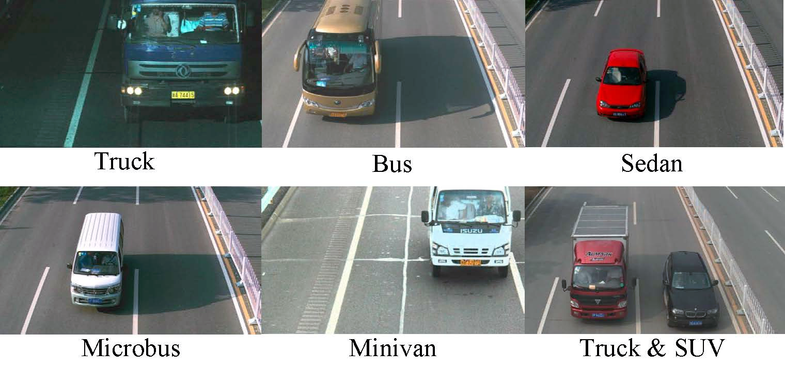

-----

| Title     | Datasets Image2D Detection BITVehicle                 |
| --------- | ----------------------------------------------------- |
| Created @ | `2018-12-19T17:36:01Z`                                |
| Updated @ | `2026-11-11T09:37:17Z`                                |
| Labels    | \`\`                                                  |
| Edit @    | [here](https://github.com/junxnone/aiwiki/issues/246) |

-----

# BIT-Vehicle

BIT-Vehicle 是北京理工大学（BIT）发布的车辆数据集，用于车辆检测与车型分类，共 9,850 张车辆图像，分 6
类，每张图含车辆位置框与类别（发布年份、对应论文待核实）。图像取自卡口监控，存在光照、尺度、颜色变化，部分图像含多辆车。

## 规模与类别



| 类别       | 数量    |
| -------- | ----- |
| Bus      | 558   |
| Microbus | 883   |
| Minivan  | 476   |
| Sedan    | 5,922 |
| SUV      | 1,392 |
| Truck    | 822   |

合计 9,850（Sedan 约占 60%）。图像分辨率不固定（待核实）。

## 目录结构

    ├── README.txt
    ├── vehicle_0000001.jpg
    ├      ...
    ├── vehicle_0009849.jpg
    ├── vehicle_0009850.jpg
    └── VehicleInfo.mat ==> matlab annotation information.

## Annotation information

  - name: The filename of the image.
  - height: The height of the image.
  - wideth: The width of the image.
  - nvehicles: The number of the vehicles in the image.
  - vehicles: This field is a struct array with the size of 1\*n
    vehicles, and each element describes a vehicle. Each element
    contains five fileds: left, top, right, bottom, and category. The
    former four fileds characterize the location of the vehicle in the
    image, and the field "category" represents the type of the vehicle.

框为 `[left, top, right, bottom]`（VOC 风格 xyxy，转换见 [BBox
Format](0488_Datasets_Image2D_Detection_BBox)）。

## 解析示例

``` python
import scipy.io as sio
m = sio.loadmat("VehicleInfo.mat", squeeze_me=True, struct_as_record=False)
key = [k for k in m if not k.startswith("__")][0]
for d in m[key][:3]:
    print(d.name, d.height, d.wideth, d.nvehicles)
    vs = d.vehicles if hasattr(d.vehicles, "__len__") else [d.vehicles]
    for v in vs:
        print(v.left, v.top, v.right, v.bottom, v.category)
```

> 变量名与字段拼写以 mat 实际内容为准（可用 `sio.whosmat` 查看，原文字段拼写为 `wideth`）。

## 下载、许可与常见坑

  - 从官网或百度网盘下载；用途限学术研究，具体许可条款以官网为准（待核实）。
  - 官网为国内高校站点，外网访问可能不稳定。
  - 类别不均衡（Sedan 占多数），训练需重采样或加权。
  - 无官方训练/测试划分，需自行切分。

## 相关

[Detection 汇总](0237_Datasets_Image2D_Detection)、[BBox
Format](0488_Datasets_Image2D_Detection_BBox)、[总入口](0018_Datasets_Image2D)。

## Reference

  - [ BitVehicle](http://iitlab.bit.edu.cn/mcislab/vehicledb/)
  - 彩蛋 ctrl + u \~\~ [backup- BIT-Vehicle
    Dataset.html](https://github.com/zj2626/Vehicle_Type_Identification/blob/d7fa07cb687275da9a25157711d6f8e06fa0abfe/document/BIT-Vehicle%20Dataset.html)
