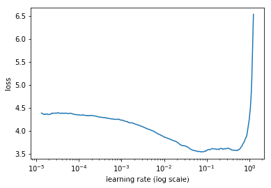

-----

| Title     | ML Arch LR LRFinder                                   |
| --------- | ----------------------------------------------------- |
| Created @ | `2019-09-03T09:29:52Z`                                |
| Updated @ | `2026-11-26T08:33:48Z`                                |
| Labels    | \`\`                                                  |
| Edit @    | [here](https://github.com/junxnone/aiwiki/issues/263) |

-----

# 学习率选择

  - 最佳 learning rate 选择
  - 学习率范围测试（LR Range Test / LR Finder）：用一次很短的训练快速找到合适的学习率量级，避免盲目试错

## Steps

  - 从一个较低的学习率开始训练一个网络，并以指数级增长每一批的学习率, 记录每个批次的学习率和训练损失。
  - 绘制损失和学习率
  - 在低学习率的情况下，损失会缓慢地改善，然后训练会加速，直到学习率过大，损失上升:训练过程会出现分歧。
  - 在图上选择一个损失下降最快的点作为学习率初始值。

第 $i$ 批的学习率按指数增长：

$$
\\eta\_i=\\eta\_{min}\\left(\\frac{\\eta\_{max}}{\\eta\_{min}}\\right)^{\\frac{i}{n-1}},\\qquad
i=0,1,\\dots,n-1 $$

其中：

  - $\\eta\_{min}$、$\\eta\_{max}$：扫描的学习率下限和上限（如 $10^{-7}$ 到 $10$）
  - $n$：扫描的总批数；$i$：当前批序号
  - 取指数（对数均匀）增长，使每个量级上的采样点一样多

图中：该图为原文档附带的 LR Finder 示意图，对应上面的步骤：横轴为学习率，纵轴为训练损失，用来选择损失下降最快处的学习率。

## 如何读图

| 阶段    | 曲线表现    | 含义          |
| ----- | ------- | ----------- |
| 学习率太小 | 损失几乎不变  | 更新步长过小，收敛很慢 |
| 学习率合适 | 损失快速下降  | 适合训练的区间     |
| 学习率太大 | 损失上升或发散 | 步长过大，训练不稳定  |

表中：

  - 选值经验：取损失下降最陡处，或最低点再缩小约一个数量级的位置，不要取最低点本身（那里已接近不稳定）
  - 配合 [CLR 周期学习率](https://github.com/junxnone/aiwiki/issues/266)
    时，该范围可作为学习率上下限

## 注意

  - 损失曲线噪声较大时先做平滑（如指数滑动平均）再看
  - 扫描完要恢复模型初始权重，再用选定的学习率正式训练
  - batch size 变化后需要重新测试

## Reference

  - [调参如何为神经网络选择最合适的学习率lr-LRFinder-for-Keras](https://blog.csdn.net/m0_37477175/article/details/89395050)
  - [Github -
    keras\_lr\_finder](https://github.com/surmenok/keras_lr_finder)
