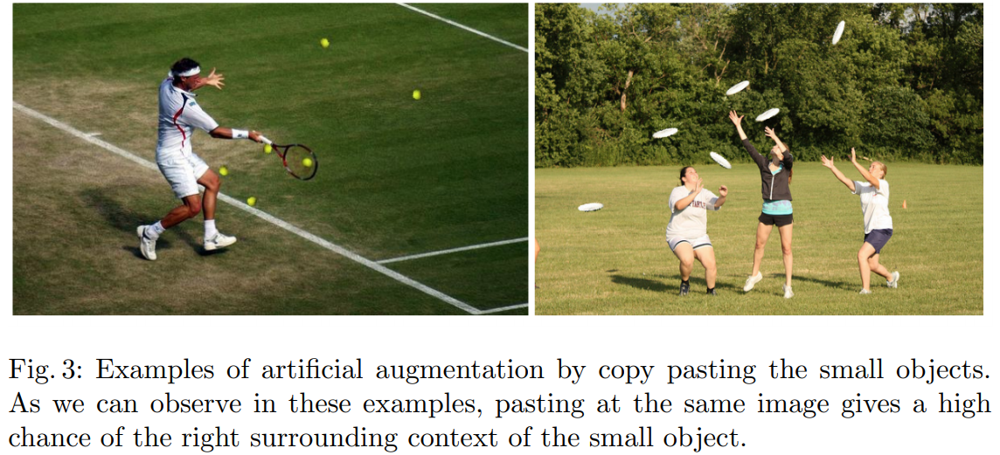
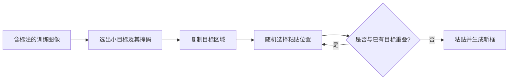
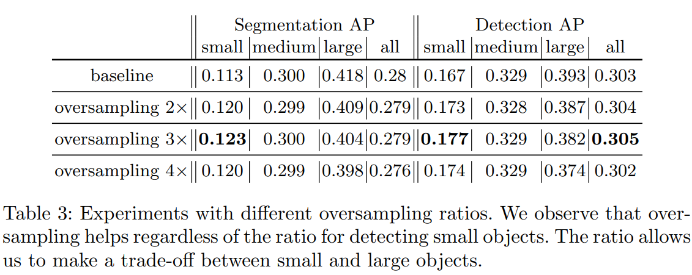
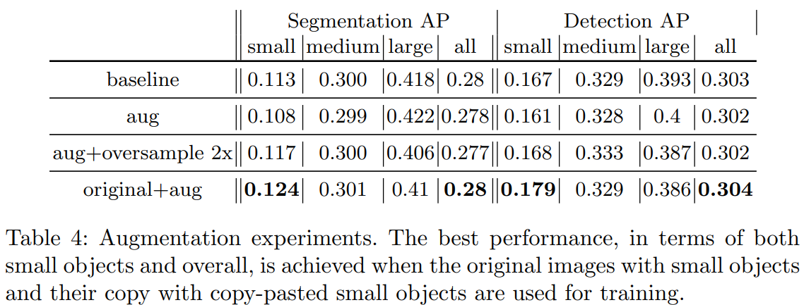
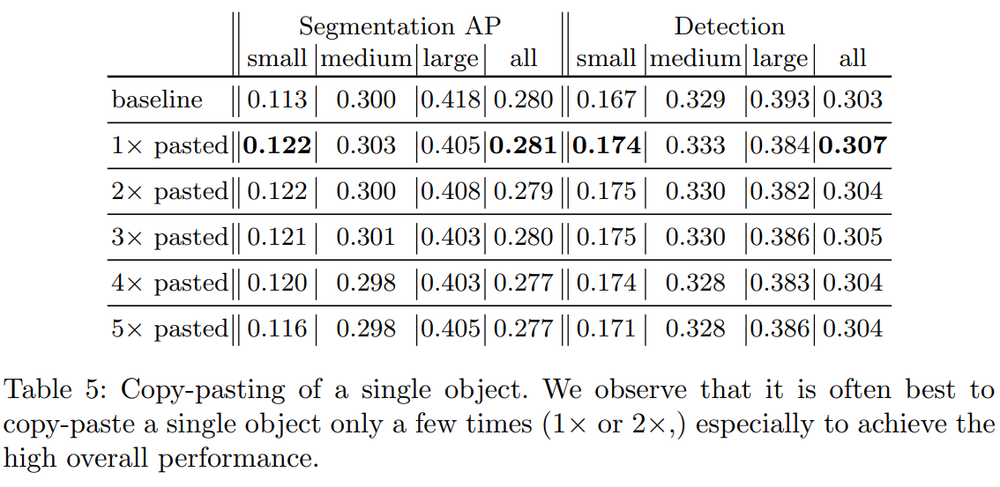
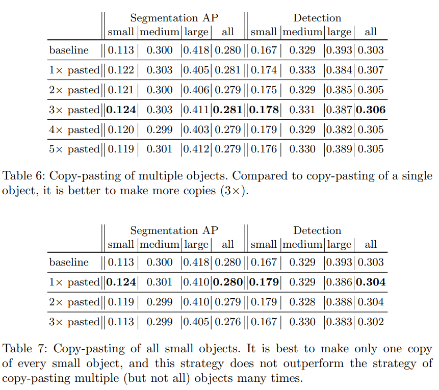

-----

| Title     | ML PreP DataAug CP                                    |
| --------- | ----------------------------------------------------- |
| Created @ | `2019-12-09T10:17:07Z`                                |
| Updated @ | `2026-11-26T08:33:57Z`                                |
| Labels    | `index`                                               |
| Edit @    | [here](https://github.com/junxnone/aiwiki/issues/269) |

-----

# Copy-Pasting

针对小目标检测的数据增强：把图像中的小物体复制后粘贴到图像的其他位置，增加小目标的出现次数。

  - 小物体平均精度差
      - 训练数据中缺少小物体的表示

## 问题：为什么小目标难检测

  - 小目标占的像素少，特征在下采样后几乎丢失
  - 小目标在训练集中出现次数少、与锚框（anchor）的匹配度低，对损失的贡献小

## 方法

  - Oversampling（过采样）- 直接复制图片？
  - Augmentation（增强）
      - Copy-pasting - 从其原始位置复制对象, 然后将副本粘贴到不同的位置

-----

图中：该图为原文档附带的示意图，对应上面的「方法」：把小目标复制后粘贴到图像中的其他位置，使同一张图里出现更多小目标。

## 流程

图中：

  - 先根据分割掩码（或框）选出小目标，复制其像素
  - 在图像中随机选位置粘贴，粘贴位置不能与已有目标重叠（可设置重叠阈值）
  - 粘贴后同步生成新的标注框，用于训练
  - 关键结论：增加小目标的数量，让它们在训练中占更大的比重

## 做法对比

| 做法               | 说明            | 特点                  |
| ---------------- | ------------- | ------------------- |
| Oversampling     | 对含小目标的图片过采样   | 简单，但容易过拟合，且大目标同样被重复 |
| Copy-pasting 单目标 | 每张图只复制粘贴一个小目标 | 提升有限                |
| Copy-pasting 多目标 | 每张图复制粘贴多个小目标  | 提升更明显，需控制数量避免失真     |

表中：

  - 对比结论：只增加图片数量（过采样）不如增加**小目标实例**数量（复制粘贴）有效

## Test Results

### Oversampling

### Copy-pasting of Single Object

### Copy-pasting of Multiple Objects

图中：以上各图为论文在不同增强方式下的检测效果统计，对应上面「做法对比」中的三种做法。

## 相关工作

  - Simple Copy-Paste（2021）：在实例分割中随机缩放、平移后粘贴，成为强力的通用增强
  - 与 Cutout（见
    [Cutout](https://github.com/junxnone/aiwiki/issues/257)）相反，Copy-Paste
    是「添加」目标，Cutout 是「遮挡」区域

## Reference

  - [paper - Augmentation for small object
    detection](https://arxiv.org/pdf/1902.07296.pdf)
  - [增强小目标检测（Augmentation for small object
    detection）](https://blog.csdn.net/u011344545/article/details/91355839)
