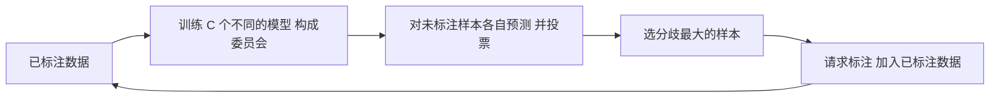
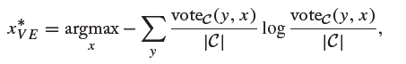
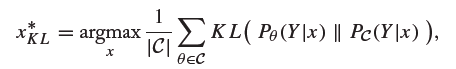
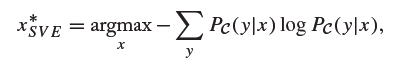

-----

| Title     | ML AL QS QBC                                          |
| --------- | ----------------------------------------------------- |
| Created @ | `2020-10-20T01:22:42Z`                                |
| Updated @ | `2026-11-26T10:09:27Z`                                |
| Labels    | \`\`                                                  |
| Edit @    | [here](https://github.com/junxnone/aiwiki/issues/272) |

-----

# QBC

QBC（Query By
Committee，委员会查询）是主动学习的一种采样策略：让多个模型投票，在**委员会成员意见分歧最大**的样本上请求标注，因为分歧大说明这个样本信息量高。

  - 多个 `模型` 构成 `委员会`
  - 委员会投票选出样本进行标注

<!-- end list -->

图中：每轮用已标注数据训练多个不同模型（如不同初始化、不同子集），让它们对未标注样本投票，选出分歧最大的样本去标注，再重新训练。

| Algos                                       | 公式                                                           |
| ------------------------------------------- | ------------------------------------------------------------ |
| **vote entropy**                            |  |
| **KL(Kullback-Leibler) divergence** KL散度 |  |
| soft vote entropy                           |  |

  - `vote()` - 某 label 获取的票数
  - `C` - 委员会成员个数
  - KL 散度可以衡量两个概率之间的“距离”，因此可以用 KL 散度计算出那些偏差较大的数据样本。

上面三个公式（原文档用图片给出）可以写成：

$$ x^{\*}*{VE}=\\arg\\max*{x}\\
-\\sum\_{y}\\frac{V(y)}{C}\\log\\frac{V(y)}{C} $$

$$ x^{\*}*{KL}=\\arg\\max*{x}\\
\\frac{1}{C}\\sum\_{c=1}^{C}D\_{KL}\\big(P\_{\\theta^{(c)}},\\Vert,P\_{\\mathcal{C}}\\big),\\qquad
P\_{\\mathcal{C}}(y\\mid
x)=\\frac{1}{C}\\sum\_{c=1}^{C}P\_{\\theta^{(c)}}(y\\mid x) $$

$$ x^{\*}*{SVE}=\\arg\\max*{x}\\ -\\sum\_{y}P\_{\\mathcal{C}}(y\\mid
x)\\log P\_{\\mathcal{C}}(y\\mid x) $$

其中：

  - $x^{\*}$：被选中去标注的样本；$C$：委员会成员数；$V(y)$：类别 $y$ 获得的票数（即上面的 `vote()`）
  - 第一式 vote entropy：票数分布的熵，各类票数越均匀熵越大，说明分歧越大
  - $\\theta^{(c)}$：第 $c$ 个成员的模型参数；$P\_{\\theta^{(c)}}(y\\mid x)$：它对类别
    $y$ 的预测概率
  - $P\_{\\mathcal{C}}$：委员会的平均预测分布；$D\_{KL}(P\\Vert Q)=\\sum\_y
    P(y)\\log\\frac{P(y)}{Q(y)}$：KL 散度，度量某个成员的预测偏离平均的程度
  - 第三式 soft vote entropy：用平均概率代替硬投票，计算平均分布的熵
  - 说明：公式按文献中常见的写法整理，与原图可能在符号上略有差别，请以图为准

## 方法对比

| 判据                | 使用的信息      | 特点               |
| ----------------- | ---------- | ---------------- |
| vote entropy      | 各成员的硬投票    | 简单，只看票数          |
| soft vote entropy | 各成员的概率平均   | 利用了置信度           |
| KL 散度             | 每个成员与平均的差异 | 衡量成员之间的分歧，需要概率输出 |

表中：对比结论：成员能输出概率时优先用 KL 或 soft vote entropy。

## History

  - 1992 [Query by
    committee](https://dl.acm.org/doi/pdf/10.1145/130385.130417)
  - 1995 [Committee-Based Sample Selection for Probabilistic
    Classifiers](https://arxiv.org/pdf/1106.0220.pdf)
  - 1998 [Employing EM in pool-based active learning for text
    classification](http://www.cs.cmu.edu/~knigam/papers/emactive-icml98.pdf)
  - 1998 [Query learning strategies using boosting and
    bagging](https://www.researchgate.net/profile/Naoki_Abe2/publication/221345332_Query_Learning_Strategies_Using_Boosting_and_Bagging/links/5441464b0cf2e6f0c0f60abf/Query-Learning-Strategies-Using-Boosting-and-Bagging.pdf)
  - 2007 [Active learning for regression based on query by
    committee](http://dl.ifip.org/db/conf/ideal/ideal2007/BurbidgeRK07.pdf)
