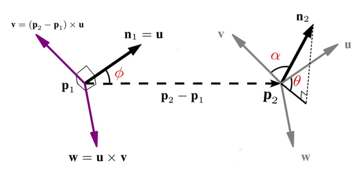

-----

| Title     | 3D Cloud Features PFH                                 |
| --------- | ----------------------------------------------------- |
| Created @ | `2021-05-08T03:11:56Z`                                |
| Updated @ | `2026-10-21T05:19:52Z`                                |
| Labels    | \`\`                                                  |
| Edit @    | [here](https://github.com/junxnone/aiwiki/issues/298) |

-----

# PFH

  - PFH - `Point Feature Histogram` - 点特征直方图
  - 通过数理统计的方法获得一个用于描述中心点邻域几何信息的直方图
  - 使用空间k点差异信息, 描述几何属性

## Algos

### Point Pair(点对)

  - 红色点 $P\_{q}$ 为 **Query Point**
  - 以 $r$ 为半径搜索 $P\_{q}$ 近邻点, 所有点两两相连组成网络
  - **Point Pair** - 网络内的点两两配对得到 $k(k+1)/2$ 个点对
  - 计算每个点的 PFH 复杂度: $O(k^2)$

### 计算 PFH

  - 点 $p\_1$ $p\_2$ 各自法向量 $n\_1$ $n\_2$
  - 在 $p\_2$ 上定义局部坐标系:
      - $u=n\_1$
      - $v = u \\times \\frac{{p\_2} - {p\_1}}{{\\parallel}{p\_2} -
        {p\_1}{\\parallel}}\_2$
      - $w = u \\times v$
  - $n\_1$ $n\_2$ 差异表示: $(\\alpha, \\phi, \\theta)$
      - $\\alpha = v \\cdot {n\_2}$
      - $\\phi = u \\cdot \\frac{{p\_2} - {p\_1}}{{\\parallel}{{p\_2} -
        {p\_1}}{\\parallel}\_2}$
      - ${\\theta} = {\\arctan (w \\cdot {n\_2},u \\cdot {n\_2})}$
  - 邻域内 k 个点 计算 $C\_{k}^2$ 个所有四元组 $(\\alpha, \\phi, \\theta, d)$
      - $d={{\\parallel}{p\_2} - {p\_1}{\\parallel}}\_2$
  - $(\\alpha, \\phi, \\theta)$ 每个值分为 b 个区间, 三个维度组合为 $b^3$ 个区间,
    统计特征值出现在每一个区间的频率
  - b=5 ==\> `float[125]` ==\> **125 维特征向量** ==\> `pcl::PFHSignature125`

> 压缩信息 $(x\_1, y\_1, z\_1, n\_1^x, n\_1^y, n\_1^z, x\_2, y\_2, z\_2,
> n\_2^x, n\_2^y, n\_2^z)$ 为 $(\\alpha, \\phi, \\theta, d)$

## 前置步骤：法向量从哪来

PFH 的输入要求每个点都已经有法向量 $n\_1,
n\_2$——这不是点云原始数据自带的，需要预先估计：对每个点取局部邻域，计算邻域点的协方差矩阵并做特征值分解，**最小特征值对应的特征向量就是该点的法向量**。这一次
PCA 分解除了给出法向量，顺带也能算出该点的曲率近似值（见
[曲率](0304_3D_Cloud_Features_Curvature)）——法向量估计和曲率估计本质上是同一次计算的两个副产品。

## 为什么能用于配准：姿态无关性

PFH 的 $(\\alpha, \\phi, \\theta, d)$
四元组完全建立在**点对自身的局部坐标系**（$u,v,w$）和两点间的相对关系上，不依赖点云所在的全局坐标系——这意味着**同一块局部几何形状，不管点云整体怎么平移、旋转，算出来的
PFH 直方图都应该是一样的**（姿态无关/位姿不变性）。这正是 PFH
能用来做"找对应点"这件事的关键：两份点云哪怕朝向完全不同，只要局部几何形状相似，PFH
直方图就会相似，从而建立起跨点云的对应关系。

## UseCase

PFH 的典型用途是作为点云**粗配准**（Coarse Registration）阶段的特征描述子——为两份点云的每个点算出 PFH
直方图，根据直方图相似度寻找对应点对，再据此求解初始变换矩阵。实践中更常用计算更快的简化版
[FPFH](0299_3D_Cloud_Features_FPFH) 来完成这一步，具体配准流程见
[点云拼接](0286_3D_Cloud_Merge)。

## Reference

  - [几何特征系列：Point Feature
    Histogram（点特征直方图）](http://lemonc.me/point-feature-histogram.html)
  - [PCL计算PFH源码computePairFeatures](https://blog.csdn.net/m0_49291417/article/details/110198763)
  - [【点云局部特征描述子】PFH & FPFH](https://zhuanlan.zhihu.com/p/192343758)
  - [Aligning point cloud views using persistent feature
    histograms](https://ias.in.tum.de/_media/spezial/bib/rusu08iros-1.pdf)
  - [3D Cloud Features Curvature](0304_3D_Cloud_Features_Curvature)
  - [3D Cloud Merge](0286_3D_Cloud_Merge)
