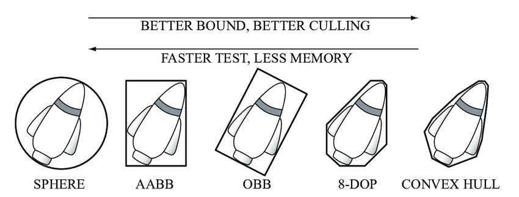

-----

| Title     | 3D Tools PCL Bbox                                     |
| --------- | ----------------------------------------------------- |
| Created @ | `2022-09-21T05:56:12Z`                                |
| Updated @ | `2026-11-26T10:18:21Z`                                |
| Labels    | `index`                                               |
| Edit @    | [here](https://github.com/junxnone/aiwiki/issues/315) |

-----

# AABB OBB

  - AABB - `Axis-aligned bounding box` - Bbox 与坐标轴平行
  - OBB - `Oriented bounding box` - 平行于点云整体方向, 相对包含区域较小

图中：该图为原文档附带的示意图，对比与坐标轴对齐的包围盒（AABB）和沿点云主方向的包围盒（OBB）。

## AABB

取点云在 x、y、z 三个方向上的最小值和最大值：

$$ \\text{AABB}=\\big\[\\min\_i x\_i,\\ \\max\_i
x\_i\\big\]\\times\\big\[\\min\_i y\_i,\\ \\max\_i
y\_i\\big\]\\times\\big\[\\min\_i z\_i,\\ \\max\_i z\_i\\big\] $$

其中：$(x\_i,y\_i,z\_i)$ 为第 $i$ 个点的坐标；三个区间的乘积就是一个与坐标轴平行的长方体。计算只需一次遍历，非常快。

## OBB

先求点云的主方向，再在该方向坐标系下取最小最大值：

$$
C=\\frac{1}{n}\\sum\_{i=1}^{n}(p\_i-\\bar{p})(p\_i-\\bar{p})^{\\top},\\qquad
C,v\_k=\\lambda\_k v\_k $$

其中：

  - $p\_i$：第 $i$ 个点；$\\bar{p}$：点云的重心；$n$：点数；$C$：$3\\times3$ 协方差矩阵
  - $v\_k$、$\\lambda\_k$：$C$ 的特征向量和特征值（PCA）；三个特征向量给出点云的三个主方向
  - 把点投影到这三个主方向上，取每个方向的最小最大值，即得到贴合点云的有向包围盒

## 对比

| 对比项  | AABB        | OBB       |
| ---- | ----------- | --------- |
| 方向   | 与坐标轴平行      | 沿点云主方向    |
| 紧致程度 | 点云倾斜时包围盒偏大  | 更贴合，体积更小  |
| 计算   | 极快          | 需要 PCA，稍慢 |
| 用途   | 粗略碰撞检测、范围裁剪 | 抓取、物体尺寸测量 |

表中：对比结论：快速粗略判断用 AABB；需要准确的尺寸和朝向用 OBB。PCL 中对应
`pcl::MomentOfInertiaEstimation` 等类，相关文章见
[PCL](https://github.com/junxnone/aiwiki/issues/77)。

## Reference

  - [PCL求点云外接立方体：AABB（轴对齐）和OBB（带方向](https://blog.csdn.net/h649070/article/details/112308932)
  - [用PCL绘制AABB和OBB包围盒](https://blog.csdn.net/u012010729/article/details/104115932)
