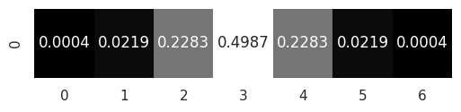
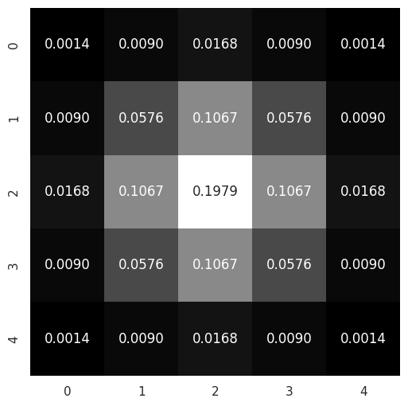

-----

| Title     | OpenCV IP Filter GaussianBlur                         |
| --------- | ----------------------------------------------------- |
| Created @ | `2022-11-29T07:55:56Z`                                |
| Updated @ | `2026-11-26T09:13:22Z`                                |
| Labels    | \`\`                                                  |
| Edit @    | [here](https://github.com/junxnone/aiwiki/issues/320) |

-----

# GaussianBlur 高斯滤波

高斯滤波用高斯函数作权重，对窗口内像素加权平均：离中心越近权重越大，因此比均值滤波更自然，能在平滑噪声的同时更好地保留结构。

## 高斯核

  - 1D 高斯核: $G\_i= \\alpha *e^{-(i-( \\texttt{ksize} -1)/2)^2/(2*
    \\texttt{sigma}^2)}$
  - 2D 高斯核: $G\_{0}(x, y) = A e^{ \\dfrac{ -(x - \\mu\_{x})^{2} }{
    2\\sigma^{2}*{x} } + \\dfrac{ -(y - \\mu*{y})^{2} }{
    2\\sigma^{2}\_{y} } }$

其中：

  - $i$：1D 核中的下标，取 $0,\\dots,\\texttt{ksize}-1$；$(\\texttt{ksize}-1)/2$
    是核的中心位置
  - $\\texttt{ksize}$：核的边长（奇数）；$\\texttt{sigma}$（$\\sigma$）：高斯函数的标准差，越大越平滑
  - $\\alpha$：归一化系数，使核的所有元素之和为 1，这样滤波不改变图像整体亮度
  - $x,y$：2D
    核中的坐标；$\\mu\_x,\\mu\_y$：中心坐标；$\\sigma\_x,\\sigma\_y$：两个方向的标准差
  - $A$：2D 情形的幅度系数，同样用来保证核的和为 1

| D      | 高斯核 OpenCV API                                                    | 高斯核                                                          |
| ------ | ----------------------------------------------------------------- | ------------------------------------------------------------ |
| 1D 7x1 | `cv2.getGaussianKernel(7, 0.8)`                                   |  |
| 2D 5x5 | `cv2.getGaussianKernel(5, 0.9) * cv2.getGaussianKernel(5, 0.9).T` |  |

表中：

  - **D**：核的维度与尺寸；**OpenCV API**：生成该核的调用；最后一列为核的可视化图
  - 2D 高斯核可以由两个 1D 核相乘得到（外积），这就是高斯核的**可分离性**
  - 对比结论：滤波 2D 图像时，可以先做一次水平 1D 卷积，再做一次垂直 1D 卷积，计算量由 $k^2$ 降到 $2k$

## 使用

``` python
import cv2
dst = cv2.GaussianBlur(src, (5, 5), sigmaX=0)   # ksize=(5,5); sigmaX=0 时由 ksize 自动计算
```

其中：

  - `ksize`：核的宽高，必须为正奇数；`sigmaX`、`sigmaY`：x、y 方向标准差，`sigmaY=0` 时取与
    `sigmaX` 相同
  - 若 `sigma` 不大于 0，OpenCV 按
    $\\sigma=0.3\\times\\big((\\texttt{ksize}-1)\\times0.5-1\\big)+0.8$
    由核大小估计

## 与其他滤波对比

| 滤波       | 权重       | 特点                                                                     |
| -------- | -------- | ---------------------------------------------------------------------- |
| 均值（blur） | 窗口内相等    | 最简单，会模糊边缘，见 [blur](https://github.com/junxnone/aiwiki/issues/441)      |
| 高斯       | 距离中心越近越大 | 平滑自然，擅长抑制高斯噪声                                                          |
| 中值       | 取窗口中值    | 对椒盐噪声效果好，见 [medianBlur](https://github.com/junxnone/aiwiki/issues/442) |

表中：对比结论：高斯噪声选高斯滤波，椒盐噪声选中值滤波，只需快速模糊选均值滤波。
