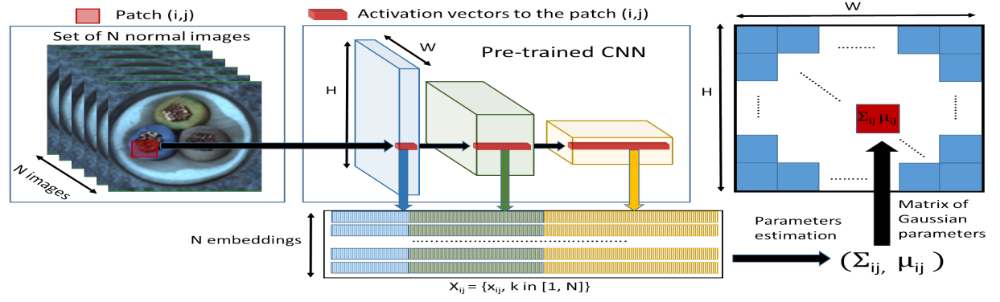
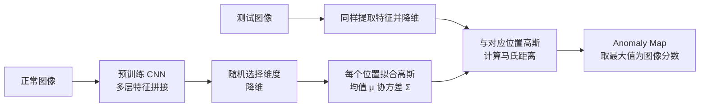

-----

| Title     | paper PaDiM                                           |
| --------- | ----------------------------------------------------- |
| Created @ | `2022-12-05T01:58:43Z`                                |
| Updated @ | `2026-11-24T08:15:25Z`                                |
| Labels    | \`\`                                                  |
| Edit @    | [here](https://github.com/junxnone/aiwiki/issues/322) |

-----

# PaDiM 补丁分布建模

  - PaDiM - `Patch Distribution Modeling`
  - 核心流程围绕 “特征提取 - 分布建模 - 异常评分” 展开，结合预训练 CNN 与概率统计方法实现异常检测与定位。
  - 使用预训练的 CNN 网络提取中间层feature 组成嵌入向量
  - 使用随机选择来降低维数，去除冗余信息
  - **仅正常类的学习** =\> `构建正常类特征`
  - 对训练集中正常图片相应的 `patch` 建模高斯分布, 作为正常特征
  - 计算 `Anomaly Map` - 待测试图片与正常类特征计算相似度
      - 对待测试图片计算特征向量，根据 `Mahalanobis Distance` 马氏距离计算`相应patch`的异常分数

## Arch



    训练阶段：
    正常图像 → 分块 → 预训练CNN提取多層特征 → 拼接特征 → 随机降维（可选）→ 计算各位置高斯分布参数(μ, Σ)
    
    测试阶段：
    测试图像 → 分块 → 提取特征并降维 → 对每个补丁计算马氏距离 → 生成异常热图 → 全局异常评分

### 训练阶段：构建正常模式的概率模型

#### 1\. 图像分块与特征提取

  - **输入**：仅使用正常类图像（单类学习设定）。
  - **分块**：将图像划分为多个重叠或非重叠的补丁（patch），每个补丁对应原始图像的局部区域。
  - **特征提取**：通过预训练CNN（如ResNet、EfficientNet）提取不同层的激活值，例如：
      - 对ResNet18，提取前3层（Layer1-Layer3）的特征，融合低层级（边缘、纹理）和高层级（语义结构）信息。
      - 对EfficientNet-B5，提取第7、20、26层的特征，平衡分辨率与语义信息。
  - **特征融合**：将不同层的特征拼接，形成每个补丁的高维嵌入向量（如ResNet18拼接后为448维）。

#### 2\. 降维优化（可选）

  - **问题**：高维特征可能包含冗余信息，增加计算复杂度。
  - **方法**：采用**随机特征选择（Rd）** 而非PCA，随机选取部分维度（如100维），实验证明此方法更高效且性能损失极小。

#### 3\. 高斯分布建模

  - 对每个补丁位置 $(i,j)$ （对应CNN特征图的空间坐标），收集所有训练图像中该位置的嵌入向量集合 $X\_{ij}$ 。
  - 假设 $X\_{ij}$ 服从多元高斯分布 $\\mathcal{N}(\\mu\_{ij}, \\Sigma\_{ij})$ ，计算：
      - 均值 $\\mu\_{ij}$ ：该位置所有训练特征的平均值。
      - 协方差矩阵 $\\Sigma\_{ij}$ ：考虑特征间的相关性，并添加正则项 $\\epsilon I$ 保证矩阵可逆。
  - **输出**：每个位置的高斯分布参数 $(\\mu\_{ij}, \\Sigma\_{ij})$ ，构成“正常模式”的概率模型。

### 测试阶段：生成异常热图与评分

#### 1\. 测试图像特征提取

  - 对测试图像同样分块，通过相同预训练CNN提取特征，拼接后得到各补丁的嵌入向量 $x\_{ij}$ 。
  - 若训练阶段使用降维，测试时对特征进行相同的随机维度选择。

#### 2\. 马氏距离计算异常分数

  - 对每个补丁 $x\_{ij}$ ，计算其与对应高斯分布的**马氏距离**：
    
    $$M(x\_{ij}) = \\sqrt{(x\_{ij} - \\mu\_{ij})^T \\Sigma\_{ij}^{-1}
    (x\_{ij} - \\mu\_{ij})}$$
    
      - 距离越大，说明该补丁偏离正常模式的程度越高，异常可能性越大。

#### 3\. 生成异常热图与全局评分

  - **异常热图**：将所有补丁的马氏距离映射为图像像素的颜色值（如黄色表示高分异常，蓝色表示正常），直观显示异常位置。
  - **图像级异常分数**：取热图中的最大值作为整幅图像的异常分数，用于判断图像是否存在异常。

## 流程图

下图概括了 PaDiM 训练与测试的两条流水线：



图中：

  - 上半部分是训练阶段：只用正常图像，提取多层特征并降维后，对每个空间位置分别拟合一个高斯分布
  - 下半部分是测试阶段：测试图像经过同样的特征提取，与对应位置的高斯分布比较，得到每个位置的异常分数，组成 Anomaly Map
  - 两条流水线共用同一个特征提取器，且 CNN 全程不训练，所以训练过程只是统计均值和协方差，不需要反向传播

## 公式

$$ \\mu\_{ij} = \\frac{1}{N}\\sum\_{n=1}^{N}x\_{ij}^{(n)}, \\qquad
\\Sigma\_{ij} = \\frac{1}{N-1}\\sum\_{n=1}^{N}\\big(x\_{ij}^{(n)} -
\\mu\_{ij}\\big)\\big(x\_{ij}^{(n)} - \\mu\_{ij}\\big)^\\top +
\\varepsilon I $$

$$ M(x\_{ij}) = \\sqrt{(x\_{ij} - \\mu\_{ij})^\\top \\Sigma\_{ij}^{-1}
(x\_{ij} - \\mu\_{ij})} $$

其中：

  - $(i, j)$：特征图上的空间位置；$n$：训练图像编号，$N$：训练图像总数；$x\_{ij}^{(n)} \\in
    \\mathbb{R}^{d}$：第 $n$ 张图在位置 $(i,j)$ 的嵌入向量（多层特征拼接并降维后，$d$ 为维度）
  - $\\mu\_{ij}$：位置 $(i,j)$ 的均值向量；$\\Sigma\_{ij}$：协方差矩阵，描述特征各维之间的相关性
  - $\\varepsilon I$：加在对角线上的正则项（$\\varepsilon$ 为小正数，$I$ 为单位矩阵），保证
    $\\Sigma\_{ij}$ 可逆，即使训练图像数量少于维度
  - $x\_{ij}$：测试图像在位置 $(i,j)$
    的嵌入；$M(x\_{ij})$：马氏距离，考虑了特征的方差和相关性，比欧氏距离更适合描述「偏离正常分布多远」
  - 图像级分数为 $\\max\_{ij} M(x\_{ij})$，即 Anomaly Map 的最大值

## 特点

| Name     | 说明                                                                       |
| -------- | ------------------------------------------------------------------------ |
| 为什么用马氏距离 | 正常特征的各维方差和相关性不同，马氏距离会把方差大的维度权重降低，更准确                                     |
| 为什么随机选维度 | 论文发现随机选择维度与 PCA 效果相当但更快，且不改变原始特征的空间对应                                    |
| 位置相关     | 每个位置有自己的高斯分布，所以要求训练和测试图像对齐良好（如固定摆放的工业产品）                                 |
| 存储代价     | 每个位置要存 $\\mu$（$d$ 维）和 $\\Sigma$（$d \\times d$），位置数多、维度高时占内存，模型大小与训练图像数无关 |
| 推理速度     | 无需迭代，推理时只需特征提取和马氏距离计算，速度较快                                               |

表中是 PaDiM
的设计取舍：它把「全部正常图像」压缩成每个位置的一个高斯分布，所以推理快、模型大小固定，但对物体位置变化敏感（如物体随机旋转、平移时每个位置的分布不再稳定）。

## 优缺点

  - **优点**
      - 训练无需反向传播，只做统计，训练快
      - 能同时输出图像级分数和像素级异常图
      - 推理速度快，精度对 CNN 骨干较稳定
  - **缺点**
      - 对对齐敏感，物体位置、姿态变化大时效果下降
      - 需要存储每个位置的协方差矩阵，高分辨率或高维时占用大
      - 假设每个位置的正常特征服从单一高斯分布，对多模态的正常情况（如正常的外观有多种）建模不足

## 使用与评估

在 anomalib 中训练 PaDiM：

``` bash
anomalib train --model Padim --data MVTecAD --data.category <category>
```

以下结果来自 anomalib README（MVTec AD 全部 15 类平均，seed 42），指标含义见 [Anomaly
Detection Metrics](/0711_ML_Metrics_Anomaly)：

| Backbone       | Image AUROC | Pixel AUROC | Image F1 |
| -------------- | ----------- | ----------- | -------- |
| ResNet-18      | 0.891       | 0.968       | 0.916    |
| Wide ResNet-50 | 0.950       | 0.979       | 0.951    |

表中分别是图像级 AUROC、像素级 AUROC 和图像级 F1，骨干更强（Wide ResNet-50）时三项都更好；PaDiM 的像素级
AUROC 很高，但 Pixel AUROC 受背景像素主导，不能单独说明定位的好坏。

## Reference

  - [PaDiM: a Patch Distribution Modeling Framework for Anomaly
    Detection and Localization](https://arxiv.org/pdf/2011.08785.pdf)
