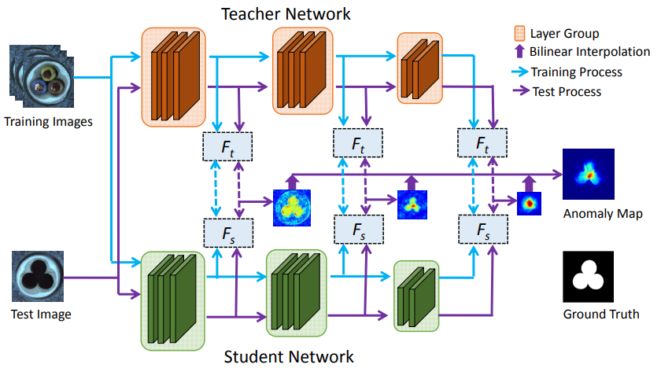
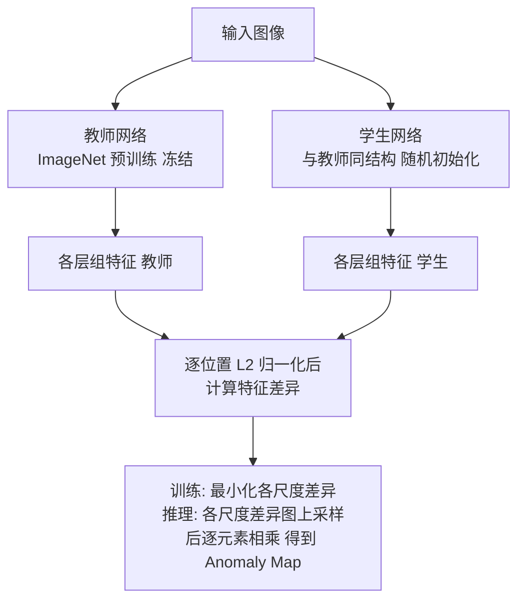

-----

| Title     | paper STFPM                                           |
| --------- | ----------------------------------------------------- |
| Created @ | `2022-12-09T03:33:27Z`                                |
| Updated @ | `2026-11-24T09:20:43Z`                                |
| Labels    | \`\`                                                  |
| Edit @    | [here](https://github.com/junxnone/aiwiki/issues/324) |

-----

# STFPM 师生特征金字塔匹配

  - 通过比较教师网络和学生网络的特征金字塔。差异越大，异常发生的概率越高
  - **师生网络架构**：用一个在图像分类任务上预训练好的强大模型（教师网络，如
    ResNet-18），去指导一个结构相同的学生网络学习正常图像的特征分布。学生网络通过匹配教师网络的特征来学习
    “正常” 的模式，两者特征差异越大，越可能是异常。
  - **多尺度特征匹配**：教师和学生网络都会提取不同层级的特征（形成特征金字塔），底层特征关注纹理、边缘等细节，高层特征关注整体结构。通过对比这些多尺度特征的差异，能检测出不同大小的异常区域。
    具体方法

## Arch

  - **训练过程**：仅用正常图像训练学生网络，让它尽可能模仿教师网络的特征输出。通过计算两者特征向量的距离（L2
    距离）作为损失函数，优化学生网络的参数。
  - **测试过程**：对于测试图像，分别通过师生网络得到特征金字塔，计算各层特征差异并生成异常分数图，再将多尺度的分数图融合，最终得到每个像素的异常概率。

## 动机与思路

  - 论文：[Student-Teacher Feature Pyramid Matching for Anomaly
    Detection](https://arxiv.org/abs/2103.04257)（Wang
    等，北航与百度）。异常检测通常被表述成单类学习问题。早期的师生方法（STAD，Bergmann
    等）用预训练模型更高效，但存在**两步、单尺度**的知识迁移，信息损失大
  - 论文的做法：以在图像分类上预训练的强模型为**教师**，把知识**一步**蒸馏到一个**结构相同**的**学生**网络，学生因此学到无异常图像的分布；并引入**多尺度特征匹配**，让学生在更好的监督下接收来自特征金字塔的多层级知识，从而能检测各种大小的异常；两个网络的**特征金字塔之差**就是异常评分函数，所以只需**一次前向**就能完成准确快速的像素级异常检测

## 流程图

下图是 STFPM 的训练与推理过程：

图中：

  - 教师网络是预训练且参数冻结的分类网络（如 ImageNet 预训练的
    ResNet-18），学生网络与教师**结构相同**但随机初始化，只有学生被训练
  - 两个网络在若干个底层的层组（如 ResNet-18 的 block）输出特征图（特征金字塔），逐层计算两者的差异
  - 底层特征分辨率高、编码纹理、边缘、颜色等低层信息，通用性强；顶层分辨率低、含上下文信息。选择若干连续的底层层组的特征来引导学生，使方法能检测不同大小的异常
  - 训练时只用正常图像，最小化差异，使学生学会「在正常图像上模仿教师」；推理时，异常区域学生模仿不好，差异大的位置就是异常

## 公式

训练阶段的目标是让学生在无异常图像上完美模仿固定教师的输出。对输入图像 $I\_k$，教师和学生的第 $l$ 个层组分别输出特征图
$F\_t^l(I\_k), F\_s^l(I\_k) \\in \\mathbb{R}^{w\_l \\times h\_l \\times
d\_l}$。由于没有物体外观和位置的先验，训练集里所有图像区域都被假设为无异常。对每个位置先沿通道维做 $\\ell\_2$
归一化，再计算损失：

$$ \\ell^l(I\_k)*{ij} = \\frac{1}{2}\\Big\\lVert \\hat{F}*t^l(I\_k)*{ij}
- \\hat{F}*s^l(I\_k)*{ij} \\Big\\rVert\_2^2, \\qquad
\\hat{F}*t^l(I\_k)*{ij} = \\frac{F\_t^l(I\_k)*{ij}}{\\lVert
F\_t^l(I\_k)*{ij}\\rVert\_2},\\quad \\hat{F}*s^l(I\_k)*{ij} =
\\frac{F\_s^l(I\_k)*{ij}}{\\lVert F\_s^l(I\_k)\_{ij}\\rVert\_2} $$

$$ \\ell^l(I\_k) = \\frac{1}{w\_l
h\_l}\\sum\_{i=1}^{w\_l}\\sum\_{j=1}^{h\_l}\\ell^l(I\_k)*{ij}, \\qquad
\\ell(I\_k) = \\sum*{l=1}^{L}\\alpha\_l,\\ell^l(I\_k), \\quad \\alpha\_l
\\ge 0 $$

其中：

  - $l$：层组编号，共 $L$ 个层组；$w\_l, h\_l, d\_l$：该层特征图的宽、高和通道数；$(i,
    j)$：空间位置；$F^l(I\_k)\_{ij} \\in
    \\mathbb{R}^{d\_l}$：该位置的特征向量
  - $\\hat{F}$：沿通道维 $\\ell\_2$ 归一化后的特征向量（模长为 1），此时 $\\ell\_2$
    距离与**余弦距离**成正比，所以逐位置损失 $\\ell^l(I\_k)\_{ij}$ 的取值范围在
    $(0, 1)$ 之间，**不受特征幅值影响**
  - $\\ell^l(I\_k)$：第 $l$
    层对整张图的损失，是各位置损失的平均；$\\ell(I\_k)$：各层加权求和得到的总损失，$\\alpha\_l$
    表示第 $l$ 个特征尺度对异常检测的影响，论文所有实验取 $\\alpha\_l = 1$
  - 在 mini-batch 上最小化 $\\ell\_\\mathcal{B} =
    \\frac{1}{\\lvert\\mathcal{B}\\rvert}\\sum\_{k \\in
    \\mathcal{B}}\\ell(I\_k)$ 来更新**学生**，整个训练过程**教师保持固定**

测试阶段：对测试图像 $J$，第 $l$ 层的异常图 $\\Omega^l(J)$（大小 $w\_l \\times
h\_l$）的每个元素就是上面的逐位置损失；上采样到原图大小，各尺度**逐元素相乘**得到最终异常图，并取最大值作为图像异常分数：

$$ \\Omega(J) =
\\prod\_{l=1}^{L}\\text{Upsample}\\big(\\Omega^l(J)\\big), \\qquad
\\text{score}(J) = \\max\\big(\\Omega(J)\\big) $$

其中 $\\Omega\_{ij} \\in \[0, 1\]$ 表示位置 $(i, j)$
的像素偏离训练数据流形的程度，$\\text{Upsample}$
是双线性插值上采样。**图像只要有任何一个像素异常，就被判为异常**，所以取最大值。逐元素相乘意味着各尺度要「共同认为」某位置异常，该位置的分数才会高。

## 论文实验设置与结果

**实验设置**：

  - 在 MVTec AD 上做图像级和像素级的实验，指标是 AUC-ROC 和 PRO（见 [Anomaly Detection
    Metrics](/0711_ML_Metrics_Anomaly)）；补充材料还在 ShanghaiTech Campus 和
    CIFAR-10 上做了实验
  - **骨干**：教师和学生都取 ResNet-18 的**前三个
    block**（conv2\_x、conv3\_x、conv4\_x）作为金字塔特征提取器；教师参数复制自
    ImageNet 预训练的 ResNet-18，学生随机初始化
  - **训练**：SGD，学习率 0.4，训练 100 个 epoch，batch size 32；图像缩放到 256×256；每个类别用
    80% 的训练图像训练学生，其余 20% 作验证，选验证误差（上面的 $\\ell$）最低的 checkpoint

**结果**：

  - **图像级**（MVTec AD 15 类平均 AUC-ROC）：优于
    Geom、GANomaly、$\\ell\_2$-AE、ITAE、Cut-Paste、Patch-SVDD、PaDiM
    和 SPADE；相比同样利用预训练模型多尺度特征的 SPADE，**最多提升 11.7%**，说明师生学习框架的优越性
  - **像素级**：论文总结了两类提升性能的趋势：①用预训练模型（SPADE 用 Wide-ResNet50×2
    得到有竞争力的分数）；②自训练（Cut-Paste 和 Patch-SVDD
    设计代理任务做特征学习）。STFPM
    用在通用图像上预训练的模型而不是在小规模异常检测数据集上自监督学习；其性能优于这些方法，并且始终优于
    STAD，论文把差距归因于 STAD **两步、单尺度**的知识迁移带来的信息损失。当使用与 SPADE 相同的骨干时，STFPM
    进一步提升到 AUC-ROC **0.973**、PRO **0.923**
  - 以 ResNet-18 为骨干、ImageNet 预训练教师的设置下，论文 Table 4 报告的 15 类平均图像级
    AUC-ROC（ARI）为 **0.955**，像素级 AUC-ROC（ARP）为 **0.970**

**消融实验**（论文第 5 节）：

| Name      | 结论                                                                                                                                                                                                                           |
| --------- | ---------------------------------------------------------------------------------------------------------------------------------------------------------------------------------------------------------------------------- |
| 单层 vs 金字塔 | 单独用 ResNet-18 的 block 2、3、4、5 做匹配时，在第 3、4 个 block 末尾做特征匹配效果更好，与「中层特征对知识迁移更重要」的已有发现一致；多个连续 block 的组合里，**block \[2, 3, 4\] 的组合优于其他组合和单个成分**，说明**特征金字塔匹配**是更好的特征学习方式；低层特征生成的异常图适合精确定位但含背景噪声，高层特征生成的异常图能分割大的异常区域，多尺度聚合能检测各种大小的异常 |
| 教师预训练数据集  | 用 ImageNet 预训练的教师最好（ARI 0.955）；换成 CIFAR-100（0.835）、CIFAR-10（0.826）、SVHN（0.796）、MNIST（0.619）依次变差，说明通用、大规模的预训练数据对教师很重要                                                                                                         |
| 训练样本数     | 只用 5% 或 10% 的无异常图像训练，STFPM 仍能达到令人满意的水平，而 SPADE 性能严重下降；只用 10% 训练样本就超过了初步的师生框架（STAD）。论文认为这得益于针对性的特征学习策略（学生学到了无异常图像的特征分布）                                                                                                       |

表中的结论：多层级匹配、强教师、少量训练样本下的鲁棒性是 STFPM 的主要优点。

## 特点

| Name    | 说明                                                                                                                                          |
| ------- | ------------------------------------------------------------------------------------------------------------------------------------------- |
| 多尺度匹配   | 浅层关注纹理等小缺陷，深层关注结构等大缺陷，金字塔让不同大小的异常都能检出；各层异常图相乘                                                                                               |
| 训练与推理速度 | 只训练学生网络，不需要记忆库，推理只需要一次前向（两个网络各一次）                                                                                                           |
| 推理无 kNN | 区别于 [PatchCore](/0535_paper_PatchCore)，不需要保存和搜索大量特征                                                                                         |
| 依赖教师质量  | 教师在 ImageNet 上预训练，特征的通用性决定匹配效果                                                                                                              |
| 学生泛化风险  | 如果学生网络过强，会在异常图像上也模仿得很好，导致异常漏检；后续的 [Reverse Distillation](/0749_paper_ReverseDistillation) 和 [EfficientAD](/0748_paper_EfficientAD) 重点改进了这一点 |

表中是 STFPM
的主要特点：它把「异常检测」转化为「学生能否模仿教师」，计算简单；最后一行说明了它的本质局限：模仿能力的泛化是不可控的，后续师生类方法的改进都围绕这一点。

## 优缺点

  - **优点**
      - 结构简单、无需记忆库；训练和推理速度快
      - 多尺度特征匹配，能检测不同大小的缺陷
      - 同时输出图像级分数和像素级异常图；少量训练样本下依然稳健
  - **缺点**
      - 学生网络可能在异常区域也能很好地模仿教师，造成漏检
      - 对教师网络的特征质量依赖较大
      - 在 anomalib 中用更大的骨干不一定更好（见下表 Wide ResNet-50 反而不如
        ResNet-18）；不同类别的结果波动较大，如某些类别（如 Toothbrush）在 Wide
        ResNet-50 上不稳定

## anomalib 评估结果

以下结果来自 anomalib README（MVTec AD 15 类平均，seed 42）：

| Backbone       | Image AUROC | Pixel AUROC | Image F1 |
| -------------- | ----------- | ----------- | -------- |
| ResNet-18      | 0.893       | 0.951       | 0.932    |
| Wide ResNet-50 | 0.876       | 0.903       | 0.926    |

表中可以看到 anomalib 里 STFPM 用 ResNet-18 的效果更好，Wide ResNet-50
反而下降，这与「骨干越大越好」的直觉不同；Wide ResNet-50 的
Pixel AUROC 平均值偏低，主要受个别类别拖累，README 中该设置下 Toothbrush 类像素级 AUROC 只有
0.178。anomalib 的数值（图像级 AUROC 0.893）低于论文报告的
0.955，原因可能包括训练设置（如训练轮数、数据划分和预处理）的差异。

## Reference

  - [2021.3 **STFPM** Student-Teacher Feature Pyramid Matching for
    Anomaly Detection](https://arxiv.org/pdf/2103.04257.pdf)
  - [code](https://github.com/gdwang08/STFPM)
