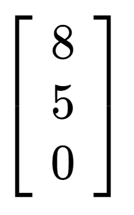
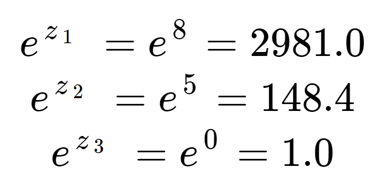
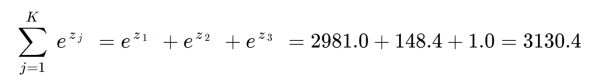
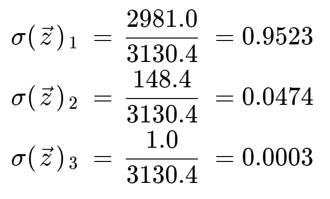

-----

| Title     | ML Op AF Softmax                                      |
| --------- | ----------------------------------------------------- |
| Created @ | `2022-12-24T12:25:20Z`                                |
| Updated @ | `2026-11-11T01:07:35Z`                                |
| Labels    | \`\`                                                  |
| Edit @    | [here](https://github.com/junxnone/aiwiki/issues/335) |

-----

# Softmax

  - 把任意实数向量（logits）映射为概率分布：各元素在 $(0,1)$ 且和为 1，用于单标签多分类输出，以及
    [Attention](0210_ML_Attention) 中的注意力权重归一化。
  - 总览见 [激活函数](0279_ML_Op_AF)；二分类/多标签见 [Sigmoid](0280_ML_Op_AF_Sigmoid)。
  - **二分类时** `sigmoid` 和 `softmax` 等价

| Name    | 应用                            | 输出                           |
| ------- | ----------------------------- | ---------------------------- |
| sigmoid | \- 二分类<br>- 多标签分类/Multi-Label | 一个或多个 0∼1 范围内的概率值            |
| softmax | \- 多分类                        | 在 classes\_num 个不同输出类别上的概率分布 |

## Softmax

  - `Softmax` = `Soft` + `max`
  - hardmax 相对就是求最大值（one-hot）
  - $softmax(\\vec{z})*{i}=\\frac{e^{z*{i}}}{\\sum\_{j=1}^{K}e^{z\_{j}}}$
      - $\\vec{z}$ : Input Vector
      - $z\_{i}$: Vector Value
      - $e^{z\_{i}}$: Vector Value 指数函数值
      - $\\sum\_{j=1}^{K}e^{z\_{j}}$: 确保所有值加起来等于 1（原文分母下标写作 $z\_i$，已修正为
        $z\_j$）
      - $K$: 类别数量
  - 添加指数函数使输出的概率距离更大
  - 将 `Vector` 映射到 `概率 Vector`
  - shape 不变，沿指定维度 `dim`/`axis` 归一化；平移不变：$softmax(z+c)=softmax(z)$。

### Examples

|  |  |  |  |
| ------------------------------------------------------------ | ------------------------------------------------------------ | ------------------------------------------------------------ | ------------------------------------------------------------ |

## 数值稳定（减 max）

$z\_i$ 较大时 $e^{z\_i}$ 溢出（fp32 约 $z\>88$，fp16 约 $z\>11$）。利用平移不变性，先减最大值：

$$softmax(z)\_i=\\frac{e^{z\_i-m}}{\\sum\_j e^{z\_j-m}},\\quad
m=\\max\_j z\_j$$

此时指数项都在 $(0,1\]$，分母 $\\ge1$，不会上溢/除零。

``` python
import torch
def softmax_stable(x, dim=-1):
    m = x.max(dim=dim, keepdim=True).values
    e = torch.exp(x - m)
    return e / e.sum(dim=dim, keepdim=True)
```

朴素实现需要 3 遍扫描（求 max、求和、归一化）。

## log\_softmax

$$\\log softmax(z)\_i = z\_i - m - \\log\\sum\_j e^{z\_j-m}$$

即 LogSumExp 技巧。不要写 `log(softmax(x))`：概率下溢为 0 时得到 $-\\infty$。

  - 交叉熵 $L=-\\log softmax(z)\_y$；PyTorch 的 `nn.CrossEntropyLoss` 内部 =
    `log_softmax` + `NLLLoss`，**输入应是原始 logits，不要先过 softmax**（常见坑）。
  - 概率蒸馏常用 `F.kl_div(log_softmax(student/T), softmax(teacher/T))`。

<!-- end list -->

``` python
import torch, torch.nn.functional as F
logits = torch.randn(4, 10); y = torch.randint(0, 10, (4,))
loss = F.cross_entropy(logits, y)                 # 推荐
loss2 = F.nll_loss(F.log_softmax(logits, -1), y)  # 等价
```

损失函数见 [Loss Function](0281_ML_Arch_Func_LossFunction)。

## 温度 (Temperature)

$$softmax(z/T)\_i=\\frac{e^{z\_i/T}}{\\sum\_j e^{z\_j/T}}$$

  - $T\\to0$：趋近 hardmax（one-hot）；$T=1$：标准；$T\\to\\infty$：趋近均匀分布。
  - 应用：知识蒸馏（$T\>1$ 暴露类间相似性）、LLM 采样（temperature）、Attention 缩放
    $1/\\sqrt{d\_k}$ 相当于温度，避免点积过大使 softmax 饱和。

## 梯度

设 $p=softmax(z)$，Jacobian：

$$\\frac{\\partial p\_i}{\\partial z\_j}=p\_i(\\delta\_{ij}-p\_j)\\
,\\quad J=\\mathrm{diag}(p)-pp^{T}$$

  - 反向（上游梯度 $g$）：$\\frac{\\partial L}{\\partial z}=p\\odot(g-\\langle
    g,p\\rangle)$，只需输出 $p$，无需完整 Jacobian。
  - 与交叉熵结合：$\\frac{\\partial L}{\\partial z\_i}=p\_i-y\_i$（$y$ 为
    one-hot），与 sigmoid+BCE 的 $\\sigma(x)-y$ 形式一致。
  - 某个 $p\_i\\to1$ 时其余梯度趋于 0，即饱和。

## Online Softmax 与融合 Attention

标准三遍扫描需要多次读写整行（如 Attention 里一行有 $N$ 个分数）。**Online softmax**
一遍扫描同时维护当前最大值 $m$ 和归一化和 $d$：

$$m\_k=\\max(m\_{k-1},z\_k),\\quad
d\_k=d\_{k-1}e^{m\_{k-1}-m\_k}+e^{z\_k-m\_k}$$

最终 $p\_i=e^{z\_i-m\_N}/d\_N$。

  - FlashAttention 把它扩展到分块：处理 K/V 的每个 tile 时，更新行最大值 $m$ 与行和 $\\ell$，并按
    $e^{m\_{old}-m\_{new}}$ 对已累计的输出 $O$ 做重缩放，使 $N\\times N$
    的注意力矩阵无需写回显存，实现 $QK^T$、softmax、$PV$ 的融合。
  - 因果 mask 用 $-\\infty$（或很大的负数）填充再 softmax；整行都被 mask 时会出现 0/0 得到
    NaN，需特殊处理。
  - 半精度下 softmax 的累加通常用 fp32。

## 实现与推理引擎

  - 朴素：3 遍（max、exp+sum、除）；优化：online 2 遍、行内 warp/block 规约（GPU 常见一行一个
    warp/block）、与前一算子（scale+mask）融合。
  - 除法可替换为乘以 $1/d$；exp 可用 $2^x$ 近似（先乘 $\\log\_2 e$）或 LUT/多项式（NPU 常见）。
  - 量化：输入 logits 量化为 int8 后可在 LUT/整数域做 exp；输出范围 (0,1)，常用固定
    scale=1/256、zero\_point=0（各框架具体取值待核实）。
  - ONNX：`Softmax`（opset 13 起对单个 `axis` 归一化；opset 13 之前会把 axis
    之后的维度展平再归一化，语义不同，导出/转换时留意）；另有
    `LogSoftmax`、`Hardmax`。PyTorch 的 `F.softmax(x, dim)` 导出到 ONNX 对应它。
  - 常见坑：忘记指定 `dim`（PyTorch 隐式 dim 已弃用）；对 logits 先 softmax 再喂
    `CrossEntropyLoss`；fp16 下不减 max。

## 二分类时 `sigmoid` 和 `softmax` 等价

| Name    | Formula                                                               |
| ------- | --------------------------------------------------------------------- |
| sigmoid | $sigmoid(x)= \\frac{1}{1 + e^{-x}}$                                   |
| softmax | $softmax(\\vec{z})*{i}=\\frac{e^{z*{i}}}{\\sum\_{j=1}^{K}e^{z\_{j}}}$ |

  - 当 二分类时 Vector = \[x, 0\]

$softmax(\\vec{z})*{1}=\\frac{e^{z*{1}}}{e^{z\_{1}} +
e^{z\_{2}}}=\\frac{e^{x}}{e^{x} + e^{0}}=\\frac{e^{x}}{e^{x} +
1}=\\frac{1}{1+e^{-x} }$

  - 一般地 $softmax(\[z\_1,z\_2\])\_1=\\sigma(z\_1-z\_2)$。

## 对比

  - Sigmoid 与 Softmax 完全等价
  - Sigmoid 与 Softmax 分类器的权值可以相互转换
  - Softmax 会比 Sigmoid 浪费 2 倍的权值空间
  - 类别互斥选 Softmax；多标签（可同时属于多类）用逐类 Sigmoid。

## Reference

  - <http://neuralnetworksanddeeplearning.com/chap3.html#softmax>
  - [logistic函数和softmax函数](http://www.cnblogs.com/maybe2030/p/5678387.html)
  - [详解sigmoid与softmax，
    多分类及多标签分类](https://blog.csdn.net/uncle_ll/article/details/82778750)
  - [Keras - Softmax 与 Sigmoid
    二分类问题分析](https://www.aiuai.cn/aifarm679.html)
  - [Keras深度学习笔记(三)：神经网络入门](https://xiaosheng.me/2018/11/24/article154/)
  - [sigmoid\_and\_softmax.ipynb](https://gist.github.com/ypwhs/6905ebbda99d04621f9fc00417657ae2)
  - [一文详解Softmax函数](https://zhuanlan.zhihu.com/p/105722023)
  - [Softmax Function -
    deepai.org](https://deepai.org/machine-learning-glossary-and-terms/softmax-layer)
  - [Online normalizer calculation for softmax (Milakov &
    Gimelshein, 2018)](https://arxiv.org/abs/1805.02867)
  - [FlashAttention (Dao et
    al., 2022)](https://arxiv.org/abs/2205.14135)
  - [ONNX Softmax](https://onnx.ai/onnx/operators/onnx__Softmax.html)
