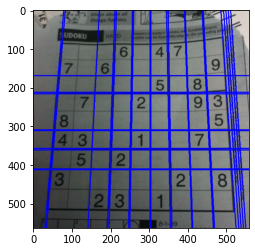

-----

| Title     | OpenCV IP Feature Hough                               |
| --------- | ----------------------------------------------------- |
| Created @ | `2020-11-06T06:00:25Z`                                |
| Updated @ | `2026-11-26T10:07:09Z`                                |
| Labels    | \`\`                                                  |
| Edit @    | [here](https://github.com/junxnone/aiwiki/issues/340) |

-----

# Hough Line Circle 霍夫线圆

霍夫变换把图像空间中的点映射到参数空间，通过「投票」找出共同满足某种形状（直线、圆）的点集。基本原理见 [Hough
Transform](https://github.com/junxnone/aiwiki/issues/71)。

## OpenCV Hough Line

| Function         | Description              | 变换方法                                                                                    |
| ---------------- | ------------------------ | --------------------------------------------------------------------------------------- |
| cv.HoughLines()  | O(n*n*m) 耗时长<br>无法检测直线端点 | SHT - Standard Hough Transform - 标准霍夫变换<br>MSHT - Multi-Scale Hough Transform - 多尺度霍夫变换 |
| cv.HoughLinesP() | 效率更高 <br>可以检测端点          | PPHT - Progressive Probabilistic Hough Transform - 累计概率霍夫变换                             |



图中：该图为原文档附带的霍夫直线检测结果示意图。

表中：

  - **Description**：两个函数的特点；**变换方法**：函数所用的霍夫变换种类
  - 对比结论：只需要「有没有这条直线」用 `HoughLines`；需要线段的起止点用 `HoughLinesP`

直线用极坐标参数表示（避免竖直线斜率无穷大的问题）：

$$ \\rho=x\\cos\\theta+y\\sin\\theta $$

其中：

  - $(x,y)$：图像中边缘点的坐标；$\\theta$：直线法线与 $x$ 轴的夹角；$\\rho$：原点到直线的距离
  - 每个边缘点在 $(\\rho,\\theta)$ 参数空间中对应一条正弦曲线；共线的点的曲线交于同一点，该点的票数最多

<!-- end list -->

``` python
import cv2, numpy as np
edges = cv2.Canny(gray, 50, 150)
lines  = cv2.HoughLines(edges, 1, np.pi/180, 150)                 # rho 精度 1 像素，theta 精度 1 度，阈值 150 票
linesP = cv2.HoughLinesP(edges, 1, np.pi/180, 50, minLineLength=30, maxLineGap=10)
```

其中：

  - 第 2、3 个参数是 $\\rho$、$\\theta$ 的累加器分辨率；第 4 个参数是投票阈值，越大越严格
  - `minLineLength`：线段最短长度；`maxLineGap`：同一直线上允许的最大断开间隔
  - 输入必须是边缘图（如 [Canny](https://github.com/junxnone/aiwiki/issues/101)
    的输出）

## OpenCV Hough Circle

  - cv.HoughCircles()


图中：该图为原文档附带的霍夫圆检测结果示意图。

圆的方程：

$$ (x-a)^2+(y-b)^2=r^2 $$

其中：$(a,b)$ 为圆心，$r$ 为半径；三个参数构成三维参数空间。OpenCV 的 `HOUGH_GRADIENT`
利用边缘点的梯度方向先确定圆心，再确定半径，把三维投票降成二维，所以更快。

``` python
circles = cv2.HoughCircles(gray, cv2.HOUGH_GRADIENT, dp=1, minDist=30,
                           param1=100, param2=30, minRadius=5, maxRadius=100)
```

其中：

  - `dp`：累加器分辨率与图像分辨率的反比；`minDist`：检测到的圆心之间的最小距离
  - `param1`：Canny 高阈值；`param2`：累加器阈值，越小检测到的圆越多（可能有误检）
  - `minRadius`、`maxRadius`：半径范围

| Modes                | Description             |
| -------------------- | ----------------------- |
| HOUGH\_STANDARD      | 标准霍夫变换，对应 `HoughLines`  |
| HOUGH\_PROBABILISTIC | 概率霍夫变换，对应 `HoughLinesP` |
| HOUGH\_MULTI\_SCALE  | 多尺度霍夫变换                 |
| HOUGH\_GRADIENT      | 基于梯度的方法，用于圆检测           |

表中：对比结论：直线用前三种模式，圆用 `HOUGH_GRADIENT`。

## Reference

  - [霍夫变换](https://www.cnblogs.com/php-rearch/p/6760683.html)
  - [Hough Transform](http://homepages.inf.ed.ac.uk/rbf/HIPR2/hough.htm)
  - [【OpenCV入门教程之十四】OpenCV霍夫变换：霍夫线变换，霍夫圆变换合辑](https://blog.csdn.net/poem_qianmo/article/details/26977557/)
  - [使用opencv识别同心圆](https://blog.csdn.net/u011853479/article/details/50405793)
