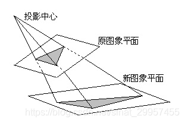
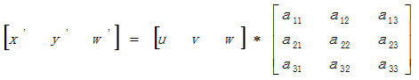
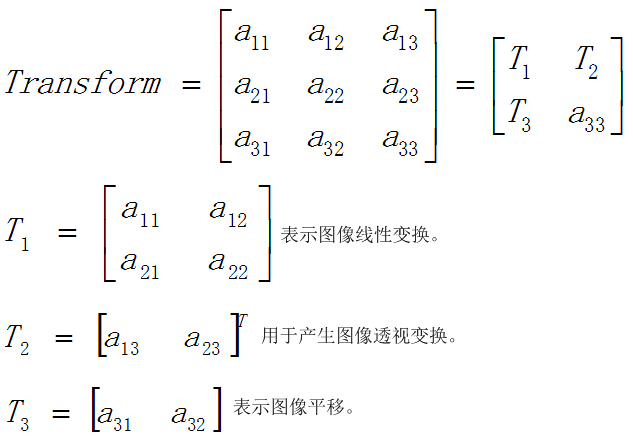
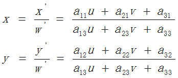
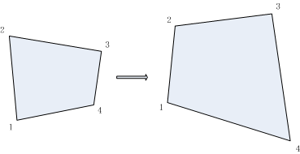

-----

| Title     | Media Image PT                                        |
| --------- | ----------------------------------------------------- |
| Created @ | `2020-11-05T03:01:31Z`                                |
| Updated @ | `2026-11-25T16:21:44Z`                                |
| Labels    | \`\`                                                  |
| Edit @    | [here](https://github.com/junxnone/aiwiki/issues/345) |

-----

# Perspective Transformation - 透视变换

## Reference

  - [图像几何变换之透视变换](https://www.cnblogs.com/liekkas0626/p/5262942.html)
  - [OpenCV
    几何变换](https://www.docs.opencv.org/4.0.0/da/d6e/tutorial_py_geometric_transformations.html)
  - [透视变换原理实例代码详解](https://xiulian.blog.csdn.net/article/details/104281693)

## Brief

| 将图片投影到一个新的视平面 |  |
| ------------- | ------------------------------------------------------------ |
| 透视变换          |  |
| 分解            |  |
| 计算公式          |  |
| 示例            |  |

## 变换公式

透视变换用一个 $3\\times3$ 的单应矩阵 (Homography) 把源图坐标映射到目标图坐标, 在齐次坐标下写为:

$$ \\begin{bmatrix}x'\\y'\\w'\\end{bmatrix}= \\begin{bmatrix} a\_{11} &
a\_{12} & a\_{13}  
a\_{21} & a\_{22} & a\_{23}  
a\_{31} & a\_{32} & 1 \\end{bmatrix}
\\begin{bmatrix}x\\y\\1\\end{bmatrix},\\qquad u=\\frac{x'}{w'},\\quad
v=\\frac{y'}{w'} $$

其中：

  - $(x,y)$：源图中的像素坐标; 末尾的 $1$ 是齐次坐标
  - $(u,v)$：变换后目标图中的像素坐标, 需要除以 $w'$ 才得到 (这一步除法就是「透视」效果的来源)
  - $a\_{11},a\_{12},a\_{21},a\_{22}$：线性部分, 对应旋转、缩放、错切
  - $a\_{13},a\_{23}$：平移量
  - $a\_{31},a\_{32}$：透视项, 使平行线在目标图中可以相交; 当它们为 $0$ 时 $w'=1$, 退化为仿射变换
  - 矩阵固定 $a\_{33}=1$, 所以有 $8$ 个自由度, 需要 $4$ 组对应点 (每组给出 2 个方程) 才能唯一求解

仿射变换只使用前两行, 为 $2\\times3$ 矩阵:

$$ \\begin{bmatrix}u\\v\\end{bmatrix}= \\begin{bmatrix} a\_{11} &
a\_{12} & a\_{13}  
a\_{21} & a\_{22} & a\_{23} \\end{bmatrix}
\\begin{bmatrix}x\\y\\1\\end{bmatrix} $$

其中符号含义同上, 共 $6$ 个自由度, 需要 $3$ 组对应点。

## 透视变换 vs 仿射变换

| Name      | 透视变换                                                | 仿射变换                                      |
| --------- | --------------------------------------------------- | ----------------------------------------- |
| 矩阵大小      | $3\\times3$                                         | $2\\times3$                               |
| 自由度       | 8                                                   | 6                                         |
| 所需对应点     | 4                                                   | 3                                         |
| 保持直线      | 是                                                   | 是                                         |
| 保持平行      | 否                                                   | 是                                         |
| 保持长度/角度   | 否                                                   | 否 (仅旋转+平移+等比缩放时保持)                        |
| OpenCV 接口 | `cv.getPerspectiveTransform` / `cv.warpPerspective` | `cv.getAffineTransform` / `cv.warpAffine` |

表中：每行是一个性质, 后两列分别给出两种变换的取值。仿射变换保持平行线仍平行 (如把矩形变成平行四边形), 透视变换不保证,
可以把矩形变成任意凸四边形 (如俯视图拉正、文档矫正)。二者都保持直线仍是直线。

## OpenCV

``` python
import cv2 as cv
import numpy as np

# 4 组对应点: 源图四角 -> 目标图四角
src = np.float32([[56, 65], [368, 52], [28, 387], [389, 390]])
dst = np.float32([[0, 0], [300, 0], [0, 300], [300, 300]])
M = cv.getPerspectiveTransform(src, dst)           # 3x3 单应矩阵
out = cv.warpPerspective(img, M, (300, 300))       # dsize 是 (w, h)
```

  - `cv.getPerspectiveTransform` 用 4 组点解出 $M$; 点多于 4 组时用
    `cv.findHomography` 做最小二乘/RANSAC 估计
  - `cv.warpPerspective` 内部按 $M^{-1}$ 反向映射并插值, 插值方法见
    [Resize](/0347_Media_Image_Resize)
