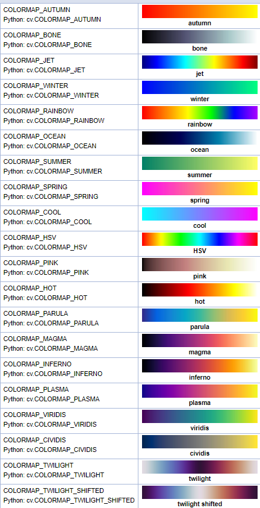
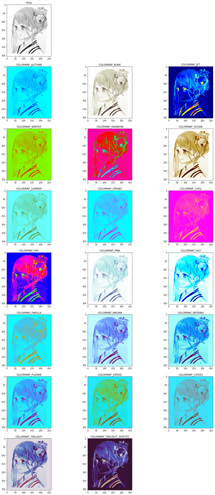

-----

| Title     | OpenCV IP Colormaps                                   |
| --------- | ----------------------------------------------------- |
| Created @ | `2019-08-07T05:19:00Z`                                |
| Updated @ | `2026-11-26T10:07:13Z`                                |
| Labels    | \`\`                                                  |
| Edit @    | [here](https://github.com/junxnone/aiwiki/issues/349) |

-----

# ColorMaps

伪彩色（pseudocoloring）：把单通道灰度图的灰度值映射成颜色，让人更容易看出细微的数值差异，常用于热力图、深度图、红外图和特征图的可视化。

图中：以上两图为原文档附带的 OpenCV 伪彩色映射示例，对应下面的 `applyColorMap`。

## Convert to JET

    import cv2 
     
    im_gray = cv2.imread("yourimage.jpg", cv2.IMREAD_GRAYSCALE)
    im_color = cv2.applyColorMap(im_gray, cv2.COLORMAP_JET)

其中：

  - `applyColorMap(src, colormap)`：`src` 为 8
    位灰度图（或三通道图，会先转灰度），`colormap`
    为色图类型
  - 映射是查表：灰度值 $v\\in\[0,255\]$ 对应色图中的第 $v$ 种颜色，即
    $\\text{color}=\\text{LUT}\[v\]$
  - 输出为三通道 BGR 彩色图

## 常见色图

| 色图          | 常量                 | 特点                     |
| ----------- | ------------------ | ---------------------- |
| JET         | `COLORMAP_JET`     | 蓝到红，最常见，但亮度不单调，易产生视觉误导 |
| HOT         | `COLORMAP_HOT`     | 黑—红—黄—白，适合热力           |
| TURBO       | `COLORMAP_TURBO`   | Google 改进的 JET，更平滑     |
| VIRIDIS     | `COLORMAP_VIRIDIS` | 感知均匀，色盲友好              |
| BONE / GRAY | `COLORMAP_BONE`    | 偏灰蓝，适合医学图像             |

表中：对比结论：需要定量比较时优先选择感知均匀的色图（VIRIDIS、TURBO），而不是 JET。

## 注意

  - 输入必须是 8 位；浮点数据（如深度图）要先归一化到 $0\\sim255$：`cv2.normalize(x,
    None, 0, 255, cv2.NORM_MINMAX).astype('uint8')`
  - 伪彩色只是显示手段，不增加信息；叠加到原图可用 `cv2.addWeighted`

## Reference

  - [applyColorMap for pseudocoloring in OpenCV ( C++ / Python
    )](https://learnopencv.com/applycolormap-for-pseudocoloring-in-opencv-c-python/)
  - [API
    Doc](https://docs.opencv.org/4.1.1/d3/d50/group__imgproc__colormap.html)
