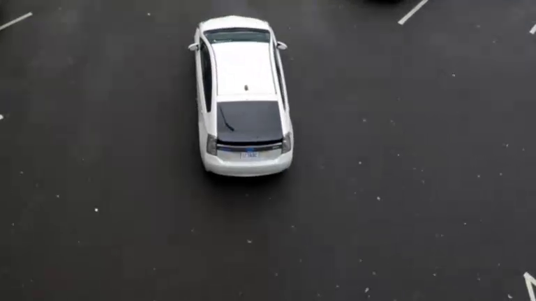
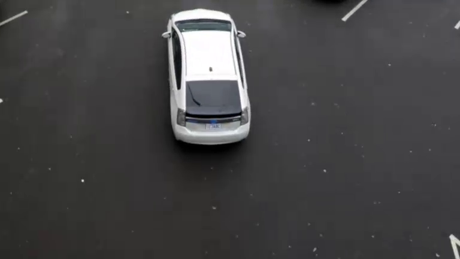
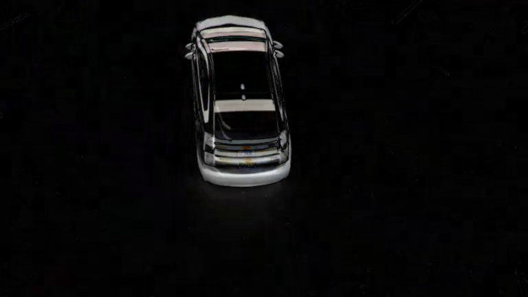
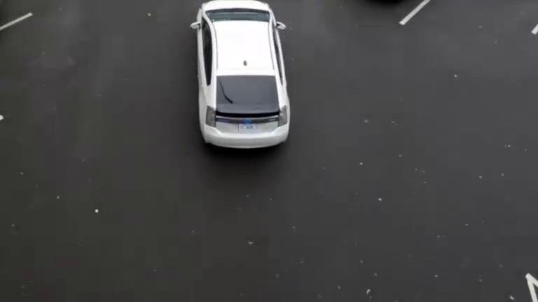
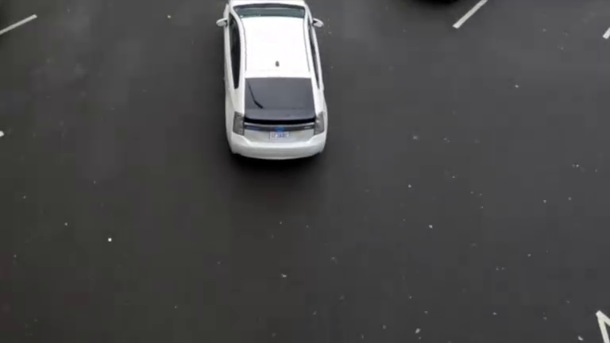
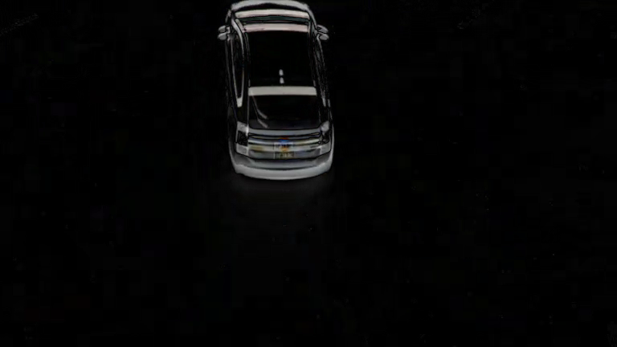
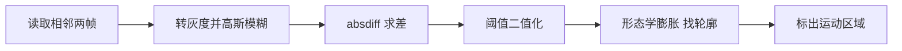

-----

| Title     | OpenCV Core absdiff                                   |
| --------- | ----------------------------------------------------- |
| Created @ | `2022-07-04T01:28:29Z`                                |
| Updated @ | `2026-11-26T10:07:18Z`                                |
| Labels    | \`\`                                                  |
| Edit @    | [here](https://github.com/junxnone/aiwiki/issues/353) |

-----

# absdiff 检测物体运动

  - 多用于移动检测

`absdiff` 逐像素计算两幅图像（或图像与常量）差的绝对值。相邻两帧里没有变化的背景差值接近
0，运动物体处差值较大，因此可用来检测运动（帧差法）。

| 输入    | 计算公式                                                                               |
| ----- | ---------------------------------------------------------------------------------- |
| 矩阵&矩阵 | $\\texttt{dst}(I) = \\texttt{saturate} (| \\texttt{src1}(I) - \\texttt{src2}(I)|)$ |
| 矩阵&常量 | $\\texttt{dst}(I) = \\texttt{saturate} (| \\texttt{src1}(I) - \\texttt{src2}(I)|)$ |
| 常量&矩阵 | $\\texttt{dst}(I) = \\texttt{saturate} (| \\texttt{src1} - \\texttt{src2}(I) |)$   |

其中：

  - $I$：像素位置；$\\texttt{src1},\\texttt{src2}$：两个输入（图像或标量）；$\\texttt{dst}$：输出
  - $|\\cdot|$：绝对值；$\\texttt{saturate}$：饱和运算，结果超出数据类型范围时截断（如 8 位限制在
    0\~255）
  - 8 位无符号图像直接相减会下溢，用 `absdiff` 可避免负值问题

| pre\_frame                                                        | frame                                                             | absdiff                                                            |
| ----------------------------------------------------------------- | ----------------------------------------------------------------- | ------------------------------------------------------------------ |
|  |  |  |
|  |  |  |

表中：三列依次为上一帧、当前帧和两帧的差图（原文档附带），差图中亮的区域对应运动的部分。

## UseCase

帧差法检测运动的基本步骤：



图中：先灰度化和模糊以抑制噪声，再求差，经阈值二值化得到运动区域，膨胀后找轮廓并标记。

``` python
diff = cv2.absdiff(prev_gray, gray)
_, mask = cv2.threshold(diff, 25, 255, cv2.THRESH_BINARY)
mask = cv2.dilate(mask, None, iterations=2)
contours, _ = cv2.findContours(mask, cv2.RETR_EXTERNAL, cv2.CHAIN_APPROX_SIMPLE)
```

其中：`25` 是差值阈值，越小越敏感（噪声也越多）；`dilate` 把相邻的小块连成区域；`findContours`
提取运动物体的外轮廓。

局限：对缓慢移动或与背景相似的物体不敏感，光照变化会引起整幅图的差异；更鲁棒的方法见背景建模。相关内容：[Motion Detection
运动侦测](https://github.com/junxnone/aiwiki/issues/243)。

## Reference

  - [API
    absdiff()](https://docs.opencv.org/4.6.0/d2/de8/group__core__array.html#ga6fef31bc8c4071cbc114a758a2b79c14)
