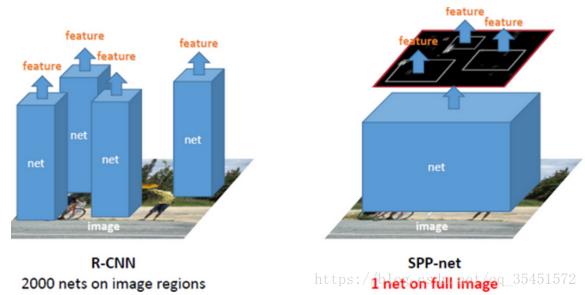
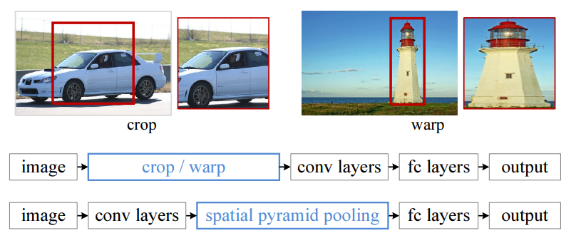
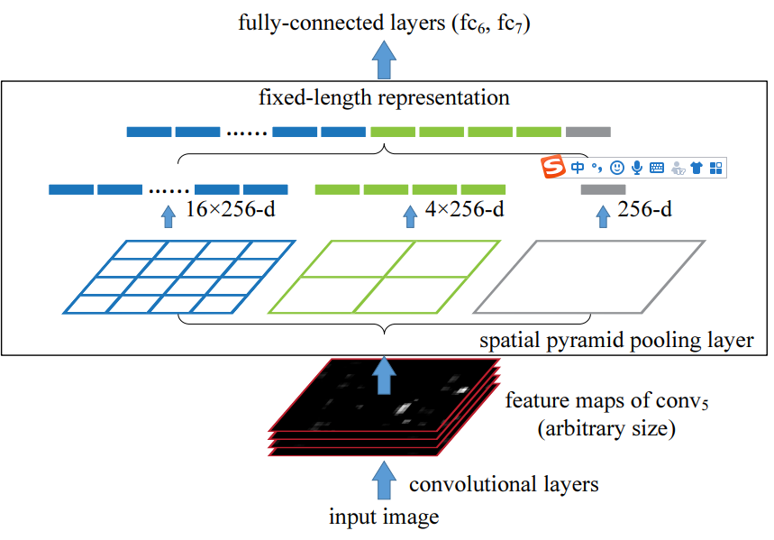

-----

| Title     | ML Op Pooling SPP                                     |
| --------- | ----------------------------------------------------- |
| Created @ | `2019-11-30T13:11:02Z`                                |
| Updated @ | `2026-11-11T01:07:28Z`                                |
| Labels    | \`\`                                                  |
| Edit @    | [here](https://github.com/junxnone/aiwiki/issues/365) |

-----

# Spatial Pyramid Pooling - 空间金字塔池化

针对卷积神经网络重复运算问题，2015 年微软研究院的何恺明等提出
SPP-Net，通过在卷积层和全连接层之间加入空间金字塔池化结构（Spatial
Pyramid Pooling），代替 R-CNN
在输入卷积神经网络前对各个候选区域进行裁剪、缩放（crop/warp）使图像子块尺寸一致的做法。SPP
是 [Pooling](0268_ML_Op_Pooling) 的多尺度变体，可把任意大小的特征图变成固定长度向量。

  - 解决了卷积神经网络对图像重复特征提取的问题（整图只过一次卷积，再在特征图上取候选区域）
  - 避免了 R-CNN 对图像区域裁剪、缩放导致的物体裁剪不全以及形状扭曲等问题
  - 网络可接受任意尺寸输入，仅 FC 层要求固定长度，SPP 正好提供
  - Deeplab v2 的 ASPP 就是基于 SPP 的思想（把多尺度池化换成不同 dilation 的空洞卷积）

### R-CNN vs SPPNet




## Spatial Pyramid Pooling



## 定义与 bin 计算

设最后一层卷积特征图为 $C\\times a\_h\\times a\_w$，金字塔有若干层，第 $l$ 层把特征图划为
$n\_l\\times n\_l$ 个 bin，每个 bin 内做 Max Pooling。典型配置
${4\\times4,,2\\times2,,1\\times1}$：

$$\\text{输出长度}=C\\cdot\\sum\_l n\_l^2=C,(16+4+1)=21C$$

论文中的窗口与步长（第 $l$ 层，$n=n\_l$）：

$$\\text{win}=\\lceil a/n\\rceil,\\qquad \\text{stride}=\\lfloor
a/n\\rfloor$$

例：$a=13$，$n=3$：win = 5，stride = 4；$n=2$：win = 7，stride = 6；$n=1$：win =
13，stride = 13。不论 $a$ 多大，输出均为固定 $21C$ 维向量，再送入 FC。

## 与 Adaptive Pooling 的关系

$\\text{AdaptiveMaxPool2d}(n)$ 的第 $i$ 个 bin 为 $\[\\lfloor
ia/n\\rfloor,\\ \\lceil (i+1)a/n\\rceil)$，与上面的 win/stride
公式在可整除时一致，不能整除时 bin 划分略有不同（后者允许 bin
重叠且大小不一）。因此 SPP 可以写成"多个不同输出尺寸的 AdaptivePool 的展平拼接"：

``` python
import torch, torch.nn as nn

class SPP(nn.Module):
    def __init__(self, levels=(4, 2, 1)):
        super().__init__()
        self.pools = nn.ModuleList(nn.AdaptiveMaxPool2d(n) for n in levels)

    def forward(self, x):                      # x: (N, C, H, W), H/W 任意
        return torch.cat([p(x).flatten(1) for p in self.pools], dim=1)  # (N, C*21)

print(SPP()(torch.randn(2, 256, 13, 17)).shape)   # torch.Size([2, 5376])
print(SPP()(torch.randn(2, 256, 20, 9)).shape)    # torch.Size([2, 5376])
```

[GAP](0267_ML_Op_Pooling_GAP) 即只有 $1\\times1$ 一层、使用平均的特例。

## 训练与推理要点

  - 训练时可使用多种输入尺寸（如 224 与 180 交替）实现多尺寸训练，提高尺度鲁棒性；SPP 层自动适配。
  - 反向传播同 Max Pooling：梯度只回传给每个 bin 的 argmax；不同金字塔层的 bin 会重叠，同一位置梯度累加。
  - 在 SPP-Net 检测流程中，候选框先按总步长映射到特征图坐标，再对其所在区域做 SPP；映射时的取整会引入位置误差。
  - YOLOv3-SPP / YOLOv4 中的 "SPP 模块"是另一种用法：对同一特征图并行做不同 kernel（如
    5/9/13）、stride 1 的 MaxPool
    后通道拼接，不改变空间尺寸，目的是扩大感受野，不是固定长度输出。YOLOv5
    的 SPPF 用串联的 5x5 MaxPool 得到等价结果以加速。

## ROI Pooling / ROI Align 简述

SPP 的单层形式启发了 **ROI Pooling**（Fast R-CNN）：对每个候选框 ROI，将其在特征图上的区域划分为固定
$H\_o\\times W\_o$ 的网格，每格做 Max Pooling，输出固定尺寸，从而共享整图卷积、支持任意
ROI。其缺点是两次坐标量化（ROI 取整、bin 取整）带来错位，对像素级任务（如实例分割）影响明显。

**ROI Align**（Mask R-CNN）取消量化：bin 边界保持浮点，每个 bin 内取若干采样点，用双线性插值取值后再做
Max/Avg 聚合，对齐更精确。

``` python
from torchvision.ops import roi_pool, roi_align
# boxes: (K, 5) = [batch_idx, x1, y1, x2, y2], 坐标在输入图尺度
out1 = roi_pool(feat, boxes, output_size=(7, 7), spatial_scale=1/16)
out2 = roi_align(feat, boxes, output_size=(7, 7), spatial_scale=1/16, sampling_ratio=2, aligned=True)
```

ONNX 对应算子：`MaxRoiPool`、`RoiAlign`；SPP 本身无专用算子，一般展开为多个 `MaxPool` 加
`Flatten`、`Concat`。

## 常见坑

  - 特征图尺寸小于 bin 数（如 $a=3$ 但 $n=4$）时，bin 会重复覆盖同一元素，需保证输入足够大。
  - 展平后的维度 $C\\sum n\_l^2$ 要与后接 FC 的 `in_features` 匹配，通道数改变时需重算。
  - 不要把检测里的 SPP 模块（YOLO 系）与原论文 SPP 混为一谈。
  - ONNX 导出带动态输入尺寸的 Adaptive Pooling 往往受限，见
    [Pooling](0268_ML_Op_Pooling)。

## 导航

  - 通用概念：[Pooling](0268_ML_Op_Pooling)；全局特例：[GAP](0267_ML_Op_Pooling_GAP)
  - 末端 FC：[Linear](0612_ML_Op_Linear)
  - 特征图缩放：[Resize](0619_ML_Op_Resize)

## Reference

  - [paper - Spatial Pyramid Pooling in Deep Convolutional Networks for
    Visual Recognition](https://arxiv.org/pdf/1406.4729.pdf)
  - [Github repo](https://github.com/ShaoqingRen/SPP_net)
  - [目标检测（四）——SPP-Net](https://blog.csdn.net/qq_35451572/article/details/80273222)
  - [目标检测：SPP-net](https://blog.csdn.net/tinyzhao/article/details/53717136)
  - [深度学习笔记（一）空间金字塔池化阅读笔记](https://blog.csdn.net/liyaohhh/article/details/50614380)
  - [SPP-net原理介绍](https://x-algo.cn/index.php/2017/01/13/1587/)
  - [Fast R-CNN](https://arxiv.org/abs/1504.08083)
  - [Mask R-CNN (ROI Align)](https://arxiv.org/abs/1703.06870)
