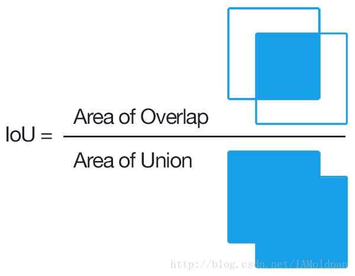

-----

| Title     | ML Metrics Detection IoU                              |
| --------- | ----------------------------------------------------- |
| Created @ | `2023-02-16T15:22:05Z`                                |
| Updated @ | `2026-11-24T02:49:57Z`                                |
| Labels    | \`\`                                                  |
| Edit @    | [here](https://github.com/junxnone/aiwiki/issues/383) |

-----

# Intersection over Union 交并比

  - `GT BBox` 与 `Predict BBox` 的交叠率，即它们交集与并集的比值。
  - 最理想情况是完全重叠，即比值为1.
  - 一般来说，这个 IoU＞ 0.5 就可以被认为一个不错的结果



图中：左右两个矩形分别是 GT 框和预测框，重叠部分是交集 (Area of Overlap)，两个框覆盖的全部区域是并集 (Area of
Union)，IoU 是两块面积的比值。

## 公式

$$ IoU = \\frac{|A \\cap B|}{|A \\cup B|} = \\frac{|A \\cap B|}{|A| +
|B| - |A \\cap B|} $$

其中：

  - $A$：预测框 (Predict BBox)；$B$：真值框 (GT BBox)
  - $|A \\cap B|$：交集面积；$|A \\cup B|$：并集面积；$|A|$、$|B|$：各自的面积
  - 取值 $\[0, 1\]$：0 表示不相交，1 表示完全重合；也称 `Jaccard Index`
  - 对于掩码（分割）同理，面积换成掩码的像素数，见 [Segmentation
    Metrics](/0231_ML_Metrics_Segmentation)

## 计算方法

两个框用 `(x1, y1, x2, y2)` 表示（左上、右下角），交集仍是矩形：

$$ w\_{\\cap} = \\max(0, \\min(x\_2^A, x\_2^B) - \\max(x\_1^A, x\_1^B)),
\\quad h\_{\\cap} = \\max(0, \\min(y\_2^A, y\_2^B) - \\max(y\_1^A,
y\_1^B)) $$

其中：

  - $x\_1, y\_1, x\_2, y\_2$：框的左上角和右下角坐标，上标 $A$、$B$ 表示属于哪个框
  - $w\_\\cap$、$h\_\\cap$：交集矩形的宽和高；两个框不相交时某个方向的差值为负，用 $\\max(0, \\cdot)$
    截断为 0
  - 交集面积 $|A \\cap B| = w\_\\cap \\times h\_\\cap$

<!-- end list -->

``` python
def iou(a, b):
    # a, b: (x1, y1, x2, y2)
    iw = max(0.0, min(a[2], b[2]) - max(a[0], b[0]))
    ih = max(0.0, min(a[3], b[3]) - max(a[1], b[1]))
    inter = iw * ih
    union = (a[2]-a[0])*(a[3]-a[1]) + (b[2]-b[0])*(b[3]-b[1]) - inter
    return inter / union if union > 0 else 0.0
```

> 注意坐标约定：像素坐标下若按「包含端点」计算，宽高要 +1；不同框架（xyxy/xywh/cxcywh、归一化/像素）要先统一格式再计算

## 使用场景

  - **评价指标**：IoU ≥ 阈值（如 0.5）才算检测正确，见 [Detection
    Metrics](/0230_ML_Metrics_Detection)；阈值越高对定位要求越严，见
    [COCO](/0384_ML_Metrics_Detection_COCO)
  - **NMS**：IoU 大于阈值的重复框被抑制
  - **Anchor 匹配**：训练时用 IoU 决定 anchor 是正样本还是负样本
  - **损失函数**：直接用 $1 - IoU$ 作回归损失

## 局限

  - 两个框不相交时 IoU 恒为 0，既无法反映「相距多远」，作为损失时也没有梯度，改进见
    [GIoU](/0232_ML_Metrics_Detection_GIoU)（以及 DIoU/CIoU）
  - 对小目标敏感：目标只有几个像素时，偏移 1 个像素 IoU 就会大幅下降
  - 只考虑重叠面积，不反映偏移的方向和长宽比；中心点误差见 [Center
    Distance](/0525_ML_Metrics_Detection_CD)
