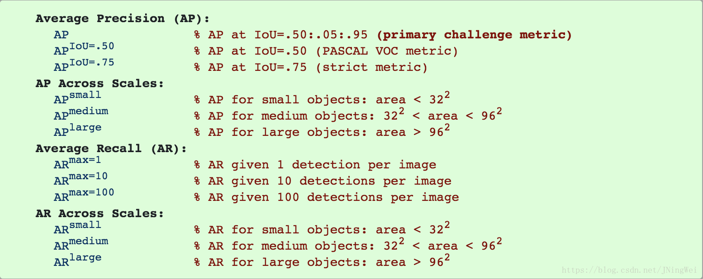

-----

| Title     | ML Metrics Detection COCO                             |
| --------- | ----------------------------------------------------- |
| Created @ | `2023-02-16T15:23:32Z`                                |
| Updated @ | `2026-11-24T02:50:00Z`                                |
| Labels    | \`\`                                                  |
| Edit @    | [here](https://github.com/junxnone/aiwiki/issues/384) |

-----

# COCO Detection Metrics COCO 检测评估指标

  - COCO IoU 按照 `AP@[.5:.95]` 来计算, 更严格
      - 早期的 Pascal VOC 按照 `AP@.50IOU` 来计算
  - COCO 中按 Area 面积定义 Small/Medium/Large Object, 可以统计不同大小 Object 的
    Metrics
      - **Small** --\> (\< `32 * 32` \< ) --\> **Medium** --\> (\< `96
        * 96` \<) --\> **Large**
  - COCO 中 AP 指 mAP



上图是 COCO 检测评估指标示意，COCO 共输出 12 个指标，按下面的表格解释。

## 12 个指标

| Type             | Metric                                      | 含义                                                 |
| ---------------- | ------------------------------------------- | -------------------------------------------------- |
| AP               | $AP$                                        | `AP@[.5:.05:.95]`，COCO **主指标**，10 个 IoU 阈值下 AP 的平均 |
| AP               | $AP^{IoU=.50}$                              | IoU=0.5 时的 AP，即 PASCAL VOC 的指标                     |
| AP               | $AP^{IoU=.75}$                              | IoU=0.75 时的 AP，严格指标                                |
| AP Across Scales | $AP^{small}$                                | 面积 $\< 32^2$ 的目标                                   |
| AP Across Scales | $AP^{medium}$                               | 面积在 $32^2 \\sim 96^2$ 之间的目标                        |
| AP Across Scales | $AP^{large}$                                | 面积 $\> 96^2$ 的目标                                   |
| AR               | $AR^{max=1}$                                | 每张图最多 1 个检测框时的 Recall                              |
| AR               | $AR^{max=10}$                               | 每张图最多 10 个检测框时的 Recall                             |
| AR               | $AR^{max=100}$                              | 每张图最多 100 个检测框时的 Recall                            |
| AR Across Scales | $AR^{small}$ / $AR^{medium}$ / $AR^{large}$ | `max=100` 时按目标尺寸分别统计的 Recall                       |

表中前三行是不同 IoU 阈值下的 AP，中间三行是不同目标尺寸下的 AP，后面是 Recall 类指标。其中：

  - 目标尺寸按**目标的像素面积**（分割掩码面积）划分，而不是按框的宽高，$32^2 = 1024$，$96^2 = 9216$
  - 所有 AP 都先对 80 个类别分别计算再平均，并使用 101 点插值，详见 [AP & mAP &
    AR](/0382_ML_Metrics_Detection_APmAPAR)
  - 评估时每张图最多保留 100 个检测框 (`maxDets=100`)，所以提交结果时需要按 score
    过滤，同时保证低分框也要输出，这样 AP 才不会被低估
  - 看指标的一般顺序：先看 $AP$，再看 $AP^{IoU=.75}$ 与 $AP^{IoU=.50}$ 的差距（定位是否准确），最后看
    $AP^{small}$（小目标是否是短板）

## VOC vs COCO

| Name      | PASCAL VOC | MS COCO                |
| --------- | ---------- | ---------------------- |
| IoU       | 0.5        | 0.5:0.05:0.95          |
| AP 插值     | 11 点 / 全点  | 101 点                  |
| 类别数       | 20         | 80                     |
| 目标尺寸区分    | 无          | Small / Medium / Large |
| Recall 指标 | 无          | AR@1 / 10 / 100        |

## Code

``` python
from pycocotools.coco import COCO
from pycocotools.cocoeval import COCOeval

coco_gt = COCO('instances_val2017.json')
coco_dt = coco_gt.loadRes('detections.json')   # [{image_id, category_id, bbox[x,y,w,h], score}, ...]
ev = COCOeval(coco_gt, coco_dt, iouType='bbox')   # 分割用 'segm'
ev.evaluate(); ev.accumulate(); ev.summarize()    # 打印上面 12 个指标
```

注意 COCO 的 `bbox` 格式是 `[x, y, width, height]`（左上角 + 宽高），与 `xyxy` 不同。

## Reference

  - [COCO Detection Evaluation](https://cocodataset.org/#detection-eval)
  - [pycocotools](https://github.com/cocodataset/cocoapi)
