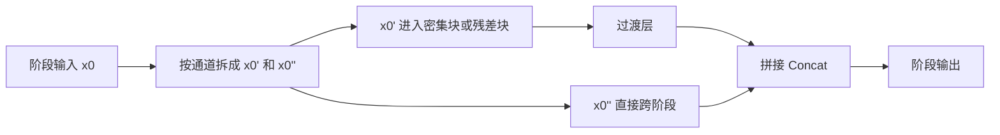
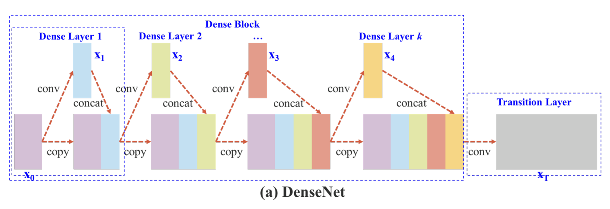
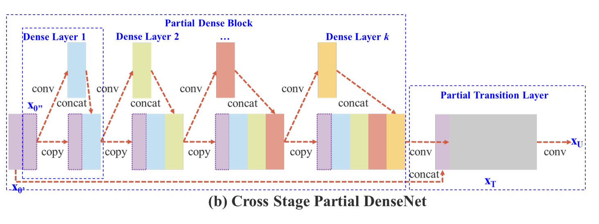
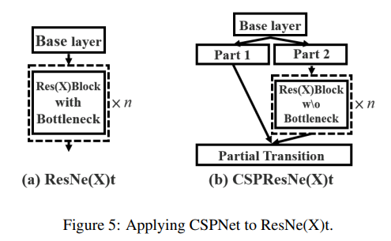
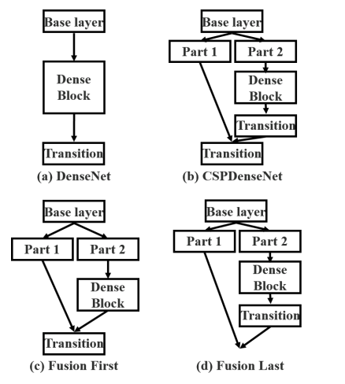
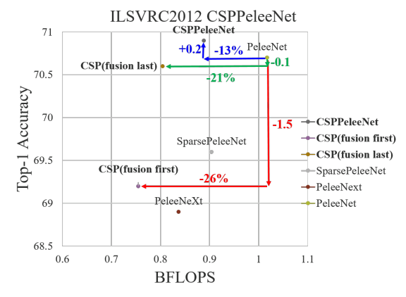

-----

| Title     | paper CSPNet                                          |
| --------- | ----------------------------------------------------- |
| Created @ | `2023-02-21T23:02:39Z`                                |
| Updated @ | `2026-11-26T08:44:03Z`                                |
| Labels    | \`\`                                                  |
| Edit @    | [here](https://github.com/junxnone/aiwiki/issues/385) |

-----

# CSPNet

CSPNet（Cross Stage Partial
Network，跨阶段局部网络）把每个阶段的特征图分成两部分：一部分走原来的密集计算块，另一部分直接跨过计算块，最后在阶段末拼接。

  - 增加了 CNN 学习能力
  - 消除了部分计算瓶颈
  - 减少了内存消耗

## Cross Stage Partial Network

### 核心思路

图中：

  - 输入特征按通道拆成两份：$x\_0'$ 进入原来的计算块，$x\_0''$ 直接连到阶段末尾
  - 两路在阶段末拼接，再经过过渡层输出
  - 关键结论：梯度流被分成两条不同的路径，避免重复的梯度信息；计算只在一半通道上做，减少计算量

以 DenseNet 为例，原始密集块与 CSP 版本的关系：

$$ \\begin{aligned} &\\text{DenseNet:}\\quad
x\_k=w\_k\*\[x\_0,x\_1,\\dots,x\_{k-1}\]  
&\\text{CSPDenseNet:}\\quad
x\_k=w\_k\*\[x\_0'',x\_1,\\dots,x\_{k-1}\],\\quad
x\_T=w\_T\*\[x\_0'',x\_k\],\\quad x\_U=w\_U\*\[x\_0',x\_T\]
\\end{aligned} $$

其中：

  - $x\_k$：第 $k$ 层输出；$w\_k$：第 $k$
    层的卷积权重；$\*$：卷积；$\[\\cdot,\\cdot\]$：通道拼接
  - $x\_0',x\_0''$：阶段输入 $x\_0$ 按通道拆成的两部分
  - $x\_T$：过渡层（transition）输出，$w\_T$ 为其权重；$x\_U$：阶段最终输出，$w\_U$ 为最后一个过渡层权重
  - 含义：密集块里只有 $x\_0''$ 参与，$x\_0'$ 绕过密集块，在最后才与过渡后的特征拼接

### DenseNet vs CSPDenseNet

图中：以上两图为原文档附带的 DenseNet 与 CSPDenseNet 结构对比图。

### ResNet vs CSPResNet

图中：该图为原文档附带的 ResNet 与 CSPResNet 结构对比图。

### 对比设计

图中：该图为原文档附带的不同设计方案对比图（如不同的拼接与过渡层位置）。

#### 对比结果

图中：该图为原文档附带的对比设计的实验结果。

## 优点

| 优点     | 原因                    |
| ------ | --------------------- |
| 增强学习能力 | 梯度流被截断为两条路径，减少重复的梯度信息 |
| 降低计算瓶颈 | 只有一半通道进入计算块，计算更均衡     |
| 降低内存消耗 | 减少特征图通道和跨层拼接的数据量      |

表中：对比结论：CSP 是通用结构，可用于 ResNet、DenseNet、ResNeXt 等，后来被 YOLOv4、YOLOv5
等检测器广泛采用。

## Reference

  - 2019 **CSPNet** CSPNet: A New Backbone that can Enhance Learning
    Capability of CNN \[[paper](https://arxiv.org/pdf/1911.11929.pdf)\]
