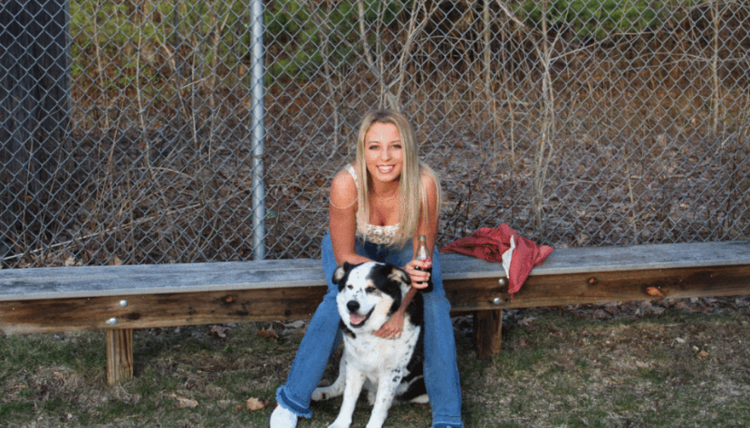
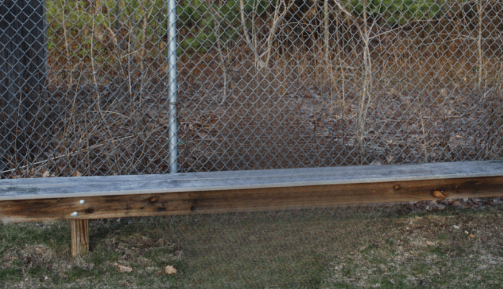

-----

| Title     | LM VLM LaMa                                           |
| --------- | ----------------------------------------------------- |
| Created @ | `2023-05-31T02:40:17Z`                                |
| Updated @ | `2026-11-26T08:28:43Z`                                |
| Labels    | \`\`                                                  |
| Edit @    | [here](https://github.com/junxnone/aiwiki/issues/404) |

-----

# LaMa - Image Inpainting

LaMa（Large Mask
Inpainting）用快速傅里叶卷积（FFC）获得整幅图像的感受野，能对大面积缺失区域做出结构合理的修复，并且对训练时没见过的更高分辨率有较好的泛化。

| Before                                                       | After                                                        |
| ------------------------------------------------------------ | ------------------------------------------------------------ |
|  |  |

表中：左为带遮罩的原图（Before），右为修复结果（After）；对比结论：大块缺失区域被补成与周围纹理、结构连贯的内容。

## 问题定义

给定图像 $x$ 和二值掩码 $m$（1 表示需要修复的区域），目标是生成补全后的图像：

$$ \\hat{x} = G\\big(,x\\odot(1-m)\\ \\Vert\\ m,\\big) $$

其中：

  - $x\\odot(1-m)$：把缺失区域置 0 的已知图像；$\\odot$ 为逐元素相乘
  - $\\Vert$：沿通道维拼接，所以网络输入是 4 通道（RGB 加掩码）
  - $G$：生成器（修复网络）；$\\hat{x}$：输出的修复结果

## 三个关键设计

### 1\. 快速傅里叶卷积 FFC

普通卷积的感受野有限，大掩码内部的像素看不到掩码外的有效信息。FFC 把特征分成「局部分支」和「全局分支」，全局分支在频域做运算：

$$ Y\_g =
\\mathcal{F}^{-1}\\Big(\\sigma\\big(W\\cdot\\mathcal{F}(X\_g)\\big)\\Big)
$$

其中：

  - $X\_g$：全局分支的输入特征；$Y\_g$：输出特征
  - $\\mathcal{F}$、$\\mathcal{F}^{-1}$：快速傅里叶变换及其逆变换，一次变换让每个位置同时依赖整幅图
  - $W$：在频域上的 $1\\times1$ 卷积权重（对实部、虚部通道做）；$\\sigma$：非线性激活
  - 直觉：频域中的逐点操作，等价于空间域里覆盖全图的卷积，因此一开始就有图像级感受野

### 2\. 高感受野感知损失 HRF-PL

用预训练的高感受野网络（如经过分割任务训练的 ResNet 变体）来计算感知损失：

$$
\\mathcal{L}*{HRF}=\\mathcal{M}\\big(\[\\phi*{HRF}(x)-\\phi\_{HRF}(\\hat{x})\]^2\\big)
$$

其中：

  - $\\phi\_{HRF}$：高感受野的预训练特征提取网络
  - $\\mathcal{M}$：对各层特征差异求平均（两阶段均值）
  - 作用：让修复结果在全局结构上与真实图像一致，而不仅是局部纹理相似

### 3\. 大掩码训练策略

训练时随机生成面积大、形状宽的掩码（如宽笔画、大矩形），让模型在训练中就习惯面对大范围缺失，而不是只会补小划痕。

## 总损失

$$
\\mathcal{L}=\\kappa,\\mathcal{L}*{Adv}+\\alpha,\\mathcal{L}*{HRF}+\\beta,\\mathcal{L}\_{DiscPL}+\\gamma,R\_1
$$

其中：

  - $\\mathcal{L}*{Adv}$：对抗损失（判别器区分真假）；$\\mathcal{L}*{DiscPL}$：判别器特征匹配损失
  - $R\_1$：判别器梯度惩罚，稳定对抗训练
  - $\\kappa,\\alpha,\\beta,\\gamma$：各项损失的权重

## 用途与局限

  - 用途：去除物体和水印、修补破损照片、配合分割工具（如
    [SAM](https://github.com/junxnone/aiwiki/issues/414)）做「圈选后擦除」
  - 局限：对极复杂的语义内容生成能力有限（不如扩散模型想象力强），但速度快、可在高分辨率图上运行

## Reference

  - 2021 **LaMa** Resolution-robust Large Mask Inpainting with Fourier
    Convolutions \[[paper](https://arxiv.org/abs/2109.07161)\]
    \[[project](https://advimman.github.io/lama-project/)\]
    \[[code](https://github.com/advimman/lama)\]
