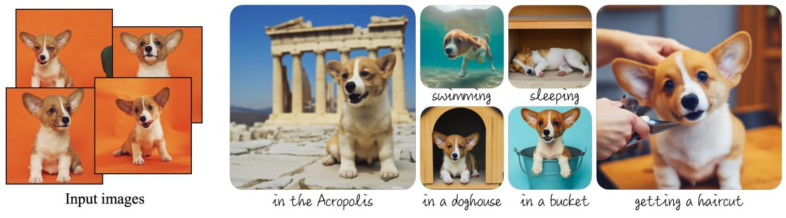
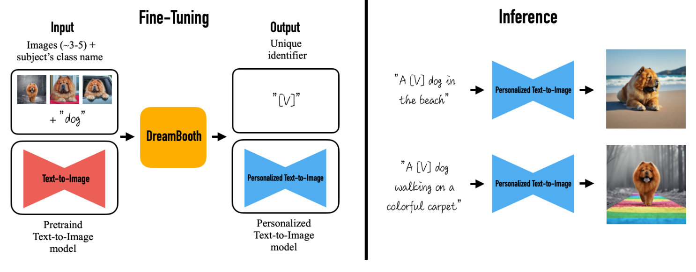
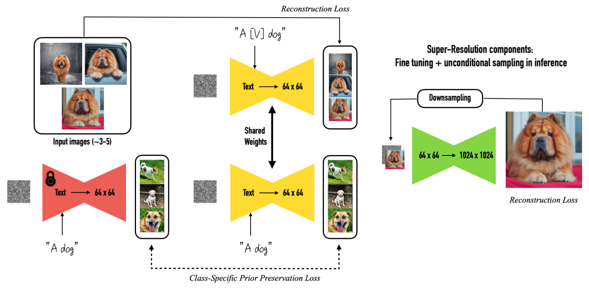

-----

| Title     | LM FT DreamBooth                                      |
| --------- | ----------------------------------------------------- |
| Created @ | `2023-06-02T06:52:09Z`                                |
| Updated @ | `2026-10-20T07:14:57Z`                                |
| Labels    | \`\`                                                  |
| Edit @    | [here](https://github.com/junxnone/aiwiki/issues/405) |

-----

# DreamBooth

  - Fine Tuning Text-to-Image Diffusion Models
  - Text2Image 个性化方法: 通过 `Prompts` 使 `Object` 出现在新的场景中
      - DreamBooth 使用 3\~5 张照片让 AI Model 记住 某个特定物体的外观，可以生成该物体在特定场景的图片
      - 物体越常见越好，罕见物体可能需要更多图片
  - 应用场景
      - 换背景
      - 艺术风格转换
      - 视角与属性修改
      - 个性化虚拟形象/IP 角色生成



## Arch

  - 使用罕见 token 作为唯一标识符，避免 token 被模型原有语义干扰
  - 类先验保留损失（PPL，Prior Preservation Loss）
      - 避免语言漂移(让模型误以为 “狗” 这个词只能指代特定个体，导致生成其他狗的能力丧失。)
      - 避免过拟合(模型只记住输入图片的背景或姿态（如狗总是站在草地），生成新场景时缺乏多样性。)
      - 具体做法：除了用 3\~5 张目标主体照片算标准扩散重建损失 `L_instance`，额外用**底座模型自己生成**的约
        100 张同类别图片（如 prompt 为"a photo of a dog"）再算一份重建损失
        `L_prior`，两者加权相加：
            L = L_instance + λ · L_prior
        `λ` 通常取 1。`L_prior`
        是用模型自己生成的样本当作监督信号，让模型在学习新主体的同时，不忘记这个类别原本的多样性——相当于一边学新知识、一边用模型自己的旧知识给自己"复习"，防止遗忘。





## 和其他个性化方法的关系

  - **Textual Inversion**（Gal et al. 2022）是比 DreamBooth
    更早的个性化方法：不改模型任何权重，只学习一个新的词嵌入（文本反转出的"虚拟词"）来代表目标主体，训练和存储成本比
    DreamBooth 低得多，但一般认为对主体细节的还原度不如 DreamBooth（DreamBooth 直接微调了 U-Net
    权重，拟合能力更强）；
  - **DreamBooth-LoRA**：实践中最常见的组合是把 DreamBooth 的训练目标（指定罕见 token +
    类先验保留损失）和 [LoRA](0406_LM_FT_LoRA)
    的参数高效更新方式结合——不全参数微调整个
    U-Net，只给 U-Net 的注意力层加 LoRA，大幅降低显存和存储成本，是目前 Stable Diffusion
    社区训练个性化模型/角色 LoRA 最主流的做法。

## 代码示例（Hugging Face Diffusers，DreamBooth + LoRA）

``` bash
accelerate launch train_dreambooth_lora.py \
  --pretrained_model_name_or_path="runwayml/stable-diffusion-v1-5" \
  --instance_data_dir="./my_subject_images" \
  --instance_prompt="a photo of sks dog" \
  --class_data_dir="./class_images" \
  --class_prompt="a photo of a dog" \
  --with_prior_preservation --prior_loss_weight=1.0 \
  --resolution=512 --train_batch_size=1 \
  --learning_rate=1e-4 --max_train_steps=800
```

## Reference

  - [DreamBooth Doc](https://dreambooth.github.io/)
  - [DreamBooth Dataset - Google](https://github.com/google/dreambooth)
  - paper 2022 [DreamBooth: Fine Tuning Text-to-Image Diffusion Models
    for Subject-Driven Generation](https://arxiv.org/abs/2208.12242)
  - [DreamBooth - Hugging
    Face](https://huggingface.co/docs/diffusers/training/dreambooth)
  - Gal, R. et al. (2022). An Image is Worth One Word: Personalizing
    Text-to-Image Generation using Textual Inversion.
    [arXiv:2208.01618](https://arxiv.org/abs/2208.01618)
  - [Hugging Face DreamBooth + LoRA
    训练脚本](https://github.com/huggingface/diffusers/tree/main/examples/dreambooth)
  - [大模型微调总览](0410_LM_FT)
