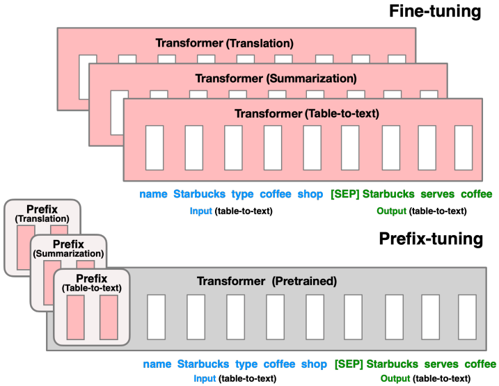
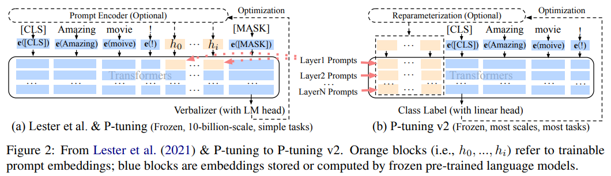

-----

| Title     | LM FT PrefixTuning                                    |
| --------- | ----------------------------------------------------- |
| Created @ | `2023-06-05T03:43:02Z`                                |
| Updated @ | `2026-10-20T07:16:34Z`                                |
| Labels    | \`\`                                                  |
| Edit @    | [here](https://github.com/junxnone/aiwiki/issues/411) |

-----

# Prefix Tuning

  - 固定预训练模型参数，只对小部分可训练参数微调——这一页覆盖的是"在每一层都插入可学习前缀"这一类深度提示方法，和只在输入嵌入层插入软提示的
    Prompt Tuning/P-Tuning（见 [大模型微调总览](0410_LM_FT)）是递进关系。

## Prefix-Tuning

Prefix-Tuning（Li & Liang, 2021）面向文本生成任务：冻结预训练语言模型的全部参数，在 Transformer
**每一层**的 Key、Value 前面都拼接一段可学习的连续向量（前缀），注意力计算时这些前缀向量会和真实的输入 token
一起参与
attention，相当于给模型在每一层都加了一组"可调节的虚拟上下文"。为了训练稳定，前缀向量通常不直接优化，而是用一个小型
MLP 重参数化后再生成，训练完成后这个 MLP 可以丢弃，只保留生成好的前缀向量。



## P-Tuning V2

P-Tuning v2（Liu et al. 2022）要解决的问题是：Prompt
Tuning、P-Tuning（只在输入嵌入层插入软提示）只有在模型规模足够大（10B+）时效果才能接近全参数微调，在中小模型、以及序列标注这类对每个
token 都要精细判断的任务上表现明显不如全参数微调。P-Tuning v2 借鉴了
Prefix-Tuning"每层都插入可学习前缀"的思路，把深度提示做成一套更通用的方案——不针对特定任务设计重参数化网络、不依赖额外的多任务学习，用约
0.1%
的任务特定参数量，就能在各种规模的模型、各种类型的任务（包括序列标注）上做到和全参数微调相当的效果，是目前"只改输入、不改模型内部结构"这条路线里最实用的方法之一。



## 代码示例（Hugging Face PEFT）

``` python
from peft import PrefixTuningConfig, get_peft_model

config = PrefixTuningConfig(
    task_type="CAUSAL_LM",
    num_virtual_tokens=20,   # 每一层插入的前缀长度
)
model = get_peft_model(base_model, config)
model.print_trainable_parameters()
```

## Reference

  - paper 2021 **Prefix-Tuning** [Optimizing Continuous Prompts for
    Generation](https://arxiv.org/abs/2101.00190)
  - paper 2022 **P-Tuning v2** [Prompt Tuning Can Be Comparable to
    Fine-tuning Universally Across Scales and
    Tasks](https://arxiv.org/abs/2110.07602)
  - [大模型微调总览（Prompt Tuning/P-Tuning 等软提示方法对比）](0410_LM_FT)
