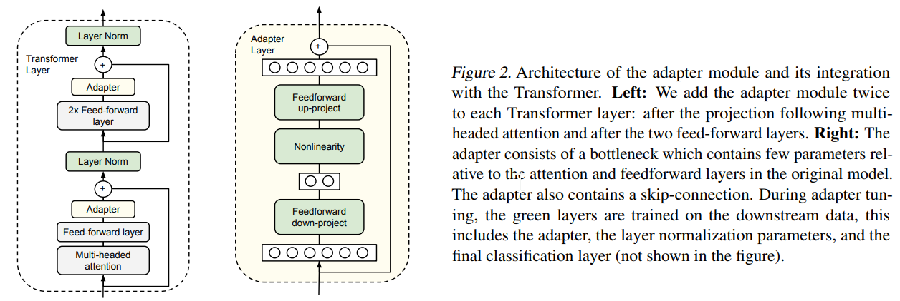

-----

| Title     | LM FT Adapter                                         |
| --------- | ----------------------------------------------------- |
| Created @ | `2023-06-05T03:55:55Z`                                |
| Updated @ | `2026-10-20T08:17:28Z`                                |
| Labels    | \`\`                                                  |
| Edit @    | [here](https://github.com/junxnone/aiwiki/issues/412) |

-----

# Adapter FineTuning

  - 添加 `Adapter Module`
  - 固定 pre-trained 网络参数

## Arch

Houlsby et al. (2019) 提出的经典 Adapter 是一个**瓶颈（bottleneck）结构**的小型
MLP：先用一个线性层把隐藏维度从 `d` 降到一个很小的瓶颈维度 `m`（`m ≪
d`），经过一个非线性激活函数，再用另一个线性层把维度升回
`d`，最后通过残差连接加回原始输入：

    h' = h + f(h W_down) W_up

其中 `W_down ∈ R^(d×m)`、`W_up ∈ R^(m×d)`，`f` 是非线性激活函数。每个 Transformer
层通常插入两个这样的 Adapter（分别接在多头注意力子层和前馈子层之后），训练时只更新这些新插入的 Adapter
参数，冻结原始 Transformer 的全部权重。

和 LoRA 的核心区别：LoRA 把低秩更新**并联**在原始权重旁边（`h = W_0 x + BAx`，推理时可以把 `BA` 合并回
`W_0`，不增加推理延迟），Adapter 是**串联**插入到计算路径里的一个额外模块（`h' = h +
f(hW_down)W_up`），推理时这个模块的计算没法合并消除，会带来额外的推理延迟——这也是后来 LoRA 类方法逐渐比经典
Adapter 更受欢迎的一个重要原因。为了保证训练刚开始时不扰乱预训练模型的行为，`W_up` 通常会被初始化成接近零，让 Adapter
刚开始约等于一个恒等变换，这个思路和 LoRA 把矩阵 B 初始化为零是同样的动机。



## AdapterFusion：把多个任务的 Adapter 组合复用

经典 Adapter 一个任务训一个独立模块，任务之间互不相干——怎么复用已经训好的多个任务 Adapter，详见
[AdapterFusion](0571_LM_FT_AdapterFusion)。

## 代码示例（Hugging Face `adapters` 库）

``` python
from adapters import AdapterConfig, AutoAdapterModel

model = AutoAdapterModel.from_pretrained("bert-base-uncased")
config = AdapterConfig.load("pfeiffer")   # 经典 bottleneck Adapter 配置
model.add_adapter("my_task", config=config)
model.train_adapter("my_task")   # 冻结原模型参数，只训练新加入的 adapter
```

## Reference

  - paper 2019 [Parameter-Efficient Transfer Learning for
    NLP](https://arxiv.org/abs/1902.00751)
    \[[Code](https://github.com/google-research/adapter-bert)\]
  - [大模型微调总览](0410_LM_FT)
