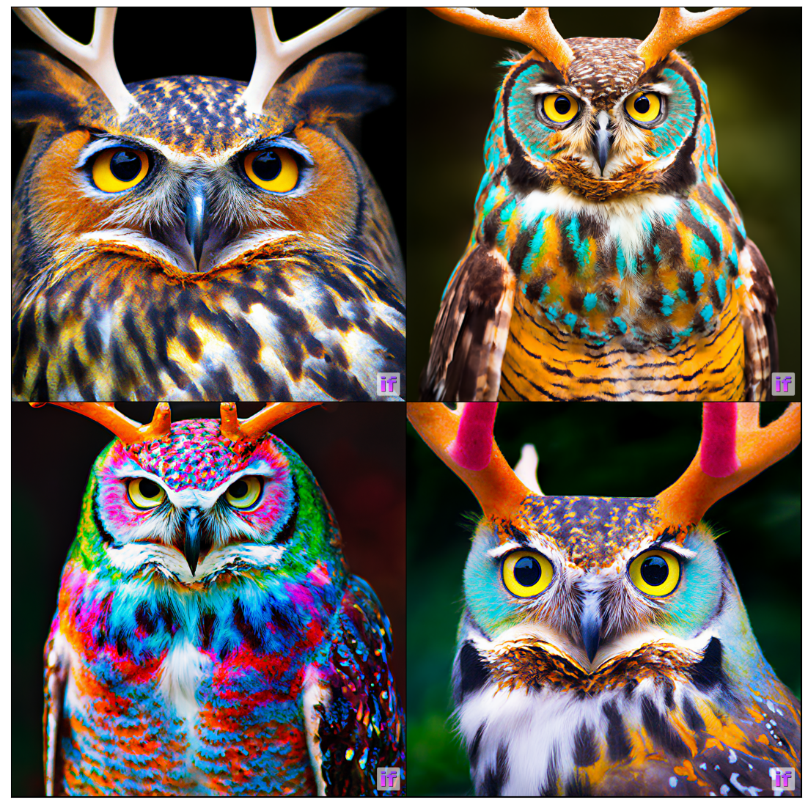
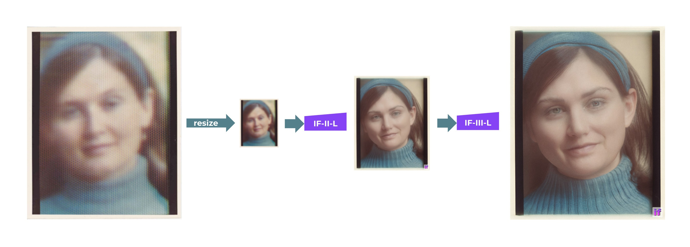
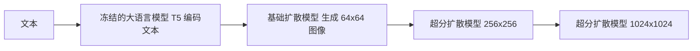
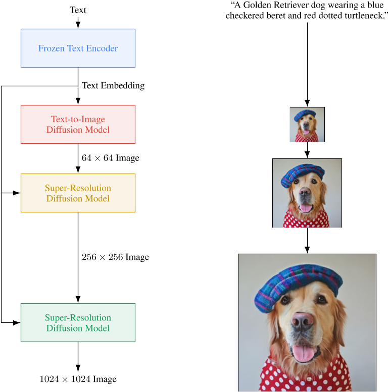

-----

| Title     | LM VLM Imagen                                         |
| --------- | ----------------------------------------------------- |
| Created @ | `2023-06-07T02:03:36Z`                                |
| Updated @ | `2026-11-26T10:21:07Z`                                |
| Labels    | \`\`                                                  |
| Edit @    | [here](https://github.com/junxnone/aiwiki/issues/413) |

-----

# Imagen

  - Text2Image Model
  - Google Brain
  - DrawBench 新的评估基准
  - Diffusion Model - Pixel Space
  - 功能
      - Text2Image
      - Image2Image Translation
      - Super Resolution
      - Inpainting

| Text2Image                                                 | Image2Image Translation                                    | Super Resolution                                           | Inpainting                                                 |
| ---------------------------------------------------------- | ---------------------------------------------------------- | ---------------------------------------------------------- | ---------------------------------------------------------- |
|  |  |  |  |

表中：该表的四张图为原文档附带的示例（来自 DeepFloyd IF 项目），分别展示文生图、图生图、超分辨率和修复功能。

## 原理

图中：

  - 文本由**冻结的大型语言模型**（T5）编码，论文发现增大语言模型比增大图像扩散模型对质量更重要
  - 先生成低分辨率（64×64）图像，再用两个超分扩散模型逐级放大到 256×256、1024×1024
  - 与 [Stable Diffusion](https://github.com/junxnone/aiwiki/issues/402)
    不同，Imagen 的扩散直接在**像素空间**进行，不使用潜空间

采样时使用无分类器引导（classifier-free guidance）增强文本对齐：

$$
\\tilde{\\epsilon}=\\epsilon\_\\theta(x\_t,\\varnothing)+w\\big(\\epsilon\_\\theta(x\_t,c)-\\epsilon\_\\theta(x\_t,\\varnothing)\\big)
$$

其中：

  - $x\_t$：第 $t$ 步的带噪图像；$c$：文本条件；$\\varnothing$：空条件（无文本）
  - $\\epsilon\_\\theta$：网络预测的噪声；$\\tilde{\\epsilon}$：引导后的噪声预测
  - $w$：引导权重，越大图像越贴合文本，但多样性下降、可能过饱和；Imagen 用动态阈值（dynamic
    thresholding）缓解大 $w$ 带来的饱和问题

DrawBench 是 Imagen
提出的评测基准：一组涵盖多种能力（计数、空间关系、文字渲染等）的文本提示，由人工比较不同模型生成图像的质量和文本对齐。

## Arch

图中：该图为原文档附带的 Imagen 结构图，对应上面的「文本编码 → 基础扩散 → 超分」流程。

## Reference

  - [Imagen](https://imagen.research.google/)
  - paper 2022 **Imagen** [Photorealistic Text-to-Image Diffusion Models
    with Deep Language Understanding](https://arxiv.org/abs/2205.11487)
