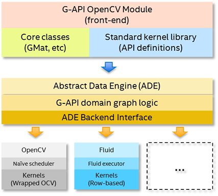

-----

| Title     | OpenCV GAPI                                           |
| --------- | ----------------------------------------------------- |
| Created @ | `2023-08-12T07:46:24Z`                                |
| Updated @ | `2026-10-19T03:22:46Z`                                |
| Labels    | \`\`                                                  |
| Edit @    | [here](https://github.com/junxnone/aiwiki/issues/439) |

-----

# G-API - Graph API

  - 为了构建 `基于图的执行模型`
  - 把`图像处理任务` 构建成 `操作->图`, 然后提交到执行设备(CPU/GPU/...)
  - 分离结构和实现，方便扩展/移植/offloaded 到新平台——和直接调用 `cv::`
    函数的区别在于：普通调用是"写一行执行一行"，立刻在
    CPU 上跑；G-API 是先把整条处理流程描述成一张图（此时不执行任何实际计算），graph compiler
    拿到完整的图之后再统一做编译期优化（算子融合、内存复用规划等），最后才一次性提交到某个
    backend 执行——这种"先描述、后执行"的模式让编译器有机会看到全局信息，而不是像逐行调用那样只能看到当前这一步
  - Backend
      - **G-API CPU**：原来的实现
      - **G-API GPU**：OpenCL 实现（目前使用 T-API`@2023.08`，T-API 本身的 Mat/UMat
        机制见 [TAPI - Transparent API](0436_OpenCV_TAPI)）
      - **G-API Fluid**:
        节省内存的实现——不是把整张图像的中间结果都存下来，而是按"行"为粒度流式处理（类似生产者-消费者），处理完一行输入对应需要的那几行输出后就可以释放，适合内存受限设备上的流水线场景
      - **G-API OpenVINO**: OpenVINO
        Inference——可以把深度学习推理直接作为图里的一个节点，和前后的经典
        CV 操作（预处理/后处理）编译进同一张图里统一调度，而不是"CV 处理完再单独调用一次推理引擎"
      - **G-API ONNX**: ONNX Inference(基于 ONNX Runtime C/C++
        API)，思路同上，换成 ONNX 模型

G-API 这几个 DL 推理 backend（OpenVINO/ONNX）体现了它和普通 OpenCV
函数调用最大的不同：普通用法里"图像预处理"和"模型推理"是两个割裂的步骤（cv::
函数处理完，再喂给推理引擎），G-API 可以把它们表达成同一张图的不同节点，由 graph compiler 统一安排执行顺序和内存。

## Arch

  - **API Layer**：用户书写管线的入口，用 `cv::GMat`/`cv::GScalar`
    等"图节点占位符"类型描述数据流，而不是直接操作真实的
    `cv::Mat`——这一层只是在"画图"，没有任何实际计算发生
  - **Graph Compiler Layer**：拿到 API
    层描述出来的完整图结构后做编译期处理——校验图的合法性、做图级别的优化（如算子融合），再根据声明的
    Backend 把图里每个节点（Kernel）映射到该 Backend 下的具体实现
  - **Backends Layer**：真正执行计算的地方，每个
    Backend（CPU/GPU/Fluid/OpenVINO/ONNX）为图里用到的"操作"（Kernel）提供各自的具体实现——同一个逻辑操作（比如"高斯模糊"）在不同
    Backend 下是完全不同的底层代码，但对上层 API 调用是透明的，这正是"分离结构和实现"的具体体现
    

## 最小示例

``` cpp
#include <opencv2/gapi.hpp>
#include <opencv2/gapi/core.hpp>
#include <opencv2/gapi/imgproc.hpp>

// 1. 用占位符类型描述计算图（此时还没有任何真实数据，也没有执行任何计算）
cv::GMat in;
cv::GMat gray  = cv::gapi::BGR2Gray(in);
cv::GMat blurred = cv::gapi::blur(gray, cv::Size(3, 3));
cv::GMat out = cv::gapi::Canny(blurred, 32, 128);

// 2. 把输入输出占位符打包成一个 GComputation —— 到此为止都只是"图的描述"
cv::GComputation ac(cv::GIn(in), cv::GOut(out));

// 3. 喂真实数据进去才真正触发编译 + 执行（默认走 CPU backend）
cv::Mat input_frame = cv::imread("input.jpg");
cv::Mat output_frame;
ac.apply(input_frame, output_frame);
```

可以看到核心差异：普通 OpenCV 代码里 `cv::cvtColor`/`cv::blur`/`cv::Canny`
是三次独立、立即执行的函数调用；G-API 里先用 `GMat` 描述出"灰度化 → 模糊 →
边缘检测"这条链路、组装成一个 `GComputation`，真正的计算发生在 `.apply()`
被调用、真实数据喂进来的那一刻，中间给了 Graph
Compiler Layer 统一优化的机会。

## Reference

  - [G-API - OpenCV
    wiki](https://github.com/opencv/opencv/wiki/Graph-API)
  - [G-API - Docs](https://docs.opencv.org/4.0.0/d0/d1e/gapi.html)
  - [Porting anisotropic image segmentation on
    G-API](https://docs.opencv.org/4.0.0/d3/d7a/tutorial_gapi_anisotropic_segmentation.html)
  - [Code
    Module](https://github.com/opencv/opencv/tree/master/modules/gapi)
  - [TAPI - Transparent API](0436_OpenCV_TAPI)
