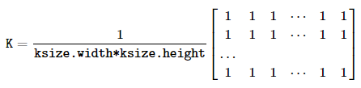

-----

| Title     | OpenCV IP Filter blur                                 |
| --------- | ----------------------------------------------------- |
| Created @ | `2023-09-20T15:22:00Z`                                |
| Updated @ | `2026-11-26T09:13:26Z`                                |
| Labels    | \`\`                                                  |
| Edit @    | [here](https://github.com/junxnone/aiwiki/issues/441) |

-----

# blur 模糊处理

blur 是**均值滤波**（归一化的盒式滤波）：用窗口内所有像素的平均值替换中心像素，是最简单的平滑方式。

``` 
void cv::blur(InputArray    src,
            OutputArray     dst,
            Size    ksize,
            Point   anchor = Point(-1,-1),
            int     borderType = BORDER_DEFAULT 
)   
```

| 参数         | 描述                                 |
| ---------- | ---------------------------------- |
| ksize      | 使用的 kernel size                    |
| anchor     | 处理时点与 kernel 对应的位置，默认对应 kernel 中心点 |
| borderType | 边界填充模式                             |

> 调用 [boxFilter
> 实现](https://github.com/opencv/opencv/blob/157b0e7760117a60de457a4ae874b0709edc4e53/modules/imgproc/src/box_filter.dispatch.cpp#L492-L498)

## 公式

$$
K=\\frac{1}{k\_w,k\_h}\\begin{bmatrix}1&1&\\cdots&1\\vdots&\\vdots&\\ddots&\\vdots\\1&1&\\cdots&1\\end{bmatrix},\\qquad
\\hat{I}(x,y)=\\frac{1}{k\_w k\_h}\\sum\_{i,j}I(x+i,\\ y+j) $$

其中：

  - $k\_w,k\_h$：kernel 的宽和高（即 `ksize`）；$K$：所有元素相等的 kernel，系数和为 1
  - $I$：输入图像；$\\hat{I}$：输出图像；$(i,j)$：窗口内相对于 anchor 的偏移
  - 效果：窗口越大，图像越模糊

| Kernel |  |
| ------ | ------------------------------------------------------------ |

表中：右侧图为原文档附带的 kernel 示意图，对应上面的均值 kernel。

## 特点

  - 速度快：可用积分图 / 滑动窗口把每个像素的计算降到与窗口大小无关
  - 缺点：所有像素权重相同，会同时模糊边缘；对椒盐噪声效果不如中值滤波
  - 对比：权重随距离衰减的
    [GaussianBlur](https://github.com/junxnone/aiwiki/issues/320)，对孤立噪声更好的
    [medianBlur](https://github.com/junxnone/aiwiki/issues/442)

## Reference

  - [boxFilter](https://docs.opencv.org/4.x/d4/d86/group__imgproc__filter.html#gad533230ebf2d42509547d514f7d3fbc3)
