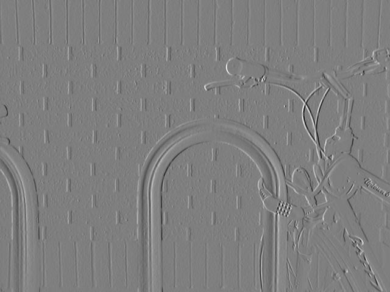
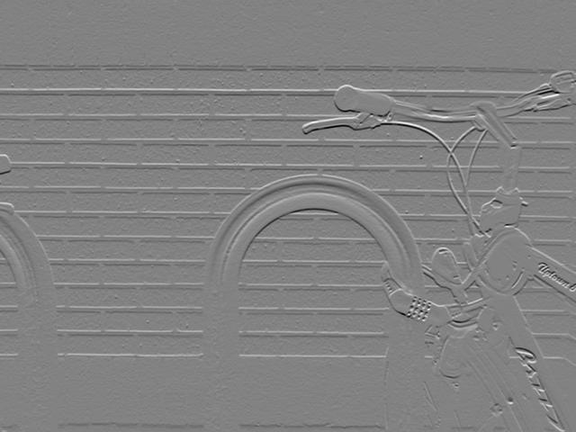

-----

| Title     | OpenCV IP Filter Sobel                                |
| --------- | ----------------------------------------------------- |
| Created @ | `2023-09-20T15:23:49Z`                                |
| Updated @ | `2026-11-26T10:07:15Z`                                |
| Labels    | \`\`                                                  |
| Edit @    | [here](https://github.com/junxnone/aiwiki/issues/443) |

-----

# 用于边缘检测的线性滤波器 Sobel

  - Sobel 算子 在水平和垂直方向上做像素值的差分，得到图像梯度近似值
  - Sobel算子对灰度渐变和噪声较多的图像处理效果较好，但是Sobel算子对边缘定位不是很准确(图像的边缘不止一个像素),因此精度要求不是很高时，Sobel比较常用

## 原理

Sobel 用两个 $3\\times3$ 的卷积核分别近似水平和垂直方向的一阶偏导（梯度），同时带有一定的平滑（中间行/列权重为 2）：

$$ G\_x = K\_x \* I,\\qquad G\_y = K\_y \* I,\\qquad
G=\\sqrt{G\_x^2+G\_y^2}\\approx |G\_x|+|G\_y| $$

其中：

  - $I$：输入图像；$\*$：卷积；$K\_x,K\_y$：下面的 x、y 方向 Sobel 核
  - $G\_x,G\_y$：x、y 方向的梯度（灰度变化率）；$G$：梯度幅值，值越大说明边缘越强
  - 实际使用常用 $|G\_x|+|G\_y|$ 近似幅值（计算更快）；梯度方向为
    $\\theta=\\arctan(G\_y/G\_x)$

<!-- end list -->

``` 
void cv::Sobel(InputArray   src,
            OutputArray     dst,
            int     ddepth,
            int     dx,
            int     dy,
            int     ksize = 3,
            double  scale = 1,
            double  delta = 0,
            int     borderType = BORDER_DEFAULT 
)       
```

| 参数         | 描述                                                                                                                       |
| ---------- | ------------------------------------------------------------------------------------------------------------------------ |
| ddepth     | 输出图像的深度                                                                                                                  |
| dx         | x 方向的差分阶数 `0`/`1`                                                                                                        |
| dy         | y 方向的差分阶数 `0`/`1`                                                                                                        |
| ksize      | 边缘检测时模板大小, 默认为 3                                                                                                         |
| scale      | 对导数计算结果缩放，默认为 1                                                                                                          |
| delta      | 计算结果 默认偏值                                                                                                                |
| borderType | 图像边界填充方法, 见 [BorderTypes](https://docs.opencv.org/4.x/d2/de8/group__core__array.html#ga209f2f4869e304c82d07739337eae7c5) |

表中：`ddepth` 通常要选 `cv2.CV_16S` 或 `cv2.CV_32F`，因为边缘的梯度有负值，8 位无符号输出会被截断为
0；之后再用 `cv2.convertScaleAbs` 取绝对值转回 8 位。

``` python
gx = cv2.Sobel(gray, cv2.CV_16S, 1, 0, ksize=3)     # x 方向
gy = cv2.Sobel(gray, cv2.CV_16S, 0, 1, ksize=3)     # y 方向
edge = cv2.addWeighted(cv2.convertScaleAbs(gx), 0.5, cv2.convertScaleAbs(gy), 0.5, 0)
```

其中：`dx=1,dy=0` 求水平方向的差分（检测竖直边缘）；`dx=0,dy=1`
求垂直方向的差分（检测水平边缘）；`addWeighted`
把两个方向的边缘合并。

| 横向边缘(dx)                                                     | 纵向边缘(dy)                                                     |
| ------------------------------------------------------------ | ------------------------------------------------------------ |
|  |  |

## Sobel 算子

### x 方向

| \-1 | 0 | 1 |
| --- | - | - |
| \-2 | 0 | 2 |
| \-1 | 0 | 1 |

### y 方向

| \-1 | \-2 | \-1 |
| --- | --- | --- |
| 0   | 0   | 0   |
| 1   | 2   | 1   |

## Scharr 算子

  - Scharr 是 Sobel $3\\times3$ 的改进，权重更大（3、10、3），对旋转的各向同性更好，边缘方向的估计更准确

  - 当 `ksize = -1` 时，[使用 scharr
    kernel](https://github.com/opencv/opencv/blob/157b0e7760117a60de457a4ae874b0709edc4e53/modules/imgproc/src/deriv.cpp#L169-L172),
    即 perf test 中的 `scharrViaSobelFilter`

### x 方向

| \-3  | 0 | 3  |
| ---- | - | -- |
| \-10 | 0 | 10 |
| \-3  | 0 | 3  |

### y 方向

| \-3 | \-10 | \-3 |
| --- | ---- | --- |
| 0   | 0    | 0   |
| 3   | 10   | 3   |

## perf test 中的 ROI

  - perf test 中 ROI
    是指[处理图像时只取部分处理](https://github.com/opencv/opencv/blob/157b0e7760117a60de457a4ae874b0709edc4e53/modules/imgproc/perf/perf_sepfilters.cpp#L75)，但是可选不同的边界填充模式,
    `BORDER_ISOLATED` 选项不使用 ROI 外的像素生成边界

> When the source image is a part (ROI) of a bigger image, the function
> will try to use the pixels outside of the ROI to form a border. To
> disable this feature and always do extrapolation, as if src was not a
> ROI, use borderType |
> [BORDER\_ISOLATED](https://docs.opencv.org/4.x/d2/de8/group__core__array.html#gga209f2f4869e304c82d07739337eae7c5a4fcb77ae62e1e1336c1c2b24a441995c).

## Reference

  - [Sobel OpenCV
    Impl](https://github.com/opencv/opencv/blob/157b0e7760117a60de457a4ae874b0709edc4e53/modules/imgproc/src/deriv.cpp#L414)
  - [Depth
    combinations](https://docs.opencv.org/4.x/d4/d86/group__imgproc__filter.html#filter_depths)
  - [Sobel算子](https://www.cnblogs.com/zhaobinyouth/p/12171497.html)
  - [图像梯度的解释及相关梯度算子的实现](https://blog.csdn.net/literacy_wang/article/details/109640726)

## 与其他边缘检测对比

| 方法        | 特点                                                                                   |
| --------- | ------------------------------------------------------------------------------------ |
| Sobel     | 一阶导数，带平滑，抗噪，边缘较粗                                                                     |
| Scharr    | 与 Sobel 相似，精度更高                                                                      |
| Laplacian | 二阶导数，对噪声敏感，边缘定位更细                                                                    |
| Canny     | 多步骤（平滑、梯度、非极大抑制、双阈值），边缘细而连续，见 [Canny](https://github.com/junxnone/aiwiki/issues/101) |

表中：对比结论：快速得到梯度用 Sobel；需要细而连续的边缘用 Canny。
