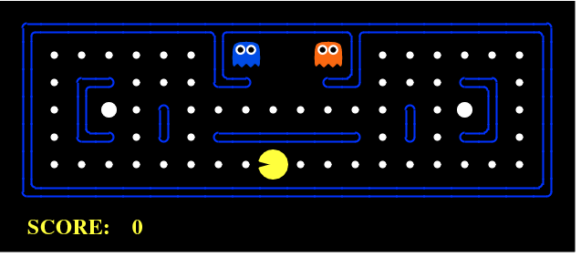
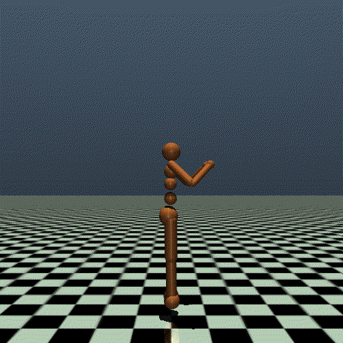
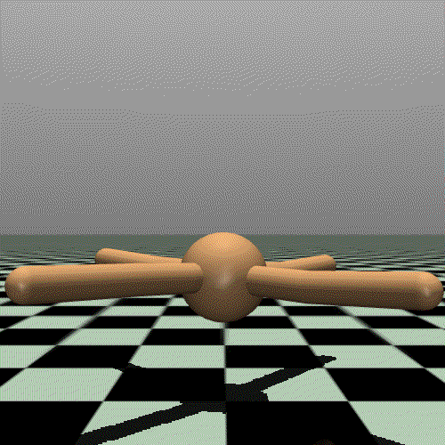

-----

| Title     | RL Taks                                               |
| --------- | ----------------------------------------------------- |
| Created @ | `2023-11-14T07:13:45Z`                                |
| Updated @ | `2026-11-26T08:07:29Z`                                |
| Labels    | \`\`                                                  |
| Edit @    | [here](https://github.com/junxnone/aiwiki/issues/457) |

-----

# RL Tasks

强化学习（RL）的任务由「环境 + 状态 + 动作 + 奖励」定义。本文按任务类型列出常见的 RL 任务及示例。所属背景见 [RL
Robot](https://github.com/junxnone/aiwiki/issues/458)，常用环境库见 [Tools
Gym](https://github.com/junxnone/aiwiki/issues/453) 和 [RL
Tools](https://github.com/junxnone/aiwiki/issues/454)。

## 任务的基本要素

形式化为马尔可夫决策过程（MDP）：

$$ \\mathcal{M}=(\\mathcal{S},\\mathcal{A},P,r,\\gamma) $$

其中：

  - $\\mathcal{S}$：状态空间（观测到的环境状态）
  - $\\mathcal{A}$：动作空间，可以是离散（如上下左右）或连续（如关节力矩）
  - $P(s'\\mid s,a)$：状态转移概率，执行动作 $a$ 后环境从 $s$ 变到 $s'$ 的概率
  - $r(s,a)$：奖励函数，任务目标的数值化表达
  - $\\gamma\\in\[0,1)$：折扣因子，决定未来奖励的权重

不同任务的差别主要在于这五个要素的形式。

## Games

游戏任务动作离散、奖励明确（得分），是 RL 早期的标准基准。

| Games Name  | Images                                                                |
| ----------- | --------------------------------------------------------------------- |
| PacMan      |  |
| Starcraft 2 |     |

表中：

  - **PacMan**：Atari 经典游戏，观测为屏幕像素，动作为 4 个方向，奖励为吃豆得分；适合验证 DQN 类算法
  - **Starcraft 2**：即时战略游戏，观测部分可见，动作空间巨大，需多智能体与长期规划（如 AlphaStar）

## Others（连续控制与机器人）

连续控制任务动作为连续向量，更接近真实机器人。

| Names    | Images                                                                  |
| -------- | ----------------------------------------------------------------------- |
| Humanoid |  |
| Ant      |       |

表中：

  - **Humanoid**：人形机器人，目标是保持平衡并向前行走，动作为多个关节力矩，维度高
  - **Ant**：四足机器人，目标是向前移动，动作为 8 个关节力矩，常用于测试连续控制算法
  - 两者常见于 MuJoCo、Isaac Gym 等仿真器

## 任务分类

| 类型   | 动作    | 典型任务                  | 常用算法             |
| ---- | ----- | --------------------- | ---------------- |
| 离散控制 | 离散    | Atari 游戏、CartPole     | DQN、A2C          |
| 连续控制 | 连续    | Pendulum、Humanoid、Ant | DDPG、TD3、SAC、PPO |
| 多智能体 | 多主体联合 | Starcraft 2、协作搬运      | MADDPG、QMIX      |
| 稀疏奖励 | 视任务   | 机械臂抓取、迷宫              | HER、课程学习         |

表中：

  - **常用算法**：该类任务上常见的 RL 方法；缩写：DQN 深度 Q 网络、SAC 软性 Actor-Critic、PPO
    近端策略优化
  - 对比结论：游戏多用值函数方法，机器人连续控制多用 Actor-Critic（见 [RL
    AC](https://github.com/junxnone/aiwiki/issues/459)、[RL
    A2C](https://github.com/junxnone/aiwiki/issues/460)）和 PPO
