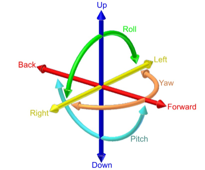

-----

| Title     | RL Robot                                              |
| --------- | ----------------------------------------------------- |
| Created @ | `2023-11-21T07:46:49Z`                                |
| Updated @ | `2026-11-25T16:34:11Z`                                |
| Labels    | \`\`                                                  |
| Edit @    | [here](https://github.com/junxnone/aiwiki/issues/458) |

-----

# Robot

机器人学的基础概念：如何描述一个物体（或机器人连杆）在空间中的**位置**与**姿态**，以及这些描述如何构成运动规划与控制的数学基础。

## 概念总览

下图展示本文各概念之间的依赖关系：先把物体抽象成刚体，再用自由度与位形空间描述它能怎么动，最后用旋转与齐次变换给出具体的数学表示。

图中：

  - 节点：每个方框是一个概念；箭头 $A \\to B$ 表示理解 $B$ 需要先理解 $A$
  - 阅读顺序：自左向右，上文各节与此顺序一致
  - 终点「运动学 / 规划 / 控制」：是上述基础概念的应用方向，本文不展开，见文末延伸主题
  - 关键结论：位形空间的「形状」（拓扑）决定了旋转必须用群（$SO(3)$）而不是普通向量来表示

## 刚体 (Rigid Body)

假设质点系里的所有质点彼此相对静止，即整个系统在运动中没有任何形变，这样的系统称为**理想刚体**。刚体内任意两点间距离恒定：

$$ \\lVert p\_i - p\_j \\rVert = \\text{const}, \\quad \\forall, i, j $$

其中：

  - $p\_i,\\ p\_j$：刚体上任意两个质点的位置向量
  - $\\lVert \\cdot \\rVert$：欧氏距离；该式说明运动过程中任意两点间距不变，这就是「无形变」的数学含义

机器人的连杆通常近似为刚体，从而把问题简化为只研究其位置与姿态。真实连杆的弹性变形、关节柔性属于刚体假设之外的修正项。

## 自由度 (DOF - Degrees of Freedom)

**自由度**：完全描述刚体位置（位姿）所需的独立变量个数。

| 空间 | 自由运动刚体自由度 | 构成                                                |
| -- | --------- | ------------------------------------------------- |
| 三维 | 6         | 平移 3（$x, y, z$）+ 旋转 3（$\\alpha, \\beta, \\gamma$） |
| 二维 | 3         | 平移 2（$x, y$）+ 旋转 1（$\\alpha$）                     |

表中：

  - **空间**：刚体所处的空间维度
  - **自由度**：描述其位姿所需的最少独立参数个数
  - **构成**：平移自由度 + 旋转自由度

另一种理解（逐点约束法）：

  - 三维：用不共线的三个点 $A(x,y,z)$、$B(m,n)$、$C(\\alpha)$ 定位。点 $A$ 占 3 个参数；点 $B$
    与 $A$ 的距离固定，只剩 2 个；点 $C$ 与 $A$、$B$ 的距离都固定，只剩 1 个。合计 $3+2+1=6$
  - 二维：点 $A(x,y)$ 占 2 个，点 $B(\\alpha)$ 因距离约束只剩 1 个，合计 $3$

估算机构自由度的 Grübler 公式（空间形式）：

$$ \\text{DOF} = 6(N-1-J) + \\sum\_{i=1}^{J} f\_i $$

其中：

  - $N$：连杆总数（含固定的地面/基座）
  - $J$：关节总数
  - $f\_i$：第 $i$ 个关节允许的自由度（转动关节、移动关节为 1，球关节为 3）
  - $6$：三维空间中单个自由刚体的自由度；平面机构应把 $6$ 换成 $3$
  - 直觉：每个连杆带来 6 个自由度，每个关节则用 $6-f\_i$ 个约束去扣除

例：6 轴串联机械臂，$N=7$（6 个活动连杆 + 基座），$J=6$，每个 $f\_i=1$，故
$\\text{DOF}=6(7-1-6)+6=6$，恰好能任意控制末端的位置与姿态。

## 位形空间 (C-Space - Configuration Space)

**位形 (configuration)**：完整确定机器人上每一个点位置所需的一组参数；所有可能位形构成的集合称为**位形空间**。

  - 位形空间的维数 = 机器人的自由度数
  - 例：二维平面上的自由刚体，位形 $q=(x, y, \\theta)$，C-Space 是三维的
  - 例：$n$ 关节机械臂，位形 $q=(\\theta\_1,\\dots,\\theta\_n)$，C-Space 是 $n$ 维
  - 在 C-Space 中，机器人被缩成**一个点**，障碍物被膨胀成 C-obstacle，路径规划就变成在该空间里为一个点找无碰撞的曲线

$$ \\mathcal{C}*{free} = \\mathcal{C} \\setminus \\mathcal{C}*{obs} $$

其中：

  - $\\mathcal{C}$：整个位形空间
  - $\\mathcal{C}\_{obs}$：使机器人与障碍物发生碰撞的位形集合（C-obstacle）
  - $\\mathcal{C}\_{free}$：无碰撞的自由位形空间；规划器只在这里面搜索路径

## 拓扑 (Topology)

位形空间并不总是普通的欧氏空间 $\\mathbb{R}^n$，其「形状」（拓扑）决定了如何表示与规划运动：

| 对象             | 位形空间                                 | 说明                                |
| -------------- | ------------------------------------ | --------------------------------- |
| 直线移动关节         | $\\mathbb{R}$                        | 可无限延伸（实际受行程限制）                    |
| 平面转角 $\\theta$ | $S^1$（圆周）                            | $\\theta$ 与 $\\theta+2\\pi$ 是同一姿态 |
| 平面刚体           | $\\mathbb{R}^2 \\times S^1$          | 平移 + 转角                           |
| 三维刚体           | $\\mathbb{R}^3 \\times SO(3)$        | 平移 + 三维旋转群                        |
| $n$ 个转动关节的机械臂  | $T^n = S^1\\times\\cdots\\times S^1$ | $n$ 维环面                           |

表中：

  - $\\mathbb{R}$：实数轴；$S^1$：单位圆；$SO(3)$：三维旋转群（见下节）；$T^n$：$n$ 维环面（torus）
  - 对比结论：含转动的自由度，其空间是「首尾相接」的弯曲空间，不是平直的 $\\mathbb{R}^n$

关键影响：圆周、旋转群无法用一组「无奇异且无重复」的全局坐标覆盖，所以才有欧拉角万向锁、四元数双重覆盖，以及规划时必须处理的「角度回绕」问题。

## 旋转与位姿 (Rotation & Pose)

三维旋转有四种常用表示，它们描述同一个对象——特殊正交群 $SO(3)$，自由度均为 3：

| 表示    | 参数个数     | 优点            | 缺点            |
| ----- | -------- | ------------- | ------------- |
| 旋转矩阵  | 9（6 个约束） | 无奇异，可直接乘向量与复合 | 冗余，需重新正交化     |
| 欧拉角   | 3        | 直观、参数最少       | 万向锁，依赖旋转顺序    |
| 轴角    | 4（3 + 1） | 几何意义清晰        | 复合不便          |
| 单位四元数 | 4（1 个约束） | 无奇异，插值方便      | $q$ 与 $-q$ 等价 |

表中：

  - **参数个数**：括号内为独立约束数，如旋转矩阵 9 个元素受 6 个正交约束，剩 3 个独立自由度
  - 旋转不满足交换律：一般 $R\_A R\_B\\neq R\_B R\_A$

位置与姿态合起来用 $4\\times4$ 齐次变换矩阵表示，属于 $SE(3)$：

$$ T=\\begin{bmatrix}R & p\\ 0 & 1\\end{bmatrix} $$

其中：

  - $R\\in SO(3)$：姿态（旋转部分）
  - $p\\in\\mathbb{R}^3$：位置（平移部分）
  - 最后一行 $\[0\\ 0\\ 0\\ 1\]$：使平移与旋转能用一次矩阵乘法合成

图中：该图为原文档附带的基础知识示意图，用于辅助理解上文刚体、自由度与旋转的概念。

## 延伸主题

  - [RL Robot
    Rotation](https://github.com/junxnone/aiwiki/issues/777)：四种旋转表示、转换公式、万向锁、Slerp
  - [RL Robot
    Transform](https://github.com/junxnone/aiwiki/issues/766)：坐标系、$SE(3)$、李群与李代数
  - [RL Robot
    Kinematics](https://github.com/junxnone/aiwiki/issues/768)：正/逆运动学、DH、雅可比、奇异性
  - [RL Robot
    CSpace](https://github.com/junxnone/aiwiki/issues/794)：C-obstacle、PRM
    / RRT 采样规划、势场法
  - [RL Robot
    Dynamics](https://github.com/junxnone/aiwiki/issues/795)：动力学方程、拉格朗日与牛顿-欧拉法、RNEA
    / ABA
  - [RL Robot
    Control](https://github.com/junxnone/aiwiki/issues/796)：PID、计算力矩、任务空间控制、阻抗控制
  - [RL Robot
    Simulation](https://github.com/junxnone/aiwiki/issues/797)：URDF /
    MJCF、物理引擎、MuJoCo / PyBullet / Isaac Lab
  - [RL Robot
    Sim2Real](https://github.com/junxnone/aiwiki/issues/798)：现实差距、域随机化、系统辨识、师生蒸馏

## Reference

  - [入门机器人需要的基础知识](https://zhuanlan.zhihu.com/p/655770237)
