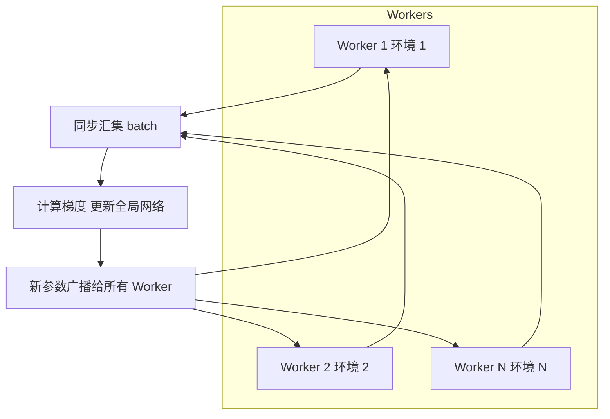
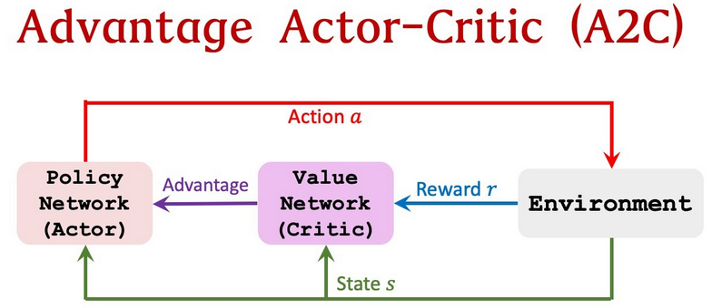

-----

| Title     | RL A2C                                                |
| --------- | ----------------------------------------------------- |
| Created @ | `2023-12-04T06:02:10Z`                                |
| Updated @ | `2026-11-26T08:07:33Z`                                |
| Labels    | \`\`                                                  |
| Edit @    | [here](https://github.com/junxnone/aiwiki/issues/460) |

-----

# Advantage Actor Critic

A2C（Advantage Actor-Critic，优势演员-评论家）是 [Actor
Critic](https://github.com/junxnone/aiwiki/issues/459)
的同步并行版本：用**优势函数**代替回报或 TD 误差作为 Actor
的学习信号，并用多个并行 worker 采样来打破样本相关性。

## 优势函数

动作价值可以分解为状态价值加优势：

$$ Q(s,a)=V(s)+A(s,a)\\quad\\Longleftrightarrow\\quad A(s,a)=Q(s,a)-V(s)
$$

其中：

  - $Q(s,a)$：在状态 $s$ 执行动作 $a$ 后，按当前策略继续所能获得的期望回报
  - $V(s)$：状态价值函数，在状态 $s$ 按当前策略行动的期望回报（对动作取平均）
  - $A(s,a)$：优势值，评估在状态 $s$ 下动作 $a$ 比「平均水平」好多少；$A\>0$ 表示优于平均，$A\<0$
    表示差于平均
  - 直觉：用 $V(s)$ 作基线（baseline），只关心「动作比平均好多少」，可在不引入偏差的前提下降低方差

## 优势的估计

只训练一个 Critic $V\_w$，用 $n$ 步回报估计优势：

$$
\\hat{A}*t=\\sum*{k=0}^{n-1}\\gamma^{k}r\_{t+k}+\\gamma^{n}V\_w(s\_{t+n})-V\_w(s\_t)
$$

其中：

  - $n$：展开步数；$n=1$ 即 TD 误差 $\\delta\_t$，$n\\to\\infty$ 即蒙特卡洛回报减基线
  - $r\_{t+k}$：第 $t+k$ 步的奖励；$\\gamma$：折扣因子
  - $V\_w$：Critic 网络，参数为 $w$
  - $n$ 越大偏差越小但方差越大；还可以用 GAE（广义优势估计）在两者间平滑折中

## 损失函数

$$ L=-,\\mathbb{E}\\left\[\\hat{A}*t\\log\\pi*\\theta(a\_t\\mid
s\_t)\\right\]+c\_v,\\mathbb{E}\\left\[\\left(R\_t-V\_w(s\_t)\\right)^2\\right\]-c\_e,\\mathbb{E}\\left\[H\\big(\\pi\_\\theta(\\cdot\\mid
s\_t)\\big)\\right\] $$

其中：

  - 第一项：策略梯度损失；$\\hat{A}\_t\>0$ 时提升该动作概率，$\\hat{A}\_t\<0$ 时降低
  - 第二项：Critic 的价值回归损失；$R\_t$ 为 $n$ 步回报目标，$c\_v$ 为权重
  - 第三项：熵正则；$H(\\pi)$ 为策略的熵，$c\_e$ 为权重，鼓励探索，防止策略过早收敛
  - 实际实现中 Actor 与 Critic 常共享网络主干，只在最后一层分开

## 并行架构

图中：

  - 每个 Worker 独立地与自己的环境交互，得到互不相关的采样经验
  - 所有 Worker 采满 $n$ 步后**同步**汇总成一个 batch，一次性更新全局网络
  - 更新后把新参数分发给各 Worker，进入下一轮
  - 关键结论：并行采样让一个 batch 内的样本相互独立，起到与 Experience
    Replay（经验回放）相当的去相关作用，且保持在策略（on-policy）

图中：该图为原文档附带的 A2C 架构示意图，对应上文的并行采样与更新流程。

## A2C 与 A3C

| 对比项     | A3C                  | A2C                  |
| ------- | -------------------- | -------------------- |
| 更新方式    | 异步，各 Worker 各自更新全局网络 | 同步，等所有 Worker 采完统一更新 |
| 全局参数新鲜度 | 可能过时（stale gradient） | 一致                   |
| GPU 利用  | 差（偏 CPU 多线程）         | 好（可批量前向）             |
| 效果      | 相近                   | 相近或更好，实现更简单          |

表中：

  - A3C：Asynchronous Advantage Actor-Critic
  - 对比结论：实践中 A2C 通常更常用；A2C 的思路也是 PPO 的基础
