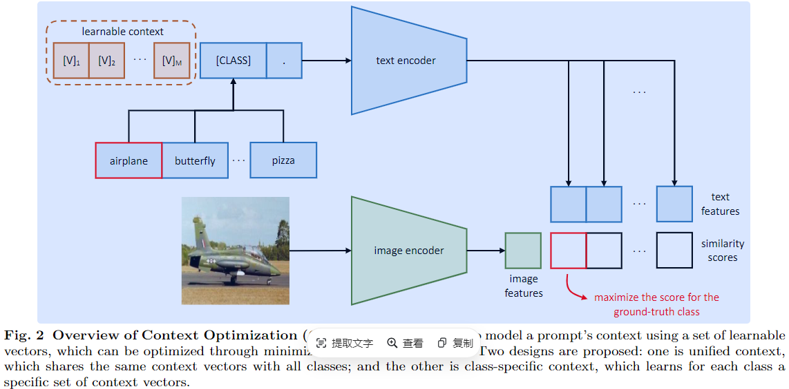
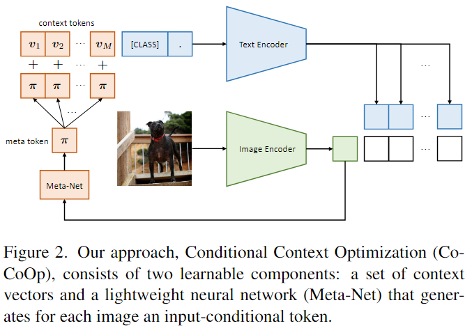
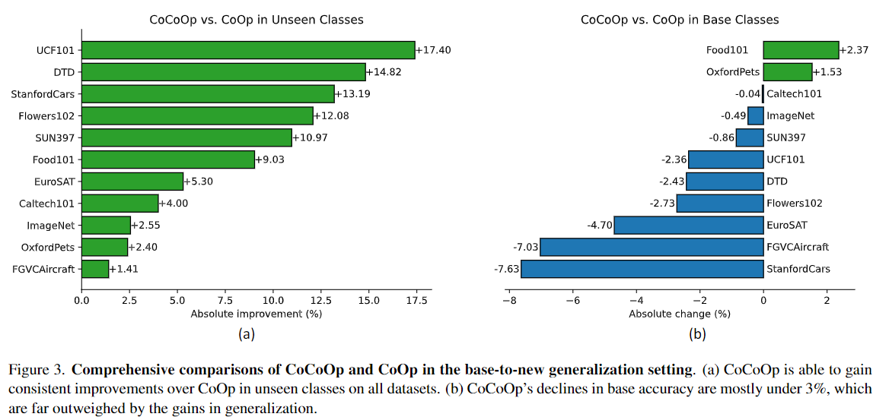

-----

| Title     | paper CoOP                                            |
| --------- | ----------------------------------------------------- |
| Created @ | `2024-10-08T03:31:04Z`                                |
| Updated @ | `2026-11-26T08:43:59Z`                                |
| Labels    | \`\`                                                  |
| Edit @    | [here](https://github.com/junxnone/aiwiki/issues/474) |

-----

# CoOP

  - Context Optimization(CoOP) - 通过自动优化提示词，提高 VLM 模型下游任务的性能，减少人工提示工程的工作量
  - **PET** `Prompt` --\> `Best pizza ever! It was ___`
  - **AutoPrompt** --\> `  [T] [T] [T] [T] [T] [P] `
  - **CLIP** --\> `A photo of a {CLASS}` :: `[Image]`
  - **CoOP** --\> `[V] [V] [V] [V] [V] [CLASS]` :: `[Image]`
  - AnomlyCLIP/FILo 等异常检测使用了 CoOP 方法

图中：该图为原文档附带的 CoOP 示意图，对应上面「CLIP 手工提示词 vs CoOP 可学习提示词」的对比。

## 方法

CLIP 用手工写的模板（如 "a photo of a {CLASS}"）做分类，不同措辞对结果影响很大。CoOP
把模板里的上下文词换成**可学习的向量**，其余部分（CLIP 的两个编码器）全部冻结：

$$ t\_i=\[V\]\_1\[V\]\_2\\cdots\[V\]\_M\[\\text{CLASS}*i\],\\qquad
p(y=i\\mid
x)=\\frac{\\exp\\big(\\cos(g(t\_i),f(x))/\\tau\\big)}{\\sum*{j=1}^{K}\\exp\\big(\\cos(g(t\_j),f(x))/\\tau\\big)}
$$

其中：

  - $\[V\]\_m$：第 $m$ 个可学习的上下文向量，维度与词嵌入相同，$M$ 为上下文长度；所有类别共用同一组 $V$
  - $\\text{CLASS}\_i$：第 $i$ 类的类别名词嵌入；$t\_i$：第 $i$ 类的提示词
  - $g(\\cdot)$：CLIP 文本编码器；$f(x)$：CLIP 图像编码器对图像 $x$ 的特征
  - $\\cos$：余弦相似度；$\\tau$：温度系数；$K$：类别数
  - 训练：只优化 $\[V\]\_1\\cdots\[V\]\_M$，损失是交叉熵，所以可训练参数极少

## CoCoOP

  - 解决 CoOp 方法中学习到的上下文无法推广到同一数据集中未见过的类别的问题。
  - 条件提示学习，使提示能够根据每个输入实例进行调整，提高模型的泛化能力
  - 在 CoOp 的基础上，进一步学习一个轻量级神经网络，为每个图像生成一个输入条件令牌（向量），与可学习的上下文向量相结合。

$$ v\_m(x)=v\_m+\\pi,\\qquad \\pi=h\_\\theta\\big(f(x)\\big) $$

其中：

  - $v\_m$：第 $m$ 个上下文向量（与 CoOP 相同的可学习向量）
  - $h\_\\theta$：轻量神经网络（Meta-Net），参数为 $\\theta$；$\\pi$：它为当前图像 $x$
    生成的条件令牌
  - $v\_m(x)$：随输入图像变化的上下文向量，每张图的提示词都不同，因而对未见类别泛化更好

图中：该图为原文档附带的 CoCoOP 示意图，对应上面「图像条件令牌与上下文向量相加」的结构。

## CoCoOP vs CoOP

图中：该图为原文档附带的 CoCoOP 与 CoOP 的对比图。

| 对比项     | CoOP    | CoCoOP           |
| ------- | ------- | ---------------- |
| 提示词     | 对所有图像相同 | 随图像变化            |
| 可训练参数   | 上下文向量   | 上下文向量 + Meta-Net |
| 对未见类别泛化 | 较弱      | 较强               |
| 训练/推理开销 | 小       | 稍大（每张图要生成提示词）    |

表中：对比结论：CoCoOP 以略多的开销换取对新类别更好的泛化；方法汇总见 [CLIP
Finetune](https://github.com/junxnone/aiwiki/issues/487)。

## Reference

  - [Conditional Prompt Learning for Vision-Language
    Models](https://arxiv.org/abs/2203.05557)
  - [Learning to Prompt for Vision-Language
    Models](https://arxiv.org/abs/2109.01134)
