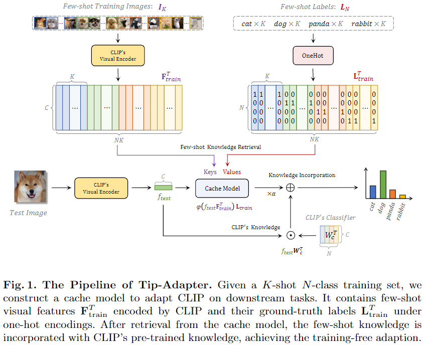
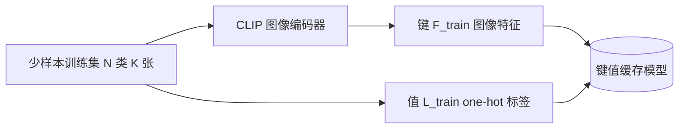

-----

| Title     | paper TipAdapter                                      |
| --------- | ----------------------------------------------------- |
| Created @ | `2024-10-09T01:53:49Z`                                |
| Updated @ | `2026-11-26T08:43:52Z`                                |
| Labels    | \`\`                                                  |
| Edit @    | [here](https://github.com/junxnone/aiwiki/issues/475) |

-----

# Tip-Adapter

  - 利用 CLIP，从少量样本训练集中构建`键值缓存模型`来作为适配器，结合 CLIP 的输出综合生成结果
  - 无需训练 - 非参数方式，训练的话更优
  - **推理:** 测试图像特征与缓存键计算相似度，聚合缓存值形成预测，再与 CLIP 原始预测通过残差连接结合
      - 其中涉及计算查询 - 键亲和力及线性组合缓存值等操作，通过调整残差比率平衡两项预测。
  - **Tip-Adapter-F**: 当few-shot 数量增加时，性能不如CoOP & CLIP-Adapter,所以提出了
    `Tip-Adapter-F`
      - 将缓存模型的键作为可学习参数并微调，冻结缓存值和 CLIP 的两个编码器

图中：该图为原文档附带的 Tip-Adapter 结构示意图，对应上面的缓存模型和推理流程。

## 缓存模型的构建

图中：

  - 用 CLIP 图像编码器提取每张少样本训练图像的特征，作为**键**
  - 对应的 one-hot 标签作为**值**
  - 键值对合起来就是缓存模型，不需要任何训练，只需要一次前向

## 推理公式

$$
\\text{logits}=\\alpha,\\varphi\\big(f\_{test}F\_{train}^{\\top}\\big),L\_{train}+f\_{test}W\_c^{\\top},\\qquad
\\varphi(x)=\\exp\\big(-\\beta(1-x)\\big) $$

其中：

  - $f\_{test}\\in\\mathbb{R}^{1\\times C}$：测试图像的 CLIP 特征，$C$ 为特征维度
  - $F\_{train}\\in\\mathbb{R}^{NK\\times C}$：缓存的键，即 $NK$ 张训练图像的特征（$N$
    类，每类 $K$ 张）
  - $L\_{train}\\in\\mathbb{R}^{NK\\times N}$：缓存的值，即 one-hot 标签
  - $W\_c\\in\\mathbb{R}^{N\\times C}$：CLIP 零样本分类器，由类别文字描述的文本特征组成
  - $f\_{test}F\_{train}^{\\top}$：测试图像与每个缓存样本的相似度（亲和力）
  - $\\varphi(\\cdot)$：把相似度转成非负权重；$\\beta$ 控制锐度，越大越只关注最相似的缓存样本
  - $\\alpha$：残差比率，平衡缓存分支与 CLIP 零样本分支；$\\text{logits}$：最终各类得分

## Tip-Adapter-F

把 $F\_{train}$ 设为可学习参数，用少量数据微调（冻结 $L\_{train}$ 与 CLIP 两个编码器）：

$$ F\_{train}\\leftarrow
F\_{train}-\\eta,\\frac{\\partial\\mathcal{L}*{CE}}{\\partial F*{train}}
$$

其中：

  - $\\eta$：学习率；$\\mathcal{L}\_{CE}$：交叉熵损失
  - 只训练缓存的键，训练参数少、收敛快（论文中只需很少 epoch）

## 对比

| 方法            | 是否训练  | 特点            |
| ------------- | ----- | ------------- |
| CLIP 零样本      | 否     | 基线            |
| Tip-Adapter   | 否     | 构建缓存即可提升小样本性能 |
| Tip-Adapter-F | 微调缓存键 | 样本增多时性能更好     |
| CoOP          | 训练提示词 | 需要较长训练        |

表中：对比结论：Tip-Adapter 用极小代价获得接近需要训练的方法的效果，见 [CLIP
Finetune](https://github.com/junxnone/aiwiki/issues/487)。

## Reference

  - [Tip-Adapter: Training-free Adaption of CLIP for Few-shot
    Classification](https://arxiv.org/pdf/2207.09519)
