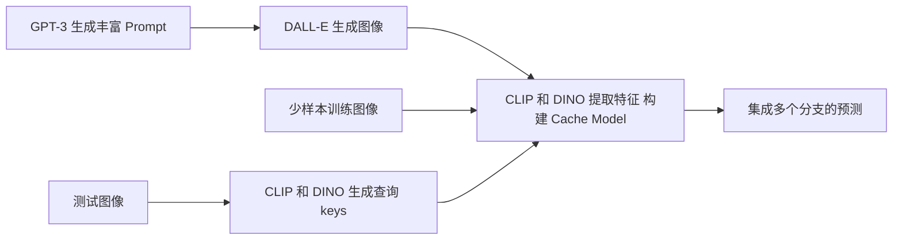
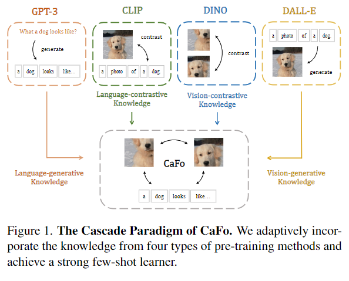
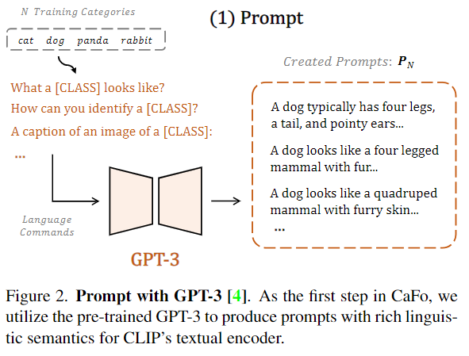
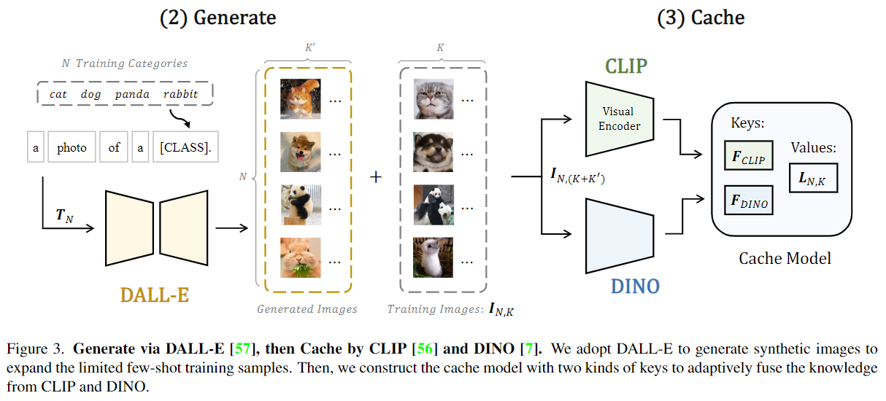
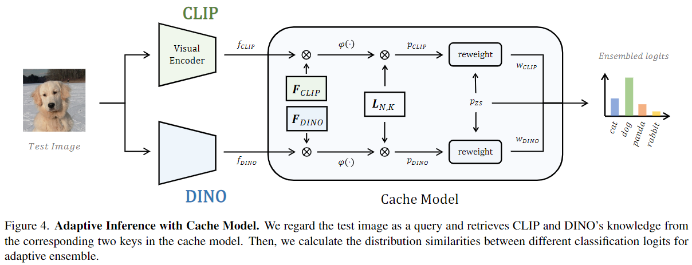

-----

| Title     | paper CaFo                                            |
| --------- | ----------------------------------------------------- |
| Created @ | `2024-10-11T01:52:10Z`                                |
| Updated @ | `2026-11-26T08:43:57Z`                                |
| Labels    | \`\`                                                  |
| Edit @    | [here](https://github.com/junxnone/aiwiki/issues/476) |

-----

# CaFo

  - 分别利用 GPT-3/CLIP/DINO/DALL-E 从 Prompt/Generate/CacheModel 方面提升模型性能

CaFo 的全称是 Cascade of Foundation Models：把不同预训练基础模型各自擅长的知识级联起来，做小样本分类。

## 四个基础模型各自的角色

| 模型     | 预训练方式    | 在 CaFo 中的作用                 |
| ------ | -------- | --------------------------- |
| GPT-3  | 语言模型     | Prompt：生成语义更丰富的类别描述         |
| CLIP   | 图文对比学习   | 视觉-语言特征，零样本分类               |
| DINO   | 自监督视觉预训练 | 视觉特征，补充纯视觉语义                |
| DALL-E | 文生图      | Generate：生成与描述对应的图像，扩充小样本数据 |

表中：

  - **小样本（few-shot）**：每类只有少量标注图像
  - 对比结论：四个模型预训练范式不同，知识互补，所以级联后效果更好

## Arch

  - 1 利用 GPT-3 生成更丰富语义的 Prompt
  - 2 利用 DALL-E 生成 Prompt 相关的 Image
  - 3 将生成的 Image 和 Training Image 使用 CLIP & DINO 生成 Cache Model
  - 4 **Inference** 测试图片通过 CLIP & DINO 生成查询 keys, 从 Cache Model 中获取
    ensemble 结果

<!-- end list -->

图中：

  - 前三步在训练前构建缓存模型：GPT-3 写描述，DALL-E 画图，生成图和真实训练图一起提取特征作为缓存
  - 推理时测试图的特征作为查询，从缓存中检索，并把来自 CLIP 与 DINO 的预测集成
  - 缓存模型的原理类似
    [Tip-Adapter](https://github.com/junxnone/aiwiki/issues/475)

图中：以上各图为原文档附带的 CaFo 结构与实验结果示意图，对应上面的四个步骤和推理集成。

## Reference

  - [Prompt, Generate, then Cache: Cascade of Foundation Models makes
    Strong Few-shot Learners](https://arxiv.org/abs/2303.02151)
  - [Code](https://github.com/OpenGVLab/CaFo)
  - 所属方法汇总见 [CLIP
    Finetune](https://github.com/junxnone/aiwiki/issues/487)
