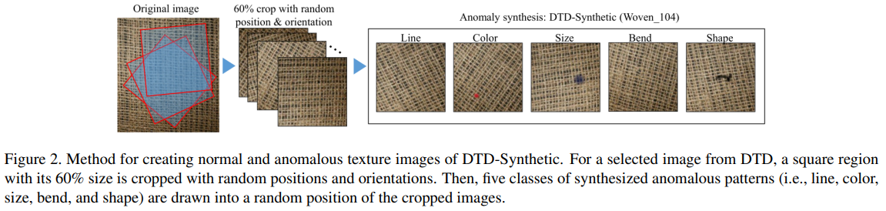

-----

| Title     | Datasets Image2D DTDSynthetic                         |
| --------- | ----------------------------------------------------- |
| Created @ | `2024-10-12T03:26:59Z`                                |
| Updated @ | `2026-11-11T09:37:27Z`                                |
| Labels    | \`\`                                                  |
| Edit @    | [here](https://github.com/junxnone/aiwiki/issues/482) |

-----

# DTD-Synthetic

DTD-Synthetic 是 Aota 等人在 WACV 2023 论文 [Zero-Shot Versus Many-Shot:
Unsupervised Texture Anomaly
Detection](https://openaccess.thecvf.com/content/WACV2023/papers/Aota_Zero-Shot_Versus_Many-Shot_Unsupervised_Texture_Anomaly_Detection_WACV_2023_paper.pdf)
中构造的合成异常数据集：为验证纹理方面的论点，借用 [DTD](0481_Datasets_Image2D_DTD)
中的纹理图像，合成带异常的纹理图。它属于[缺陷/异常检测](0245_Datasets_Image2D_Defect)类数据集，总入口见
[Datasets Image2D](0018_Datasets_Image2D)。

## 规模统计

| 项目    | 内容                                                                                       |
| ----- | ---------------------------------------------------------------------------------------- |
| 底图来源  | DTD，分辨率 300×300 \~ 640×640                                                               |
| 纹理类别  | 从 DTD 选取 12 类，分为 3 个类别，每类别 4 种                                                           |
| 异常类型  | 5 种合成异常：线条（line）、颜色（color）、大小（size）、弯曲（bend / 形变）、形状（shape）                              |
| 异常图像数 | 待核实（以论文与下载包为准）                                                                           |
| 下载    | [Google Drive](https://drive.google.com/drive/folders/10OyPzvI3H6llCZBxKxFlKWt1Pw1tkMK1) |

## 生成方法

  - 从 DTD 中选择 12 类适合目的的图像。
  - 对选中的一张图像，在随机位置和方向裁剪出边长为原图 60% 的正方形区域，再在裁剪图的随机位置绘制 5
    类合成异常图案（线条、颜色、大小、弯曲、形状）。
  - 12 种纹理分为 3 个类别，每类 4 种：
      - 类别 1：具有完全规则重复结构的各向异性纹理，与 MVTec AD 中的 grid 相似，常见于硬质材料制成的人造物体表面。
      - 类别 2：具有一定不规则性的重复结构的各向异性纹理，与 MVTec AD 中的 carpet、wood
        相似，常见于纺织品和自然物体表面。
      - 类别 3：没有明显重复图案的各向同性纹理，与 MVTec AD 中的 tile、leather
        相似，任何位置和方向上局部结构相同。



## 使用方式

数据通常按 MVTec AD 风格组织（正常训练图 + 带异常的测试图 + 掩码），实际目录结构以下载包为准（待核实）。读取后可用
[anomalib](0321_Tools_anomalib) 的 Folder 数据模块加载：

``` python
from anomalib.data import Folder

dm = Folder(
    name="dtd_synth",
    root="DTD-Synthetic/<texture>",   # 路径按实际包结构调整
    normal_dir="train/good",
    abnormal_dir="test/anomaly",
    mask_dir="ground_truth/anomaly",
)
dm.setup()
```

（上述 anomalib 参数名随版本有差异，请按所装版本文档调整。）

评测沿用异常检测惯例：图像级 AUROC 与像素级 AUROC。

## 常见坑

1.  异常是人工绘制的，与真实缺陷分布不同，结论不宜直接外推到产线。
2.  底图裁剪具有随机性，复现时需固定随机种子或直接使用发布的数据，不要重新生成后与论文数字对比。
3.  DTD 本身有使用条款，派生数据同样适用（待核实）。

## 相关

  - [DTD](0481_Datasets_Image2D_DTD)
  - [Defect 缺陷汇总](0245_Datasets_Image2D_Defect)
  - [MVTec](0323_ML_Tasks_Image_Anomaly_MVTec)
  - [Image Anomaly](0277_ML_Tasks_Image_Anomaly)

## Reference

  - [Zero-Shot Versus Many-Shot: Unsupervised Texture Anomaly
    Detection](https://openaccess.thecvf.com/content/WACV2023/papers/Aota_Zero-Shot_Versus_Many-Shot_Unsupervised_Texture_Anomaly_Detection_WACV_2023_paper.pdf)
  - [Download the
    Dataset](https://drive.google.com/drive/folders/10OyPzvI3H6llCZBxKxFlKWt1Pw1tkMK1)
