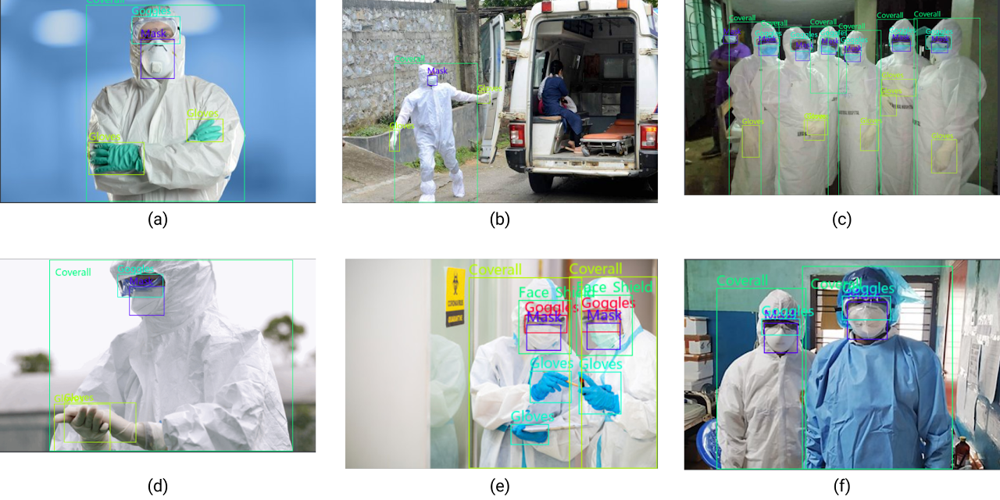

-----

| Title     | Datasets Image2D Detection CPPE5                      |
| --------- | ----------------------------------------------------- |
| Created @ | `2024-11-22T03:19:28Z`                                |
| Updated @ | `2026-11-11T09:37:32Z`                                |
| Labels    | \`\`                                                  |
| Edit @    | [here](https://github.com/junxnone/aiwiki/issues/489) |

-----

# CPPE-5

CPPE-5（Medical Personal Protective
Equipment）是用于医学个人防护装备相关研究的目标检测数据集，目标是研究防护装备的细粒度（下级）分类，这是
PASCAL VOC、ImageNet、COCO、OpenImages
等只关注大类的数据集做不到的。数据集主要包含复杂场景中的非标志性（non-iconic）图像，便于模型用于实际场景。论文见
[arXiv 2112.09569](https://arxiv.org/abs/2112.09569)（2021 年 12 月提交；原文写的
2023.2 应为后续版本时间）。



## 数据集统计信息

  - 4698 个 bounding box
  - 1029 张高质量非标志性图像
  - 平均图像尺寸约 947 像素（原文如此，指边长）
  - 5 个物体类别
  - 平均每图约 4.57 个标注
  - 约 230MB
  - 划分：训练集 1000 张、测试集 29 张（Hugging Face 版）

## 类别

| Label | Description  | cn  |
| ----- | ------------ | --- |
| 1     | Coverall     | 连体服 |
| 2     | Face\_Shield | 面罩  |
| 3     | Gloves       | 手套  |
| 4     | Goggles      | 眼镜  |
| 5     | Mask         | 口罩  |

> 注意：论文表格中类别从 1 起，而 Hugging Face 版 `category` 字段从 0 起（见下）。

## 注释

  - **数据字段含义**
      - `image_id`：图像的唯一标识符。
      - `image`：`PIL.Image.Image` 对象，表示图像数据（自动解码，注意查询方式以提高效率）。
      - `width`：图像宽度。
      - `height`：图像高度。
      - `objects`：一个字典，包含图像中对象的边界框元数据。
          - `id` 是注释的唯一标识符
          - `area` 是边界框的面积
          - `bbox` 是对象的边界框（采用 COCO 格式 `[x, y, w, h]`，见 [BBox
            Format](0488_Datasets_Image2D_Detection_BBox)）
          - `category` 是对象的类别，可能的值包括 `Coverall`（0）/ `Face_Shield`（1）/
            `Gloves`（2）/ `Goggles`（3）/ `Mask`（4）

<!-- end list -->

    {
      'image_id': 15,
      'image': <PIL.JpegImagePlugin.JpegImageFile image mode=RGB size=943x663 at 0x2373B065C18>,
      'width': 943,
      'height': 663,
      'objects': {
        'id': [114, 115, 116, 117], 
        'area': [3796, 1596, 152768, 81002],
        'bbox': [
          [302.0, 109.0, 73.0, 52.0],
          [810.0, 100.0, 57.0, 28.0],
          [160.0, 31.0, 248.0, 616.0],
          [741.0, 68.0, 202.0, 401.0]
        ], 
        'category': [4, 4, 0, 0]
      }
    }

## 加载示例

``` python
from datasets import load_dataset
ds = load_dataset("rishitdagli/cppe-5")   # 数据集 id 以 Hugging Face 为准（待核实）
sample = ds["train"][0]
print(sample["objects"]["bbox"], sample["objects"]["category"])
```

标注为 COCO 格式，也可用原仓库的标注文件配合 `torchvision.datasets.CocoDetection` 读取，转换为
xyxy 见 [BBox Format](0488_Datasets_Image2D_Detection_BBox)。

## 数据集创建过程

  - **收集图像**
      - 从 Flickr
        获取图像，保存为"Original"大小，同时提取图像的相关元数据，如原始图像链接、宽度、高度、标题、上传时间、作者用户名、作者姓名、作者资料、许可证、MD5
        哈希值等。
      - 从 Google Images 获取少量图像，并提取原始图像链接、宽度、高度、MD5 哈希值等元数据。
      - 使用安全过滤器去除不合适内容的图像，使用 GIST 描述符去除近似重复的图像。
  - **标注过程**
      - 数据集标注分两个阶段，第一阶段标注 416 张图像，第二阶段标注 613
        张图像。为志愿者提供了类别描述表格（包括工作服、口罩、面罩、手套、护目镜的定义）以及正确标注、错误标注和不适用标注的示例图像。
      - 每个志愿者在标注任务前需进行练习以确保能正确识别类别和标注。标注过程中，先由两名志愿者独立标注图像，若边界框数量、标签或标注差异较大，则由第三名志愿者整合结果，最后由一名志愿者验证边界框标注。最终得到
        1029 张高质量、主要为非标志性且标注准确的图像。标注人员为多个志愿者，使用开源工具 LabelImg 进行标注。

## 评测与常见坑

  - 评测沿用 COCO 指标（AP、AP50 等，见
    [COCO](0247_Datasets_Image2D_COCO)）；基线结果见论文与
    Papers with Code 榜单（此处不列，待核实）。
  - 测试集仅 29 张，指标方差大，建议配合交叉验证。
  - 图像来自 Flickr，许可证因图而异，商用前需逐项核查。
  - 类别 id 0 起/1 起混用易出错。

## 相关

[Detection 汇总](0237_Datasets_Image2D_Detection)、[BBox
Format](0488_Datasets_Image2D_Detection_BBox)、[总入口](0018_Datasets_Image2D)。

## Reference

  - [CPPE - 5: Medical Personal Protective Equipment
    Dataset](https://sites.google.com/view/cppe5)
  - [Github](https://github.com/Rishit-dagli/CPPE-Dataset)
  - [paper - 2021.12 - CPPE-5: Medical Personal Protective Equipment
    Dataset](https://arxiv.org/abs/2112.09569)
  - [Paperswithcode
    Leaderboard](https://paperswithcode.com/sota/object-detection-on-cppe-5)
