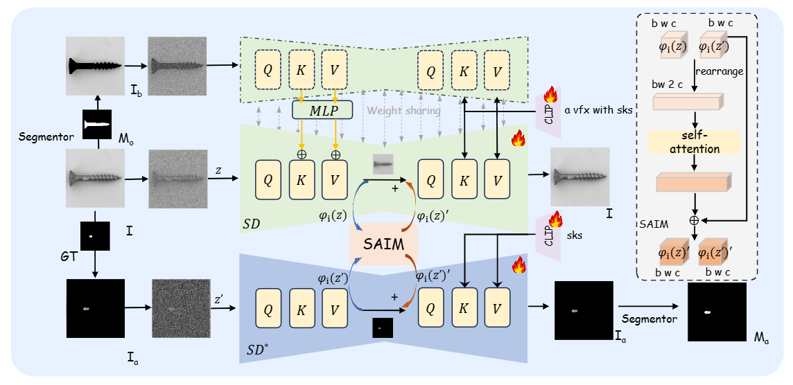
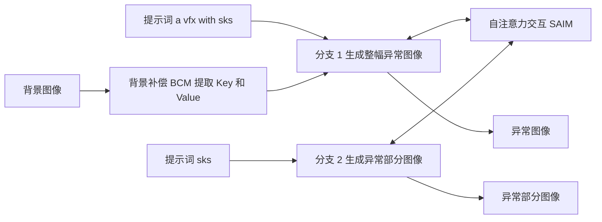

-----

| Title     | paper DualAnoDiff                                     |
| --------- | ----------------------------------------------------- |
| Created @ | `2025-06-10T02:39:25Z`                                |
| Updated @ | `2026-11-26T08:44:05Z`                                |
| Labels    | \`\`                                                  |
| Edit @    | [here](https://github.com/junxnone/aiwiki/issues/522) |

-----

# DualAnoDiff

DualAnoDiff 用扩散模型生成带异常的图像，以及异常区域本身，用于扩充异常检测与分割的训练数据（异常样本通常很少）。

  - 双分支扩散机制
  - 背景补偿模块
  - 嵌套提示词设计

## 为什么需要生成异常数据

工业缺陷检测中，异常样本稀少且标注昂贵。生成逼真、多样的异常图像（以及对应的异常区域）可以训练更好的检测和分割模型。DualAnoDiff
同时生成「整幅异常图像」和「仅含异常部分的图像」，后者可直接得到异常的位置。

## Arch

  - 如图展示了DualAnoDiff的架构:
      - 1）DualAnoDiff的两个分支利用不同但嵌套的提示词，同步生成异常图像及对应的异常部分。
      - 2）在去噪过程中，两个分支借助自注意力交互模块（SAIM），在每个注意力块之后共享注意力信息，以保证生成图像的一致性。
      - 3）背景补偿模块（BCM）提取背景图像的键（Key）和值（Value），并对稳定扩散模型（SD）进行自适应融合，助力模型将更多注意力放在图像的物体上。

<!-- end list -->

图中：

  - 两个分支分别用嵌套的提示词：外层描述整幅异常图像，内层只描述异常部分
  - **SAIM**：在每个注意力块之后，两个分支共享注意力信息，使两张输出在位置和外观上保持一致
  - **BCM**：把背景图像的 Key 和 Value 融合进稳定扩散模型，使模型把更多注意力放在物体而非背景上
  - 关键结论：同一次生成得到「异常图像加对应异常部分」，二者天然对齐，可作为带标注的新样本

### Inference

  - **输入**: 一组 Prompt `a vfx with sks` 和 `sks`
  - **输出**: 一组异常图像及对应的异常部分图像

其中 `sks` 是在训练（类似 DreamBooth，见
[DreamBooth](https://github.com/junxnone/aiwiki/issues/405)）中绑定到异常外观的稀有标识词，`vfx`
为用于指代异常的标识。

## 与其他方法对比

| 方法               | 生成内容          | 特点                                                                           |
| ---------------- | ------------- | ---------------------------------------------------------------------------- |
| AnomalyDiffusion | 在给定掩码位置生成异常   | 需要提供异常掩码，见 [AnomalyDiffusion](https://github.com/junxnone/aiwiki/issues/513) |
| DualAnoDiff      | 同步生成异常图像与异常部分 | 两分支一致，无需给定掩码                                                                 |

表中：对比结论：DualAnoDiff 从提示词出发同时得到图像和异常区域；AnomalyDiffusion 则由掩码控制位置。

## Reference

  - [paper](https://arxiv.org/abs/2408.13509)
  - [Code](https://github.com/yinyjin/DualAnoDiff)
