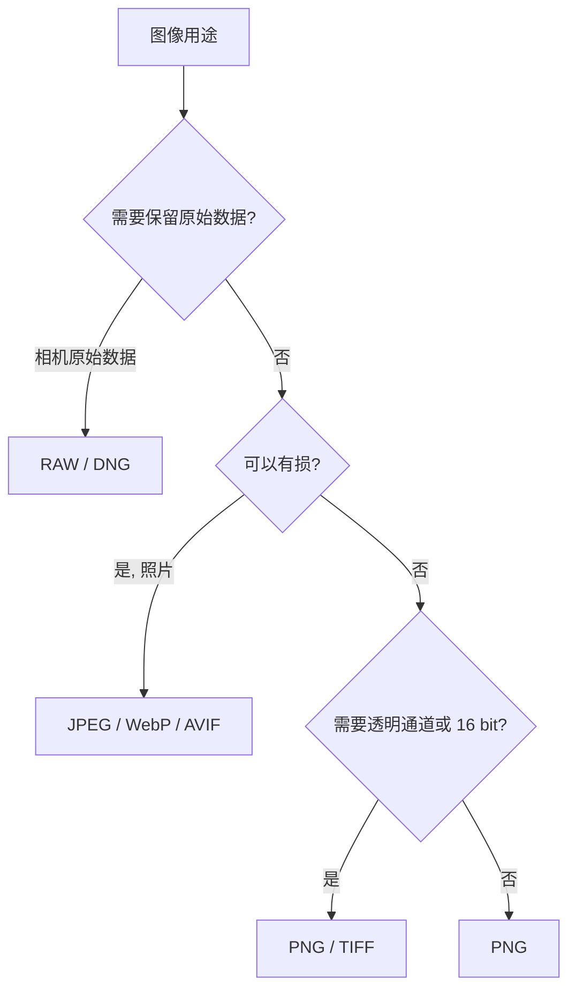

-----

| Title     | Media Image Format                                    |
| --------- | ----------------------------------------------------- |
| Created @ | `2026-11-25T16:27:44Z`                                |
| Updated @ | `2026-11-25T16:30:29Z`                                |
| Labels    | \`\`                                                  |
| Edit @    | [here](https://github.com/junxnone/aiwiki/issues/782) |

-----

# Image Format

常见 2D 图像文件格式 (JPEG、PNG、BMP、TIFF、RAW 等) 的压缩方式、特点和选用，以及内存里图像数据的大小和排布。

## 文件格式与内存数据

  - 文件格式：磁盘上的编码方式，可能压缩，需要解码才能得到像素
  - 内存数据：解码后的像素阵列，排布方式见 [像素格式](/0119_Media_Image_Camera_PixelFormat)
  - 读图过程：文件 → 解码 → 像素阵列；写图过程相反。OpenCV 的 `cv2.imread` 返回 `(H, W, C)` 的
    BGR 排列，不是 RGB

下图展示格式选择的大致思路：



图中：

  - 菱形是判断，矩形是推荐格式
  - 照片类内容容忍有损，选 JPEG 等有损格式可以大幅减小体积
  - 需要精确像素值 (如标注、分割 mask、测量) 时必须用无损格式，否则压缩会改变像素值
  - 需要保留传感器原始数据做后续处理时用 RAW，见 [Bayer](/0784_Media_Image_Bayer)

## 常见格式

| 格式          | 压缩           | 位深/通道                | 透明度  | 特点                           |
| ----------- | ------------ | -------------------- | ---- | ---------------------------- |
| JPEG/JPG    | 有损           | 8 bit，灰度或 YCbCr 彩色   | 无    | 照片首选，体积小，反复保存会累积损失           |
| PNG         | 无损 (DEFLATE) | 8/16 bit，灰度/RGB/RGBA | 有    | 适合截图、mask、需要精确像素值的场景         |
| BMP         | 通常无压缩        | 1/8/24/32 bit        | 部分支持 | 结构简单，体积大                     |
| TIFF        | 无压缩/无损/有损均可  | 8/16/32 bit，多页       | 有    | 其实是容器，常用于扫描、医学、遥感和 16 bit 图像 |
| RAW         | 无/无损         | 10\~14 bit，Bayer     | 无    | 相机传感器原始数据，各厂商格式不同，DNG 是公开格式  |
| WebP / AVIF | 有损或无损        | 8\~10 bit            | 有    | 压缩率比 JPEG 更高，网页常用            |

表中：`压缩` 说明是否会丢信息；`位深/通道` 是每个通道的位数和支持的通道组成；`特点` 是选用时最重要的区别。分割标注 mask 一定要用
PNG 之类的无损格式，用 JPEG 保存会让边缘出现原本不存在的灰度值。

## JPEG 原理

下图是 JPEG 有损压缩的主要步骤：


图中：

  - 先把 RGB 转成 YCbCr，使亮度和色度分开，见 [YUV](/0121_Media_Image_Color_Model_YUV)
  - 人眼对色度不敏感，所以色度可以下采样，4:2:0 时色度数据量只有原来的四分之一
  - 每个 $8\\times8$ 块做 DCT (离散余弦变换)，把空间信号变成频率系数，能量集中在低频
  - 量化是有损的一步：高频系数除以更大的量化步长并取整，大多变成 0；`quality` 参数越低，步长越大
  - 熵编码对剩余数据无损压缩；解码时按相反顺序恢复
  - 低质量时的块状伪影 (blocking) 就是 $8\\times8$
    块边界处量化误差不连续造成的；这一步和视频编码里的帧内压缩思路相同，见
    [Video Codec](/0770_Media_Video_Codec)

## 数据大小

$$ \\text{size}\_{raw} = W \\times H \\times C \\times \\frac{b}{8}\\
\\text{bytes} $$

其中：

  - $W,H$：图像宽、高 (像素)
  - $C$：通道数 (灰度 1，RGB 3，RGBA 4)
  - $b$：每通道位数，8 bit 即每通道 1 字节
  - 例：$1920\\times1080$ 的 RGB 8 bit 图像为
    $1920\\times1080\\times3\\approx6.2\\text{ MB}$，JPEG 往往只有几百 KB

BMP 每行字节数要对齐到 4 字节：

$$ \\text{stride} = 4\\times\\left\\lceil\\frac{W\\times
\\text{bpp}}{32}\\right\\rceil $$

其中：

  - $\\text{bpp}$：每像素位数 (如 24)
  - $\\text{stride}$：一行实际占用的字节数 (含填充)，比 $W\\times\\text{bpp}/8$
    大或相等；自己解析 BMP 或处理带 stride 的图像缓冲时要用 stride
    而不是宽度计算偏移
  - BMP 的行默认自下而上存储，像素按 BGR 排列

## OpenCV 读写

``` python
import cv2
img = cv2.imread("a.jpg")                                   # BGR, uint8, (H, W, 3)
gray = cv2.imread("a.jpg", cv2.IMREAD_GRAYSCALE)
raw16 = cv2.imread("a.png", cv2.IMREAD_UNCHANGED)           # 保留 16 bit/alpha
cv2.imwrite("b.jpg", img, [cv2.IMWRITE_JPEG_QUALITY, 90])   # 质量 0~100, 默认 95
cv2.imwrite("c.png", img, [cv2.IMWRITE_PNG_COMPRESSION, 3]) # 压缩等级 0~9, 只影响速度和体积, 不影响画质
```

  - `IMREAD_UNCHANGED` 不会把 16 bit 降成 8 bit，也不会丢掉 alpha 通道
  - PNG 的压缩等级越高文件越小但越慢，始终无损
  - 相关用法见 [OpenCV IO Image](/0361_OpenCV_IO_Image)

## Reference

  - [JPEG - Wikipedia](https://en.wikipedia.org/wiki/JPEG)
  - [PNG - Wikipedia](https://en.wikipedia.org/wiki/PNG)
  - [BMP file format -
    Wikipedia](https://en.wikipedia.org/wiki/BMP_file_format)
  - [TIFF - Wikipedia](https://en.wikipedia.org/wiki/TIFF)
  - [OpenCV imread
    flags](https://docs.opencv.org/4.x/d8/d6a/group__imgcodecs__flags.html)
