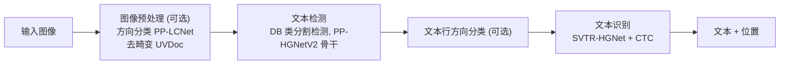

-----

| Title     | ML Tasks Image OCR PaddleOCR                          |
| --------- | ----------------------------------------------------- |
| Created @ | `2026-11-25T16:29:29Z`                                |
| Updated @ | `2026-11-25T16:29:29Z`                                |
| Labels    | \`\`                                                  |
| Edit @    | [here](https://github.com/junxnone/aiwiki/issues/791) |

-----

# PaddleOCR

PaddleOCR 是百度基于 PaddlePaddle 开源的 OCR 与文档解析工具包（Apache-2.0
协议），是工业界使用最广泛的开源 OCR
工具链之一。它的核心思路是\*\*"超轻量的专用模型 +
完整的训练/部署工具"\*\*：检测、识别、方向分类等每个环节都用参数量很小的专用网络，总量不到 1
亿参数就能在精度上和十亿参数级的视觉语言模型（VLM）竞争。算法背景见
[OCR](0200_ML_Tasks_Image_OCR)。

## 版本演进

| 年份        | 版本                       | 要点                                                                                                                                                     |
| --------- | ------------------------ | ------------------------------------------------------------------------------------------------------------------------------------------------------ |
| 2020      | PP-OCR                   | 经典的"检测 + 方向分类 + 识别"三段流水线，主打超轻量（面向移动端部署）                                                                                                                |
| 2021–2022 | PP-OCRv2 / v3            | 检测以 [DBNet](0778_ML_Tasks_Image_OCR_DBNet) 为基础做结构和蒸馏优化；v3 的识别模块用基于 Transformer 的 [SVTR](0779_ML_Tasks_Image_OCR_SVTR)（轻量化为 SVTR\_LCNet）取代 CRNN 中的 LSTM |
| 2023      | PP-OCRv4                 | 继续优化检测与识别，提供 mobile / server 两种规格                                                                                                                      |
| 2025-05   | PaddleOCR 3.0 / PP-OCRv5 | 一个模型同时支持简体中文、繁体中文、拼音、英文、日文；并加入文档解析（PP-StructureV3）和信息抽取（PP-ChatOCRv4）方案                                                                                |
| 2025-10   | PaddleOCR-VL             | 0.9B 参数的视觉语言模型，支持 109 种语言，走 OCR-free 路线                                                                                                                |

表中各行按时间从上到下排列；第三列概括每一代的主要变化。主线是：先把"检测 + 识别"两阶段流水线做小做快，再引入 Transformer
识别器，最后补上文档级解析和 VLM。

## 两阶段流水线（PP-OCR 系列）

下图展示 PP-OCRv5 的处理流程，其中虚线框是可选模块：



图中：

  - **图像预处理**：可选，用基于 PP-LCNet 的方向分类模型处理整图旋转，用基于 UVDoc 的模型矫正拍摄造成的几何畸变。
  - **文本检测**：基于可微二值化的分割检测，骨干换成 PP-HGNetV2；训练时借助 GOT-OCR2.0
    的视觉编码器做教师模型进行知识蒸馏，并用大模型挖掘难例、做数据增强。
  - **方向分类**：判断文本行是否被旋转了 180°，再送入识别。
  - **文本识别**：双分支结构，训练时 GTC-NRTR 分支（基于注意力）去指导 SVTR-HGNet 分支（基于
    CTC），**推理只用轻量的 SVTR-HGNet 分支**，所以得到注意力训练的精度、保留 CTC 的速度。
  - 版本提供 **server** 和 **mobile** 两种规格：server 针对 GPU 等加速硬件，吞吐高；mobile 面向纯
    CPU 环境，更省资源。
  - 关键结论：每个模块都是专用小模型，可单独替换和调试，这是它在边缘和高吞吐场景里比 VLM 更省成本的原因。

## 文档解析与信息抽取（PaddleOCR 3.0）

  - **PP-StructureV3**：把文档图像或 PDF 转成 Markdown/JSON
    的多模型流水线，由预处理、OCR、版面分析、文档元素识别、后处理五个模块组成。版面分析用
    PP-DocLayout-plus，并增加区域检测模型处理一页多篇文章（如报纸）；元素识别包括表格（PP-TableMagic）、公式（PP-FormulaNet\_plus）、图表转表格（PP-Chart2Table）、印章识别。
  - **PP-ChatOCRv4**：关键信息抽取方案，由版面分析、向量检索（RAG）、ERNIE 4.5 大语言模型、文档视觉语言模型
    PP-DocBee2 和结果融合模块组成，面向复杂版面、多页 PDF、生僻字和印章等场景。

## 使用

安装和最简调用（以官方 Python 包为例）：

``` bash
pip install paddleocr
```

``` python
from paddleocr import PaddleOCR

ocr = PaddleOCR()                       # 默认使用 PP-OCRv5
result = ocr.predict("demo.png")        # 检测 + 识别
for res in result:
    res.print()
```

接口名称随版本有调整（2.x 使用 `ocr.ocr(img)`，3.0 起使用
`predict`），以官方文档为准。另外官方推理库支持多种推理后端和异构硬件、可部署为服务或移动端，并提供
MCP Server，方便 LLM 调用。

## 特点与局限

  - 优点：模型小、速度快、中文场景表现强；训练、推理、部署工具链完整；PP-OCRv5
    在中文手写和印刷、拼音、古籍等场景下报告了很强的结果。
  - 局限：对复杂版面、公式、图表的"一次到位"解析不如大型 VLM（如 DeepSeek-OCR
    一类），但资源开销小得多；多模块流水线需要各模块配合，误差会逐级传递。

## Reference

  - [paper - 2025 - PaddleOCR 3.0 Technical
    Report](https://arxiv.org/abs/2507.05595)
  - [PaddleOCR - Github](https://github.com/PaddlePaddle/PaddleOCR)
  - [paper - 2022 - SVTR: Scene Text Recognition with a Single Visual
    Model](https://arxiv.org/abs/2205.00159)
  - [paper - 2019 - Real-time Scene Text Detection with Differentiable
    Binarization](https://arxiv.org/abs/1911.08947)
